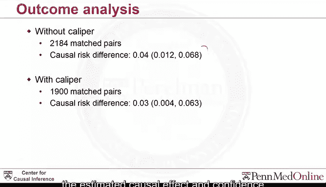

# 28：R语言中的倾向性评分匹配 🧪


在本节课中，我们将学习如何在R语言中执行倾向性评分匹配分析。这涉及多个步骤，包括如何拟合倾向性评分模型、如何进行实际匹配，以及匹配后如何分析数据。

我们将使用公开可用的右心导管插入术数据作为示例。该数据涉及五家医院的ICU患者，治疗是右心导管插入术，我们称之为RHC。结局是死亡与否。混杂因素包括人口统计学特征、疾病诊断等。每组都有数千名受试者。

---

## 第一步：准备数据与包

首先，我们需要加载必要的R包、读取数据并查看数据结构。在本分析中，我们将使用 `table1` 包和 `MatchIt` 包。

原始数据包含许多字符变量，因此第一步是将它们转换为数值变量。然后，我们将创建用于分析的数据集，其中包含协变量、治疗变量和结局变量。

```r
# 加载必要的包
library(table1)
library(MatchIt)

# 读取数据
data <- read.csv("rhc_data.csv")

# 将字符变量转换为数值变量（示例）
# data$variable <- as.numeric(as.factor(data$variable))

# 创建分析数据集
my_data <- data.frame(
  treatment = data$RHC,
  outcome = data$death,
  # 列出所有协变量
  age = data$age,
  sex = data$sex,
  # ... 其他协变量
)
```

---

## 第二步：拟合倾向性评分模型

上一节我们准备好了数据，本节中我们来看看如何拟合倾向性评分模型。假设我们感兴趣的是逻辑回归模型。

在倾向性评分模型中，**治疗是结局**。我们使用 `glm` 函数进行逻辑回归，其中治疗变量是因变量，所有协变量是自变量。

```r
# 拟合倾向性评分模型
p_model <- glm(treatment ~ age + sex + ... , # 列出所有协变量
               family = binomial(link = "logit"),
               data = my_data)

# 查看模型摘要
summary(p_model)
```

模型摘要显示了哪些变量与治疗概率显著相关。例如，如果“女性”变量的系数为负，则表明女性接受治疗的可能性低于男性。这有助于我们理解谁更可能接受治疗，并检查模型是否存在编码错误。

接下来，我们为每个个体计算倾向性评分。

```r
# 计算倾向性评分
p_score <- predict(p_model, type = "response")
```

---

## 第三步：检查倾向性评分分布与重叠

在开始匹配之前，检查倾向性评分的分布和重叠情况非常重要。我们希望看到治疗组和对照组在倾向性评分上有足够的重叠。

以下是检查重叠的代码示例：

```r
# 绘制倾向性评分分布（治疗组 vs 对照组）
library(ggplot2)
plot_data <- data.frame(p_score = p_score, treatment = my_data$treatment)
ggplot(plot_data, aes(x = p_score, fill = factor(treatment))) +
  geom_density(alpha = 0.5) +
  labs(title = "倾向性评分分布（匹配前）", x = "倾向性评分", fill = "治疗组")
```

从图中，我们主要寻找重叠区域。理想情况下，两组分布应有大量重叠，不应出现在倾向性评分尾部只有治疗组或只有对照组的情况。

---

## 第四步：执行倾向性评分匹配

现在我们已经有了倾向性评分，接下来看看如何进行匹配。我们将使用 `MatchIt` 包，它简化了匹配过程。

`MatchIt` 包可以自动计算倾向性评分并进行匹配。我们指定匹配方法，例如“最近邻”贪婪匹配。

```r
# 使用 MatchIt 进行倾向性评分匹配
m_out <- matchit(treatment ~ age + sex + ... , # 使用与模型相同的公式
                 data = my_data,
                 method = "nearest", # 最近邻匹配
                 distance = "glm")   # 使用逻辑回归计算倾向性评分

# 查看匹配结果摘要
summary(m_out)

# 创建平衡诊断图
plot(m_out, type = "jitter")  # 抖动图
plot(m_out, type = "hist")    # 直方图
```

**抖动图** 非常有用，它显示了匹配和未匹配的个体。通常，你会看到四个区域：未匹配的治疗组、匹配的治疗组、匹配的对照组和未匹配的对照组。匹配后，两组的倾向性评分分布应看起来非常相似。

**直方图** 则直观地展示了匹配前后倾向性评分分布的变化。匹配后，两组的分布形状应更加接近。

---

## 第五步：评估匹配平衡性

匹配后，评估协变量的平衡性至关重要。我们通常使用标准化差异，希望所有协变量的标准化差异绝对值都小于0.1。

以下是使用 `table1` 包创建平衡表的示例：

```r
# 提取匹配后的数据
matched_data <- match.data(m_out)

# 创建平衡表（比较匹配后治疗组与对照组的协变量）
table1(~ age + sex + ... | treatment, # 列出协变量，按治疗分组
       data = matched_data,
       overall = FALSE)
```

通过查看平衡表，我们可以确认匹配是否有效改善了协变量的平衡。

---

## 第六步：使用卡钳进行匹配

有时，简单的最近邻匹配可能无法达到理想的平衡。这时，我们可以使用**卡钳匹配**。卡钳设定了一个最大允许距离，只匹配倾向性评分差异在这个范围内的个体。

以下是使用 `Match` 包（注意不是MatchIt）进行卡钳匹配的示例：

```r
# 首先，确保已安装并加载 Match 包
# install.packages("Match")
library(Match)

# 进行无卡钳的匹配（作为比较）
match_no_caliper <- Match(Y = my_data$outcome,
                          Tr = my_data$treatment,
                          X = log(p_score/(1-p_score)), # 使用logit转换后的评分
                          M = 1, # 1:1匹配
                          replace = FALSE)

# 进行有卡钳的匹配
# caliper = 0.2 表示卡钳宽度为 logit(倾向性评分) 标准差的0.2倍
match_with_caliper <- Match(Y = my_data$outcome,
                            Tr = my_data$treatment,
                            X = log(p_score/(1-p_score)),
                            M = 1,
                            replace = FALSE,
                            caliper = 0.2)
```

使用卡钳后，匹配的对数通常会减少，因为一些差异过大的个体被排除了。但剩下的匹配对质量更高，协变量平衡性更好（标准化差异更小）。代价是样本量减小，可能导致估计效率略有下降，但偏倚更小。

---

## 第七步：匹配后结局分析

最后一步是对匹配后的数据进行结局分析，以估计平均处理效应。对于二分类结局（如死亡），我们可以使用配对检验或条件逻辑回归。

以下是使用配对t检验（适用于连续结局）或McNemar检验（适用于二分类结局）的简单示例：

```r
# 提取有卡钳匹配后的数据索引
matched_indices <- match_with_caliper$index.treated
control_indices <- match_with_caliper$index.control

# 创建匹配后的数据集
matched_pairs_data <- data.frame(
  treated_outcome = my_data$outcome[matched_indices],
  control_outcome = my_data$outcome[control_indices]
)

# 对于二分类结局，使用McNemar检验
result <- mcnemar.test(matched_pairs_data$treated_outcome,
                       matched_pairs_data$control_outcome)
print(result)

# 计算风险差及其置信区间（示例）
library(boot)
# ... 这里可以使用自助法计算风险差和置信区间
```

分析结果将提供一个点估计（如风险差）和置信区间。我们可以比较使用卡钳前后结论是否一致。在本例中，即使使用卡钳后匹配对数减少，主要结论通常保持不变。

---

## 总结 🎯



本节课中，我们一起学习了在R语言中执行倾向性评分匹配的完整流程：

1.  **准备阶段**：加载数据与包，处理变量类型。
2.  **建模阶段**：使用逻辑回归拟合倾向性评分模型，并计算每个个体的评分。
3.  **诊断阶段**：检查倾向性评分的分布与重叠。
4.  **匹配阶段**：使用 `MatchIt` 或 `Match` 包进行匹配（可选择是否使用卡钳）。
5.  **评估阶段**：通过标准化差异和图形评估匹配后的平衡性。
6.  **分析阶段**：对匹配后的数据执行结局分析，估计因果效应。

关键点在于，匹配（尤其是使用卡钳）可以改善协变量平衡，减少混杂偏倚，但可能会以损失部分样本为代价。在实际分析中，建议尝试不同的匹配设置并比较结果，以确保结论的稳健性。