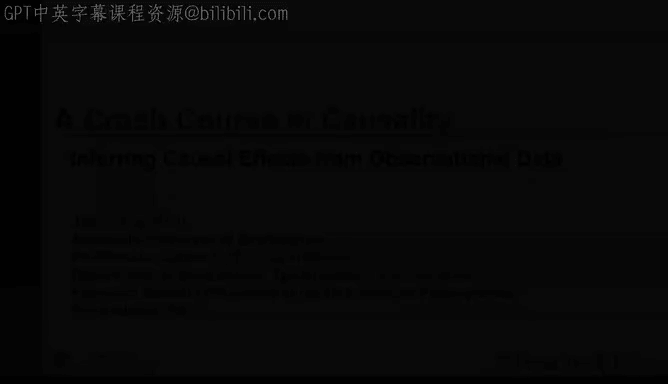
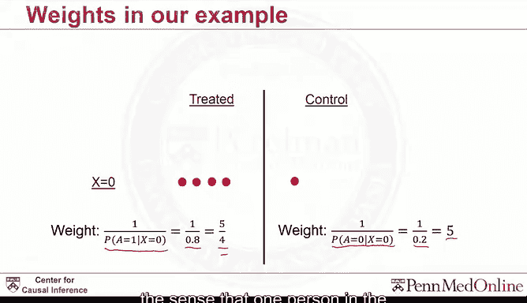

# 29：逆概率加权处理的直观理解 🧠



在本节课中，我们将学习一种估计因果效应的方法——**逆概率加权处理**。我们将通过将其与**匹配法**联系起来，直观地理解其工作原理。课程将从一个简单的二元混杂因子示例开始，逐步解释逆概率加权如何通过调整权重来模拟随机试验的平衡性，从而估计因果效应。

---

## 逆概率加权与匹配法的关系

上一节我们介绍了因果推断的基本概念，本节中我们来看看**逆概率加权处理**。为了直观理解，我们将其与更熟悉的**倾向得分匹配法**进行类比。

假设我们有一个单一的二元混杂因子，记为 **X**。我们需要控制这个变量以估计处理效应。

现在，假设在 **X=1** 的人群中，接受处理的概率是 **0.1**。这意味着，对于 **X=1** 的个体，其倾向得分 **e(X)** 为 **0.1**。这是一个不太可能接受处理的亚组。

```math
P(A=1 | X=1) = e(X=1) = 0.1
```

另一方面，在 **X=0** 的人群中，接受处理的概率是 **0.8**。这意味着，对于 **X=0** 的个体，其倾向得分 **e(X)** 为 **0.8**。这是一个非常可能接受处理的亚组。

```math
P(A=1 | X=0) = e(X=0) = 0.8
```

我们可以用一张图来描绘这种情况：用一条垂直线分隔处理组和对照组，用蓝色（X=1）和红色（X=0）表示不同的混杂因子取值。这与我们上面关于倾向得分的描述相符。

---

## 倾向得分匹配的视角

让我们先关注 **X=1** 这个组。在这个亚组中，平均每10个人里，我们预期有1个人接受处理，9个人作为对照。这与随机试验的期望不同，随机试验中处理组和对照组的人数应大致相等。

倾向得分匹配法会怎么做呢？由于这里只有一个协变量，所有 **X=1** 的个体都有相同的倾向得分。匹配时，我们会将一个处理组个体与一个随机选择的对照组个体进行配对。

经过匹配后，我们使用的数据是：处理组有1个个体，对照组也有1个（被匹配的）个体。然而，这个被匹配的对照组个体实际上代表了原本的9个对照组个体。换句话说，匹配后，**1个处理组个体在分析中“代表”了9个对照组个体**。

匹配法通过丢弃部分数据（本例中丢弃了8个对照个体）来创造这种平衡。

---

## 逆概率加权处理的思路

与其丢弃数据，我们是否可以通过调整每个个体的**权重**来达到同样的平衡效果呢？这就是逆概率加权处理的核心思想。

在这个例子中，那个唯一的处理组个体，其“代表性”应该是9个对照组个体的总和。因此，我们可以**上调**这个处理个体的权重，同时**下调**每个对照个体的权重，使得他们的总“影响力”相等。

逆概率加权正是这样做的：它根据个体**实际接受的处理**来赋予权重。

以下是赋予权重的具体规则：

*   对于**接受处理（A=1）** 的个体，其权重为 **1 / P(A=1|X)**，即倾向得分的倒数。
*   对于**接受对照（A=0）** 的个体，其权重为 **1 / P(A=0|X)**，即“不接受处理”概率的倒数。

这被称为**逆概率处理加权**。

---

## 权重计算示例

让我们回到 **X=1** 组的例子进行计算。

*   **处理组个体 (A=1)**：
    *   倾向得分 `P(A=1|X=1) = 0.1`
    *   权重 = `1 / 0.1 = 10`

*   **对照组个体 (A=0)**：
    *   `P(A=0|X=1) = 1 - 0.1 = 0.9`
    *   权重 = `1 / 0.9 = 10/9 ≈ 1.11`

现在，我们有1个权重为10的处理个体，和9个每个权重约为1.11的对照个体。9个对照个体的总权重为 `9 * (10/9) = 10`。**通过加权，处理组个体的总影响力（10）与对照组个体的总影响力（10）变得相等了**。这模拟了随机试验中该亚组内的平衡。

---

## 再看 X=0 组的情况

现在让我们看看 **X=0** 的组。其倾向得分为0.8，因此该组内个体很可能接受处理。假设有5个个体，其中4个在处理组，1个在对照组。

如果进行倾向得分匹配，我们会将那个唯一的对照组个体与处理组中的一个个体配对。匹配后，**1个对照组个体在分析中“代表”了4个处理组个体**。

使用逆概率加权：

*   **处理组个体 (A=1)**：
    *   权重 = `1 / P(A=1|X=0) = 1 / 0.8 = 1.25`
*   **对照组个体 (A=0)**：
    *   权重 = `1 / P(A=0|X=0) = 1 / 0.2 = 5`

计算总影响力：4个处理个体的总权重为 `4 * 1.25 = 5`，与那个权重为5的对照个体相等。**逆概率加权再次成功创造了组间平衡**。

---

## 总结



本节课中，我们一起学习了**逆概率加权处理**的直观原理。

我们通过一个简单的二元混杂因子例子，展示了IPTW如何工作：
1.  **核心思想**：通过给每个观察值赋予权重，使数据在混杂因子层面上看起来像是来自一个随机试验。
2.  **权重公式**：
    *   处理组权重：`W = 1 / e(X)`
    *   对照组权重：`W = 1 / (1 - e(X))`
3.  **与匹配法的关系**：IPTW可以达到与倾向得分匹配类似的目标——创造组间可比性——但**无需丢弃任何数据**，而是通过重新加权来利用所有样本信息。

无论是通过一对一匹配，还是通过逆概率加权，我们最终都实现了：**对于给定的倾向得分值（或给定的X值），处理组个体的集合与对照组个体的集合在分析中具有同等的重要性**，就像在随机试验中一样。这为后续无偏地估计平均处理效应奠定了基础。