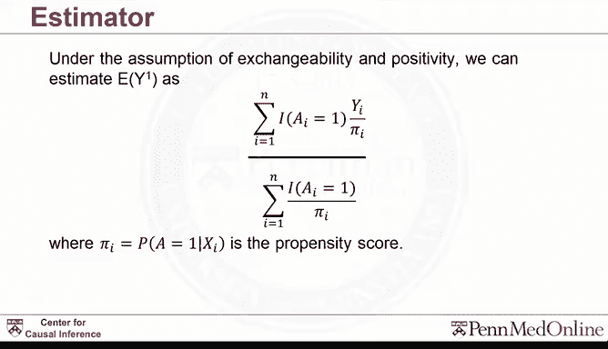

# 课程30：深入理解逆概率加权估计 ⚖️

在本节课中，我们将深入探讨逆概率加权估计的直观理解。我们将重点关注这种加权方法如何创建“伪总体”，并最终消除混杂效应。为了便于理解，我们将从调查抽样这个例子入手。

## 从调查抽样到因果推断 🔄

在调查中，相对于其他群体，过度抽样某些群体是非常常见的做法。例如，你可能最终想研究某个少数群体、老年人或某个相对于总人口规模较小的亚群体，并希望确保获得足够大的该群体样本量。因此，你可能会对这些群体进行过度抽样。

那么，如果你想要估计整个总体的均值，而不仅仅是某个亚群体的均值，你就必须对数据进行加权，以校正过度抽样的影响。这种方法被称为霍维茨-汤普森估计。

只要你知道每个群体的基础比例以及你使用的抽样权重（即你过度抽样的程度），你就可以通过加权还原回原始总体。这实际上与我们在观察性研究中比较不同处理时的情况相关。

## 观察性研究中的“过度抽样” 📊

在一个存在混杂的观察性研究中，你通常会在协变量的不同取值水平上，对处理组或对照组进行“过度抽样”。换句话说，你可以想象，也许更健康的人更有可能接受某种治疗。这可以被视为一种“过度抽样”——相对于理想的随机化情况（即健康人群中处理组和对照组人数相等），你在某种意义上过度抽样了接受处理的人。

从这个意义上说，它类似于调查抽样，因此存在使用加权来还原原始总体的可能性。我们接下来要尝试的就是使用加权来创建一个没有混杂的伪总体。

## 创建无混杂的伪总体：一个例子 🧩

让我们考虑一个倾向性得分为0.9的情况。这意味着存在一个由协变量X定义的亚群体，他们接受处理的概率为0.9。这是一群极有可能接受处理的人。

我们可以用下图表示：在处理组中，有9个红色圆圈；在对照组中，有1个。这是正确的比例，因为我们看到每10个受试者中有9个接受了处理。这就是原始总体。观察这个图，它确实看起来像是“过度抽样”——相对于理想情况（处理组和对照组平衡），你过度抽样了接受处理的人。

我们可以应用加权来得到我们真正想要的结果。

*   对于处理组，我们应用权重 `1 / 0.9`，即 `10/9`。每个处理组的受试者将获得 `10/9` 的权重。
*   对于对照组，我们应用权重 `1 / 0.1`，即 `10`。

应用这些权重后，我们最终会在处理组和对照组各得到10个圆圈。在处理组，每个人算作 `10/9` 个人，原来有9个人，`(10/9) * 9 = 10`。在对照组，每个人算作10个人，原来有1个人，`10 * 1 = 10`。

我们可以将其视为一个应用了权重后的伪总体。在这个新总体中，没有过度抽样，它完全按照我们期望的方式平衡，就像一项随机试验一样。

重申一下：在原始总体中，某些人基于其协变量更有可能接受处理。但在这个伪总体中，无论其X值如何，每个人接受处理的概率都相等。这当然是你进行随机试验时希望看到的情况——每个人接受处理的概率相等，且不依赖于X，因为我们本质上是在抛硬币。

## 如何进行估计 📈

现在，让我们想象我们实际上想要进行估计。回想一下，如果我们想估计一个因果效应，我们通常需要估计类似下式的东西：

`E[Y(1)]`

这里，`Y(1)` 是处理下的潜在结果。`E[Y(1)]` 表示如果总体中每个人都接受了处理，Y的平均值。这是我们感兴趣的量之一。我们同样也需要 `E[Y(0)]`（另一种潜在结果的均值）。我将以类似的方式说明如何估计其中一个潜在结果的均值。

我将逐步解析以下这个公式，希望这能让过程更清晰：

`E[Y(1)] ≈ ( Σ [I(A_i=1) * Y_i / π(X_i)] ) / ( Σ [I(A_i=1) / π(X_i)] )`

首先要注意的是，我们有两个指示函数 `I(A_i=1)`，并且我们对 `i=1` 到 `N` 求和。N是你数据中（随机抽样的）总人数。

*   **指示函数 `I(A_i=1)`**：这个函数会“挑选”出接受处理的个体。`A_i=1` 表示接受处理，`A_i=0` 表示未接受。它就像一个开关：如果个体接受了处理，开关打开（值为1），我们保留这个Y值；如果为0，我们就忽略它。这只是一种花哨的说法，表示我们只想要处理组的受试者。

如果没有混杂，我们只需取处理组Y的样本均值来估计处理组Y的均值。但这里存在混杂，所以我们实际上需要取伪总体的样本均值，而不是原始总体的，因为原始总体存在混杂。上面的公式所做的正是这件事。

*   **分子 `Σ [I(A_i=1) * Y_i / π(X_i)]`**：这部分是处理组伪总体中Y值的总和。我们说“处理组”是因为我们挑选了接受处理的个体，说“伪总体”是因为我们进行了加权。我们加总了处理组伪总体中所有的Y值。
*   **分母 `Σ [I(A_i=1) / π(X_i)]`**：我们不能只加总Y值，还需要除以某个总数，就像计算样本均值时需要除以N一样。这里我们需要除以的是处理组伪总体中的“受试者数量”，这本质上就是权重的总和。所以我们只考虑处理组个体，然后加总他们的权重。

进行这个除法后，我们就得到了潜在结果均值的有效估计。这一切都基于我们的典型假设得到满足：

1.  **可交换性**：也称为可忽略性。假设我们的协变量X已经完全捕捉了所有混杂因素，因此在给定X的条件下，处理分配是随机的。
2.  **正值性**：倾向性得分 `π(X)` 严格介于0和1之间，永远不会恰好等于0或1。每个人都有非零的概率接受任一种处理。

这里的 `π(X_i)` 就是倾向性得分。

关于这一点，还有一个额外的说明：你可以看到为什么正值性假设如此重要。因为我们除以了倾向性得分本身，如果倾向性得分实际为0，就会导致除以零的问题。这进一步重申了正值性假设的重要性。

## 总结 📝

本节课中，我们一起学习了逆概率加权估计的直观原理。我们从调查抽样的类比出发，理解了在观察性研究中，协变量导致的处理组不平衡可以视为一种“过度抽样”。通过应用逆概率权重（`1/π(X)` 用于处理组，`1/(1-π(X))` 用于对照组），我们能够构建一个伪总体。在这个伪总体中，处理分配与协变量X无关，模拟了随机试验的环境，从而允许我们无偏地估计潜在结果均值（如 `E[Y(1)]`）。整个过程依赖于可交换性（无未测混杂）和正值性（所有个体都有机会接受任一种处理）这两个关键假设。