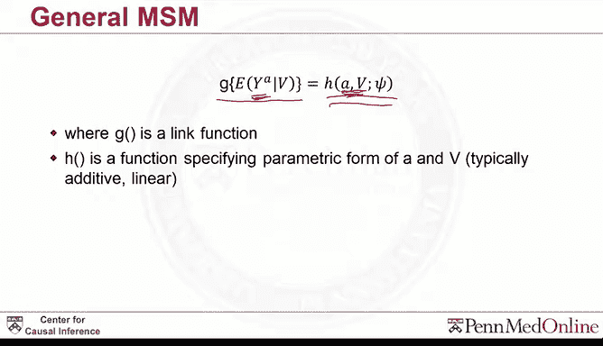

# 31：边际结构模型 🧠

在本节课中，我们将学习一种特殊的因果模型——边际结构模型。我们的目标是理解这种模型是什么，特别是它与普通回归模型有何不同。

## 概述

之前我们讨论了用于估计简单因果效应（如平均因果效应）的逆概率加权法。然而，这种通用的逆概率加权方法，可以用来估计更复杂的因果模型中的参数。边际结构模型正是这样一种模型，它用于对潜在结果的平均值进行建模。

## 什么是边际结构模型？

边际结构模型是对潜在结果均值的建模。

“边际”一词源于模型不依赖于混杂因素的条件。我们最终感兴趣的是**总体平均因果效应**，即对整个群体的潜在结果的期望值，而不是在给定某些协变量X或特定亚群体条件下的效应。这就是“边际”的含义——总体平均，可以理解为对整个群体的平均。

“结构”一词则与我们对**潜在结果**（而非观测结果）进行建模这一事实有关。

## 线性边际结构模型

首先，我们来看一个线性边际结构模型。

需要注意的关键点是，我们的模型是针对**潜在结果的期望值**。具体来说，它是针对某个特定处理值 `a` 的潜在结果 `Y^a` 的期望值的模型，并且我们假设该期望值在 `a` 本身是线性的。

其公式为：
`E[Y^a] = ψ₀ + ψ₁ * a`

其中，`ψ₀` 和 `ψ₁` 是我们想要估计的未知参数。假设 `a` 目前只能取 0 或 1（例如，对照 vs. 治疗）。

在这种情况下：
*   `E[Y⁰]`（即如果所有人都不接受治疗的潜在结果均值）就等于 `ψ₀`（因为当 `a=0` 时，`ψ₁*a` 项消失）。
*   `E[Y¹]`（即如果所有人都接受治疗的潜在结果均值）等于 `ψ₀ + ψ₁`。

因此，两者的差值 `(ψ₀ + ψ₁) - ψ₀ = ψ₁` 就是**平均因果效应**。所以，这里的 `ψ₁` 具有因果解释，它代表了潜在结果之间的平均差异。

这是一个非常简单的线性边际结构模型，通常在结果为连续变量时使用。

## 逻辑边际结构模型

为了巩固这个概念，我们来看一个逻辑边际结构模型。这适用于结果为二分类变量的情况。

其公式为：
`logit(E[Y^a]) = ψ₀ + ψ₁ * a`

这里，`logit` 是连接函数。由于 `Y^a` 是二分类变量，其期望值 `E[Y^a]` 就等于 `P(Y^a = 1)`，即概率。

这个模型表明，潜在结果 `Y^a` 等于1的对数几率是处理 `a` 的线性函数。如果我们对参数 `ψ₁` 取指数 `exp(ψ₁)`，得到的就是一个**因果比值比**。

因果比值比的定义是：
`[P(Y¹=1) / (1 - P(Y¹=1))] / [P(Y⁰=1) / (1 - P(Y⁰=1))]`

分子是假设全人群都接受治疗时，结果为1的几率；分母是假设全人群都接受对照时，结果为1的几率。

## 包含效应修饰因子的模型

以上是简单的边际结构模型，但你可以构建更复杂的模型。接下来，我们考虑一个包含效应修饰因子的模型，这通常被称为**处理效应的异质性**。也就是说，处理效应可能在不同亚群体中有所不同，而我们可能对此感兴趣。

假设 `V` 是一个能修饰处理 `A` 效应的变量（例如，糖尿病状况、性别等）。我们可以在边际结构模型中纳入它。

现在，我们建模的是**给定 `V` 时潜在结果的期望值**。注意，我们并非控制所有混杂因素，而只针对我们关心的效应修饰因子 `V` 进行条件化。对于大多数混杂因素，我们希望通过边际化来平均掉它们的影响，只保留我们关心的效应修饰因子。

模型可以写成：
`E[Y^a | V] = ψ₀ + ψ₁*a + ψ₂*V + ψ₃*a*V`

模型的右侧包含了处理 `A` 的主效应、变量 `V` 的主效应以及两者的交互项 `A*V`。

如何解释这些参数呢？一种方式是，对于给定的 `V` 值，比较不同处理下的潜在结果均值。

对于特定的 `V` 值，平均因果效应为：
`E[Y¹ | V] - E[Y⁰ | V] = (ψ₀ + ψ₁ + ψ₂*V + ψ₃*V) - (ψ₀ + ψ₂*V) = ψ₁ + ψ₃*V`

因此，如果这个边际结构模型是正确的，并且我们估计出了参数 `ψ₁` 和 `ψ₃`，那么对于任何一个 `V` 值，我们都可以通过代入公式计算出相应的处理效应。

## 广义边际结构模型

我们可以将边际结构模型推广到更一般的形式。

其一般形式为：
`g(E[Y^a | V]) = h(A, V; ψ)`

这里：
*   `g(.)` 是一个连接函数（例如，对于连续结果是恒等连接，对于二分类结果是logit连接）。
*   `E[Y^a | V]` 是在给定效应修饰因子 `V` 的条件下，潜在结果的期望值。
*   `h(A, V; ψ)` 是我们指定的一个关于处理 `A`、变量 `V` 和参数 `ψ` 的函数。它通常类似于回归模型中指定的形式，可以是包含主效应、交互项甚至多项式项的加性线性组合。

关键在于，我们建模的对象是**潜在结果**。因此，如果我们能估计出这些参数 `ψ`，我们就能得到因果效应的估计值。

## 核心挑战与总结

本节课我们一起学习了边际结构模型。我们了解到，边际结构模型是对潜在结果均值的建模，“边际”强调总体平均效应，“结构”指其针对潜在结果。

我们介绍了简单的线性模型和逻辑模型，以及如何纳入效应修饰因子来研究处理效应的异质性。最后，我们看到了其广义形式。

然而，最关键的问题是：**如何估计这些模型？** 因为等式左侧涉及的是**潜在结果**，而非观测数据。在普通回归模型中，左右两侧都是观测数据，估计相对直接。但在边际结构模型中，由于潜在结果并非全部可观测，我们需要特殊的方法（如之前提到的逆概率加权）来进行估计。这将是后续课程可能深入探讨的内容。

总而言之，边际结构模型为我们提供了一种灵活框架，用于在考虑混杂因素的情况下，对复杂的总体平均因果效应进行建模和估计。