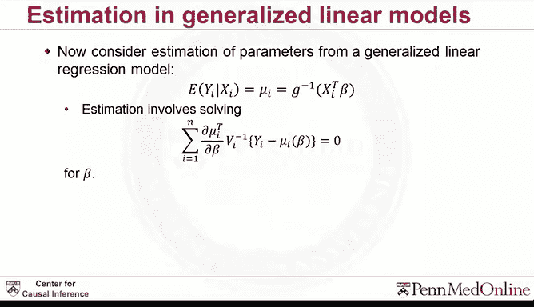

# 课程32：逆概率加权估计 🎯


在本节课中，我们将学习如何使用逆概率加权（IPTW）方法来估计边际结构模型（MSM）的参数。我们将从回顾标准回归模型的参数估计开始，逐步过渡到如何通过加权处理观测数据，以消除混杂偏倚，从而获得因果效应的无偏估计。

---

## 回顾标准回归模型的参数估计

上一节我们介绍了边际结构模型的基本概念，本节中我们来看看如何估计其参数。首先，我们需要回顾标准回归模型的参数估计方法。

### 线性回归模型

线性回归模型是一种常见的统计模型，其形式如下：

**公式：** `Y = Xβ + ε`

其中，`Y` 是观测到的结果变量，`X` 是协变量矩阵，`β` 是待估计的参数向量，`ε` 是误差项，通常假设其均值为零且方差恒定。

为了估计参数 `β`，我们通常使用最小二乘法。该方法通过最小化观测值与模型预测值之间的平方差来求解参数。



**公式：** `min Σ(Y - Xβ)²`

通过求解以下估计方程，我们可以得到参数估计值 `β_hat`：

**公式：** `Xᵀ(Y - Xβ) = 0`

### 广义线性模型

广义线性模型（GLM）扩展了线性回归模型，适用于非连续型结果变量（如二元或计数数据）。其形式如下：

**公式：** `E[Y|X] = g⁻¹(Xβ)`

其中，`g` 是链接函数，`g⁻¹` 是其反函数。例如，在逻辑回归中，`g` 是 logit 函数。

广义线性模型的参数 `β` 可以通过求解以下估计方程来估计：

**公式：** `Σ [ (∂μ/∂β) * V(μ)⁻¹ * (Y - μ) ] = 0`

其中，`μ = E[Y|X]`，`V(μ)` 是方差函数。

---

## 边际结构模型的参数估计

现在，我们将上述方法应用于边际结构模型。边际结构模型与广义线性模型形式相似，但关键区别在于它建模的是潜在结果的均值，而非观测结果的均值。

### 边际结构模型的形式

一个简单的边际结构模型示例如下：

**公式：** `E[Y(a)] = g⁻¹(β₀ + β₁a)`

这里，`Y(a)` 表示当治疗变量 `A` 被设定为特定值 `a` 时的潜在结果。注意，我们是在“设定”治疗值，而不是“条件于”观测到的治疗值。这是因果推断与标准回归分析的核心区别。

在存在混杂的情况下，直接拟合标准回归模型无法得到无偏的因果效应估计。然而，通过逆概率加权，我们可以创建一个无混杂的“伪总体”，从而应用标准回归技术。

### 逆概率加权的基本思想

逆概率加权的核心思想是为每个观测分配一个权重，该权重等于其观测到治疗值的概率的倒数。这样，加权后的数据在治疗组和对照组之间平衡了混杂因素，模拟了一个随机化试验的环境。

权重 `W` 的计算公式如下：

**代码：**
```
W = A / P(A=1|X) + (1-A) / P(A=0|X)
```
其中，`A` 是观测到的治疗变量（0或1），`P(A=1|X)` 是倾向得分（即给定协变量 `X` 下接受治疗的概率）。

### 加权估计方程

在创建了加权伪总体后，我们可以使用加权的广义线性模型估计方程来估计边际结构模型的参数：

**公式：** `Σ W * [ (∂μ/∂β) * V(μ)⁻¹ * (Y - μ) ] = 0`

这个方程与标准广义线性模型的估计方程类似，只是引入了权重 `W`。通过求解这个方程，我们可以得到因果参数 `β` 的无偏估计。

---

## 实施步骤

以下是使用逆概率加权估计边际结构模型参数的具体步骤：

1.  **估计倾向得分**：首先，需要建模治疗变量 `A` 给定协变量 `X` 的概率。通常使用逻辑回归模型。
    **代码示例（逻辑回归）：**
    ```
    model_ps <- glm(A ~ X, family=binomial, data=data)
    data$ps <- predict(model_ps, type="response")
    ```

2.  **计算权重**：根据倾向得分计算每个观测的权重。
    **代码：**
    ```
    data$weight <- ifelse(data$A == 1,
                          1 / data$ps,
                          1 / (1 - data$ps))
    ```

3.  **指定边际结构模型**：根据研究问题和结果变量的类型（连续、二元、计数等），指定合适的边际结构模型形式（如线性、logistic、Poisson等）。

4.  **拟合加权回归模型**：使用统计软件拟合加权的广义线性模型，并指定上一步计算的权重。
    **代码示例（加权线性回归）：**
    ```
    model_msm <- glm(Y ~ A, family=gaussian, data=data, weights=weight)
    ```

5.  **计算稳健标准误**：由于加权过程可能人为地“放大”了样本量，直接使用模型输出的标准误可能不准确。因此，需要使用稳健方差估计方法（如三明治估计量）或自助法（bootstrap）来获得正确的标准误和置信区间。
    **代码示例（使用三明治估计量）：**
    ```
    library(sandwich)
    library(lmtest)
    coeftest(model_msm, vcov=vcovHC(model_msm, type="HC0"))
    ```

---

## 总结

本节课中我们一起学习了如何通过逆概率加权来估计边际结构模型的参数。我们首先回顾了标准回归模型的参数估计方法，然后指出了在存在混杂时直接应用这些方法的局限性。通过为观测数据分配基于倾向得分的权重，我们可以创建一个无混杂的伪总体，从而能够使用标准的广义线性模型技术来估计因果效应。关键步骤包括估计倾向得分、计算权重、指定模型、拟合加权回归以及使用稳健方法计算标准误。掌握这一方法为从观察性数据中进行因果推断提供了强大的工具。