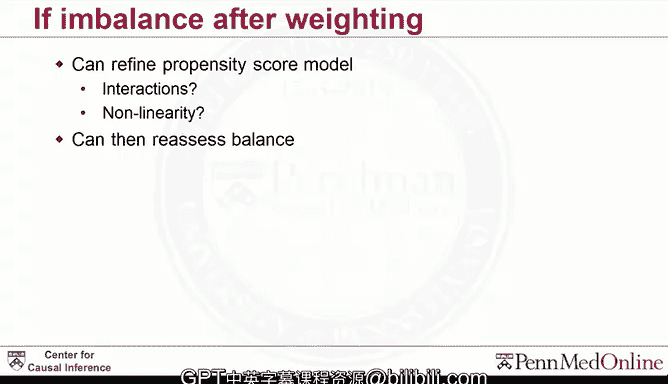

# 33：平衡性评估 🎯

在本节课中，我们将学习如何评估使用逆概率处理加权（IPTW）方法后，处理组与对照组之间协变量分布的平衡性。我们将介绍评估平衡性的核心方法，包括计算标准化均值差和使用可视化图表。

---

## 概述

逆概率处理加权会创建一个“伪总体”或加权后的总体。我们的目标是评估加权后，处理组与对照组在协变量分布上是否达到了平衡。这类似于在随机对照试验中，我们期望看到的组间均衡状态。

上一节我们介绍了如何拟合倾向性评分模型并计算权重。本节中，我们来看看如何应用这些权重并评估平衡性是否达成。

## 评估平衡性的方法

评估平衡性主要有两种方式：创建汇总统计表（如表一）和绘制可视化图表。核心在于比较加权后各协变量在处理组与对照组间的差异。

以下是两种常用的具体评估手段：

1.  **计算加权均值与标准化差异**：计算每个协变量在处理组和对照组中的加权均值，并使用标准化均值差来量化差异的大小。
2.  **绘制平衡性诊断图**：通过图表直观展示加权前后各协变量标准化差异的变化。

## 标准化均值差

标准化均值差是衡量组间差异的一个常用指标。其核心思想是计算两组均值的差异，并用一个合并的标准差进行标准化。

在不加权的原始数据中，对于一个特定协变量 `X`，其标准化均值差的计算公式为：

**SMD = (X̄_treated - X̄_control) / Sp**

其中：
*   `X̄_treated` 是处理组中该协变量的样本均值。
*   `X̄_control` 是对照组中该协变量的样本均值。
*   `Sp` 是合并标准差，例如可以计算为：`Sp = sqrt((Var_treated + Var_control) / 2)`。

通常，我们关注差异的绝对值，即 `|SMD|`。经验上，`|SMD| < 0.1` 通常被认为组间达到了较好的平衡。

## 加权后的标准化均值差

在应用逆概率处理加权后，我们需要计算的是加权数据的标准化均值差。其概念与上述相同，但计算中使用的均是加权统计量。

具体步骤如下：
1.  按处理状态分层。
2.  对于每一个协变量，分别计算其在处理组和对照组中的**加权均值**与**加权方差**。
3.  使用相同的公式计算加权后的标准化均值差：`加权SMD = (加权X̄_treated - 加权X̄_control) / 加权Sp`。

你可以手动计算这些加权统计量，也可以利用为调查分析设计的软件包（如R中的 `survey` 包）来便捷地完成。

## 实例分析：右心导管插入术数据

让我们通过一个实例来具体理解。该研究比较了接受右心导管插入术（RHC，处理组）与未接受（对照组）的患者。下表展示了一部分协变量在加权前后的比较。

| 协变量 | 对照组 (n≈3500) | 处理组 (n≈2100) | 原始SMD | 加权后SMD |
| :--- | :--- | :--- | :--- | :--- |
| 年龄 | 数据 | 数据 | 0.12 | 0.01 |
| 性别 | 数据 | 数据 | 0.05 | 0.00 |
| 血压 | 85 | 68 | **0.40** | 0.02 |
| 心力衰竭 | 数据 | 数据 | 0.15 | 0.03 |
| 结肠癌 | 数据 | 数据 | 0.08 | 0.01 |
| 败血症 | 数据 | 数据 | **0.40** | 0.04 |
| 昏迷 | 数据 | 数据 | **0.30** | 0.02 |

**解读**：
*   在原始数据（未加权）中，多个协变量（如血压、败血症）的标准化差异（SMD）较大（>0.1），表明存在明显的组间不平衡，即混杂。
*   在应用逆概率处理权重后，所有协变量的标准化差异均降至0.1以下，最大的也仅为0.04。这表明加权成功地创建了一个协变量分布均衡的伪总体。

## 平衡性诊断图

除了表格，我们还可以通过图形直观地展示平衡性的改善。下图绘制了各协变量在加权前后标准化差异的绝对值。

（此处为示意图：一张散点图，Y轴为标准化差异绝对值，X轴为各个协变量名称。每个协变量对应两个点：一个代表原始数据的SMD（红色），一个代表加权后的SMD（蓝色）。一条垂直的虚线位于SMD=0.1处。所有蓝色点都紧密分布在0附近，且低于0.1线；而许多红色点则显著高于0.1线。）

**解读**：
*   该图按原始数据的不平衡程度降序排列协变量。
*   **红色点（原始数据）**：多个协变量的SMD远超0.1的阈值线，证实了原始数据存在混杂。
*   **蓝色点（加权后数据）**：所有点都紧密聚集在0附近，且全部位于0.1阈值线以下。这清晰地表明，逆概率处理加权有效地消除了这些观测到的协变量不平衡。

## 如果加权后仍不平衡怎么办？

如果在评估后发现加权后的数据依然存在不平衡（即某些协变量的SMD仍较大），你可以采取以下措施：

以下是可能的调整步骤：

*   **改进倾向性评分模型**：此时尚未分析结局变量，因此返回修改模型不属于“数据窥探”。你可以检查是否遗漏了重要的预测变量，或者模型设定（如线性假设）是否不合适。
*   **迭代建模**：这是一个设计阶段的过程。你可以根据平衡性诊断结果，反复调整倾向性评分模型（如增减变量、加入交互项或多项式项），直到对加权后的平衡性感到满意为止。

---

## 总结

本节课中我们一起学习了如何评估逆概率处理加权后的平衡性。核心方法是计算加权数据的标准化均值差，并利用表格或图形进行展示。目标是使所有协变量的标准化差异绝对值小于0.1，这表明我们成功模拟了一个近似随机化的实验环境。如果未达到平衡，可以返回精修倾向性评分模型并重新评估。在发表相关研究时，同时呈现原始数据与加权后的平衡性表格是一种很好的做法。