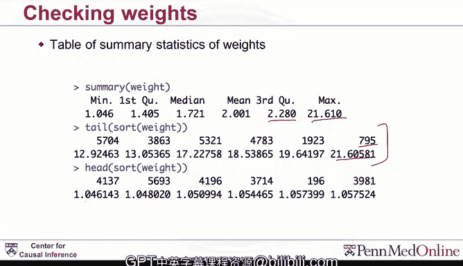

# 34：权重分布 📊


在本节课中，我们将学习逆概率加权估计中权重的分布。我们将探讨为什么过大的权重会导致问题，特别是如何增加效应估计的标准误。我们还将学习如何检查权重的分布，以确保分析的稳定性。

上一节我们介绍了逆概率加权的基本原理，本节中我们来看看权重的具体分布及其影响。

## 为什么权重的大小很重要？

权重的实际数值大小至关重要，因为较大的权重会导致因果效应估计的噪声增加，从而产生更大的标准误。

考虑一个极端情况：假设数据中有一个人的权重为10,000。这意味着在分析中，这个人基本上代表了10,000个人。如果结果是二元的（例如“是”或“否”），那么这一个人的结果（“是”或“否”）在计算中会被当作10,000个人的结果来处理。因此，这一个人的数据会极大地影响整体估计值，从而引入显著的波动性，导致估计值高度可变。理想情况下，我们不希望任何个体的权重远大于其他人。

## 大权重如何导致大标准误？

理解大权重导致大标准误的一个有效方法是借助**自助法**的思想。

自助法是一种估计标准误的方法。其基本思想是：从原始样本中**有放回地**随机抽取N个观测值，形成一个自助样本。这个过程重复多次，每次都会得到一个新的参数估计值。这些估计值的方差或标准差，就可以作为原始估计量标准误的近似。

现在，假设我们的样本中有一个权重极大（例如10,000）的个体。在进行自助抽样时，这个个体可能出现在某些自助样本中，也可能不出现。当这个个体出现时，由于其巨大的权重，它会将参数估计值强烈地拉向自己的方向；当它不出现时，则不会产生这种影响。因此，从一次自助抽样到另一次，参数估计值会产生巨大的波动。这种波动性直接体现为估计量的高方差，即**大的标准误**。

## 权重与“正值性”假设的关系

权重的计算公式是：**权重 = 1 / P(观测到的处理 | 协变量)**。一个非常大的权重意味着分母 **P(观测到的处理 | 协变量)** 非常小，即该个体在给定其协变量条件下，接受其实际处理的概率接近于零。

这并不一定直接违反“正值性”假设（该假设要求概率严格大于零），但它意味着我们**濒临违反**该假设。对于某些协变量取值，个体接受特定处理的可能性极低。因此，出现极大权重也提示我们需要重新审视数据是否满足建模所需的“正值性”假设。

## 如何检查权重分布？

检查权重分布是评估逆概率加权模型稳定性的关键步骤。以下是几种实用的方法。

### 1. 绘制权重分布图

以下是两种常用的可视化方法，用于直观展示权重分布。

*   **密度图**：显示权重值的分布密度。图中底部的刻度线代表实际的权重值。通过密度图，可以快速看出权重主要集中在哪个范围，以及是否存在远离主分布区的极端大值。
*   **排序散点图**：将所有权重值从小到大排序后绘制。横轴是排序序号，纵轴是权重值。这种图能清晰地展示有多少个体拥有较大的权重，以及这些大权重的具体数值。例如，可以轻松看出有多少个体的权重超过了某个阈值（如5或15）。

### 2. 计算权重摘要统计量

除了绘图，直接计算权重的数字摘要也很有帮助。

以下是使用R语言获取权重摘要的示例代码：

```r
# 获取权重的摘要统计信息，包括最小值、四分位数、中位数、最大值
summary(weights)

# 查看最小的6个权重值
head(sort(weights), 6)

# 查看最大的6个权重值
tail(sort(weights), 6)
```

`summary` 命令会输出权重的关键分位数。例如，如果第三四分位数（75th percentile）是2.28，意味着75%的个体权重低于此值。同时，关注最大值（如21）可以了解权重的上界。

`head` 和 `tail` 命令能列出最小和最大的几个权重值及其对应的观测编号。例如，输出可能显示第795号观测拥有最大的权重。这有助于定位这些特殊个体，以便进一步检查他们的协变量数据，理解为何他们会获得如此大的权重。

---



本节课中我们一起学习了权重分布在逆概率加权估计中的重要性。我们了解到，过大的权重会通过增加估计量的波动性而导致更大的标准误，并且这可能暗示着数据濒临违反“正值性”假设。为了诊断这一问题，我们可以通过绘制权重密度图或排序散点图来可视化分布，并通过计算摘要统计量（如分位数和极值）来量化检查。这些步骤对于确保因果推断结果的稳健性至关重要。