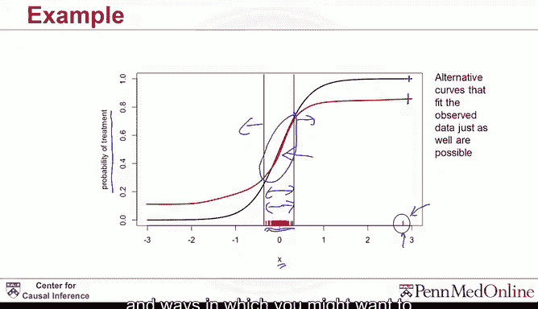

# 课程35：大权重的修正方法 🛠️

在本节课中，我们将学习当使用逆概率加权法进行分析时，如果发现数据集中存在非常大的权重，应该如何处理。我们将探讨识别问题、检查数据、调整模型以及具体的修正策略，如尾部修剪和权重截断。

## 检查异常权重个体 🔍

上一节我们介绍了逆概率加权的基本概念。本节中，我们来看看当发现非常大的权重时，首先应该做什么。

如果发现某些个体的权重非常大，第一步是仔细检查这些个体的观测数据。你需要识别出权重最高的个体，单独查看他们的数据。主要目的是理解他们为何会有如此大的权重。

例如，假设你拟合了一个逻辑回归模型来估计倾向得分。你可以查看模型的系数，并结合这些高权重个体的具体数据，分析是哪些变量或变量组合导致了极端权重的产生。这可能是因为某个变量取值极端，也可能是一系列变量的特定组合在数据中非常罕见。

以下是检查时需要关注的两个核心方面：
*   **数据合理性**：检查这些个体的所有数据是否在合理范围内。是否存在数据录入错误或异常值？
*   **模型正确性**：检查倾向得分模型是否指定正确。也许模型本身没有问题，只是这些个体确实具有极端的特征组合，从而导致了较大的权重。但首先需要排除模型误设的可能性。

## 理解模型外推问题 📈

为了更直观地理解问题，我们考虑一个简单的例子。假设我们只有一个连续混杂变量 `X`，并且假设倾向得分模型在Logit尺度上是线性的，即：
`logit(P(Treatment=1)) = β₀ + β₁X`

想象一下数据点和拟合曲线的关系。绝大多数数据点可能集中在 `X` 的一个较小范围内（例如 -0.4 到 0.4）。逻辑回归模型的参数 `β` 主要基于这个范围内的数据来估计。

然而，如果存在一个离群值，其 `X` 值远超出这个范围，模型对于该点的预测就严重依赖于“Logit线性”这个假设。由于该点附近几乎没有数据，我们无法验证这个假设在该区域是否成立。模型可能预测该个体接受治疗的概率接近1。如果该个体实际上并未接受治疗，他就会获得一个极大的权重。

问题的关键在于，在数据稀疏的区域，模型在进行大量外推。可能存在许多其他形状的曲线（例如，增长更平缓的曲线），它们在数据密集的区域与我们的线性Logit模型拟合得一样好，但在外推区域会给出不同的概率估计，从而产生小得多的权重。

因此，极端权重的出现可能有两个主要原因：
1.  **模型假设不当**：在数据稀疏区域，模型形式（如线性Logit）可能不符合真实情况。
2.  **数据错误**：极端值可能是由于数据录入错误或测量错误导致的。

## 尾部修剪策略 ✂️

在开始逆概率加权分析之前，一个有助于减少极端权重的方法是**基于倾向得分的分布进行尾部修剪**。这样做有两个好处：一是使“正值性”假设（即每个个体都有机会接受任一种处理）更加合理；二是可以直接消除一些最极端的权重。

尾部修剪意味着直接从数据集中移除某些个体。一个常见的策略是：

以下是具体的操作步骤：
*   对于**治疗组**个体，计算**对照组**个体倾向得分的第98百分位数。然后，移除所有倾向得分**高于**此百分位数的个体（无论其属于治疗组还是对照组）。
*   对于**对照组**个体，计算**治疗组**个体倾向得分的第2百分位数。然后，移除所有倾向得分**低于**此百分位数的个体。

这样操作后，剩下的数据集中在倾向得分分布的重叠区域，确保了治疗组和对照组个体在特征上有足够的可比性。

**需要注意的是**，尾部修剪改变了我们进行推断的目标人群。我们从推断“整体人群”转变为推断“有合理机会接受任一种治疗的亚人群”。虽然这通常是可接受的，甚至更合理，但必须明确意识到目标人群的定义已经发生了变化。

## 权重截断方法 ⚖️

无论是否进行了尾部修剪，都可以考虑使用**权重截断**。这种方法不删除个体，而是设定一个权重的上限。

具体做法是：预先设定一个可接受的最大权重值（例如100，或基于权重分布的某个百分位数，如第99百分位数）。然后，将所有**超过**此上限的权重值**修改为**这个上限值。例如，如果设定上限为100，那么一个权重为150的个体，其权重会被改为100。

这听起来可能有些奇怪，因为我们在手动修改数据。确实，权重截断会引入**偏差**，因为我们不再进行“正确”的加权。然而，它同时能显著降低估计值的**方差**。如果不截断，估计量可能是无偏的，但方差可能非常大（尤其受极端权重影响）。

因此，权重截断是一个典型的**偏差-方差权衡**问题。通过接受一点偏差，来换取方差的大幅降低。判断这个权衡是否值得，通常参考**均方误差**，其公式为：
`MSE = Bias² + Variance`

一些模拟研究表明，适当地截断权重可以改善均方误差。关键在于截断点的选择。通常，目标是消除那些远大于其他权重的极端值。常见的做法是将权重截断在第98或99百分位数。如果只有极少数个体拥有极端权重，适度的截断很可能在均方误差意义下带来更好的估计效果。

## 总结 📝

本节课中，我们一起学习了处理逆概率加权中极端权重的方法。我们首先探讨了如何通过检查高权重个体的数据来识别问题根源，可能是数据错误或模型误设。接着，我们介绍了两种主要的修正策略：**尾部修剪**（通过移除倾向得分分布尾部的个体来确保可比性并改变目标人群）和**权重截断**（通过设定权重上限来在偏差和方差之间进行权衡）。在实际分析中，需要根据具体情况谨慎选择和应用这些方法。