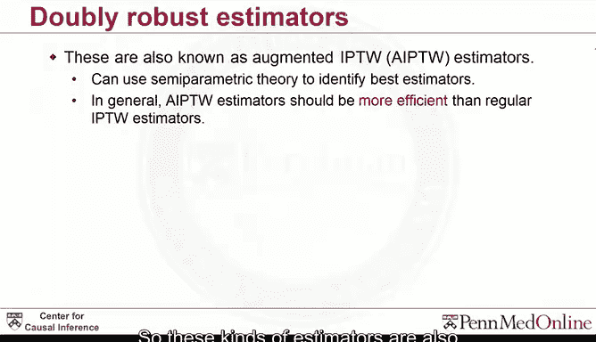
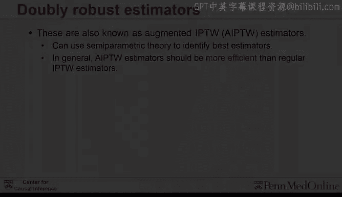

#  36：双重稳健估计量 📊


在本节课中，我们将学习一种名为“双重稳健估计量”的因果推断方法，它也被称为“增广逆概率加权估计”。我们将重点理解这类估计量背后的直观逻辑，并简要讨论其特性。

## 概述

双重稳健估计量结合了两种不同的建模思路，使得估计结果在两种模型之一正确的情况下依然保持无偏。这为我们在实际分析中提供了更强的稳健性。

## 回顾：逆概率加权估计

在深入双重稳健估计之前，我们先回顾一下标准的逆概率加权估计方法。

上一节我们介绍了因果推断的基本框架，本节中我们来看看如何估计一个特定的潜在结果均值。假设我们只关注估计“如果所有人都接受治疗”时的潜在结果均值 `E[Y(1)]`。

标准的逆概率加权估计量公式如下：

```
Ê[Y(1)] = (1/N) * Σ [ (A_i * Y_i) / π(X_i) ]
```

其中：
*   `A_i` 是治疗指示变量（`A=1` 表示治疗，`A=0` 表示对照）。
*   `Y_i` 是观测到的结果。
*   `π(X_i)` 是倾向性评分，即给定协变量 `X` 后接受治疗的概率 `P(A=1|X)`。
*   `N` 是总样本量。

这个估计量通过权重 `1/π(X)` 对接受治疗的个体进行加权，从而在加权后的“伪总体”中模拟出一个无混杂的随机化试验场景。**如果倾向性评分模型 `π(X)` 被正确设定**，那么这个估计量就是 `E[Y(1)]` 的无偏估计。

## 另一种方法：结果回归模型

除了加权，我们还可以尝试用建模的方法来估计潜在结果均值。

以下是另一种估计 `E[Y(1)]` 的思路。我们首先在**实际接受治疗的个体**中，建立一个结果变量 `Y` 对协变量 `X` 的回归模型。我们把这个条件期望模型记为 `m1(X) = E[Y | A=1, X]`。

然后，我们可以用这个模型来估计 `E[Y(1)]`，公式如下：

```
Ê[Y(1)] = (1/N) * Σ [ A_i * Y_i + (1 - A_i) * m1(X_i) ]
```

这个公式的直观解释是：
*   对于实际接受治疗的个体（`A=1`），我们直接使用其观测结果 `Y`（根据一致性假设，`Y = Y(1)`）。
*   对于实际未接受治疗的个体（`A=0`），我们使用从治疗组学到的模型 `m1(X)` 来预测其“如果接受治疗”时的结果 `Y(1)`。
*   最后对所有个体的值（无论是观测值还是预测值）取平均。

**如果结果回归模型 `m1(X)` 被正确设定**，那么这个估计量也是 `E[Y(1)]` 的无偏估计。

## 双重稳健估计量：结合两种思路

现在，我们将看到如何将上述两种方法结合起来，得到一个更稳健的估计量。

双重稳健估计量巧妙地将逆概率加权和结果回归模型融合在一起。它的核心特性是：**只要倾向性评分模型 `π(X)` 和结果回归模型 `m1(X)` 中有一个被正确设定，该估计量就是无偏的**。我们不需要同时把两个模型都设定正确。

一个常见的双重稳健估计量（增广逆概率加权估计量，AIPTW）形式如下：

```
Ê_DR[Y(1)] = (1/N) * Σ [
    (A_i * Y_i) / π(X_i)
    - [ (A_i - π(X_i)) / π(X_i) ] * m1(X_i)
]
```

接下来，我们分两种情况来理解这个估计量为何具有双重稳健性。

### 情况一：倾向性评分正确，结果模型错误

假设我们正确设定了倾向性评分模型 `π(X)`，但结果模型 `m1(X)` 是错误的。

在这种情况下，估计量中涉及 `m1(X)` 的部分（即方括号内的第二项）在期望意义上会趋近于零。这是因为 `E[A | X] = π(X)`，所以 `(A - π(X))` 的期望为零。当这一项消失后，整个估计量就退化成了标准的逆概率加权估计量，而我们已经知道在倾向性评分正确时，它是无偏的。

### 情况二：倾向性评分错误，结果模型正确

假设我们错误设定了倾向性评分模型 `π(X)`，但正确设定了结果模型 `m1(X)`。

通过一些代数变换，我们可以将上述估计量重新排列。当结果模型正确时，`E[Y | A=1, X] = m1(X)`。经过推导，估计量中涉及错误倾向性评分的部分会被抵消，最终整个估计量在期望上等于 `(1/N) Σ m1(X_i)`，这正是我们之前介绍的、在结果模型正确时无偏的结果回归估计量。

因此，无论哪种情况，只要有一个模型正确，估计量都能给出无偏的结果。

## 双重稳健估计量的优势



除了双重稳健性这一核心优势外，这类估计量通常比标准的逆概率加权估计量更**高效**，即估计量的方差更小。这意味着在相同样本量下，我们能得到更精确的估计。其理论源于半参数统计领域，可以推导出最有效的估计形式。

## 总结



本节课我们一起学习了双重稳健估计量。
*   我们首先回顾了逆概率加权估计和结果回归模型这两种估计潜在结果均值的方法。
*   接着，我们介绍了一种结合两者的双重稳健估计量（AIPTW），并详细解释了其工作原理：只要倾向性评分模型或结果回归模型中有一个正确，估计结果就是无偏的。
*   最后，我们了解到这类估计量通常还具有方差更小的优势。尽管实现上比单一方法更复杂，但它在实践中往往能提供更可靠、更精确的因果效应估计。