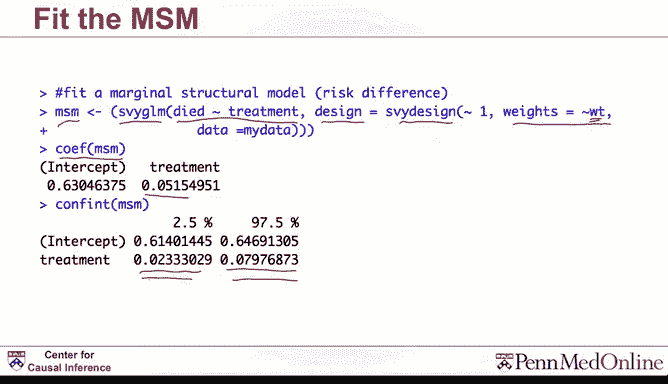

# 课程37：R语言数据实例 - 使用IPTW拟合边际结构模型 📊


在本节课中，我们将学习如何在R语言环境中进行数据分析，具体而言，我们将通过一个实例，演示如何使用**逆概率处理加权**方法来拟合**边际结构模型**。

我们将使用一个关于右心导管插入术的公开数据集。该数据来自五家医院的ICU患者。**治疗变量**是是否接受右心导管插入术，**结局变量**是患者是否死亡。数据中包含许多混杂变量，每组有数千名患者。

本次分析将使用几个R包：`tableone`用于创建基线特征表，`IPW`用于计算逆概率权重，`sandwich`用于稳健方差估计，以及`survey`包，它虽然设计用于调查数据，但也可用于获取加权估计量。

---

## 数据准备与预处理

首先，我们需要读取并查看数据，以理解各个变量的含义。在之前的视频中，我们详细讨论过这部分代码，这里仅作简要回顾。

这个特定数据集包含许多字符型变量，而某些R包对此类数据的处理不太友好。因此，一个常见的做法是将所有变量转换为数值型，以便于后续分析，同时也可以将变量重命名为更易理解的名称。

例如，原始数据中有一个名为`sex`的变量，我们将其更改为`female`，使其成为一个指示变量（取值为1代表女性）。类似地，我们将其他诊断变量（如`COPD`）也转换为指示变量（1代表有该诊断，0代表无）。

我们将**治疗变量**命名为`treatment`（1=接受RHC治疗，0=未接受），**结局变量**命名为`died`。此外，我们还会选取一系列混杂变量。为了演示清晰，我们仅使用部分变量创建一个名为`my_data`的新数据集。在实际分析中，你可能会使用更多的变量。

```r
# 示例：创建子数据集
my_data <- data.frame(
  treatment = ...,
  died = ...,
  age = ...,
  female = ...,
  copd = ...,
  # ... 其他混杂变量
)
```

---

## 拟合倾向评分模型

进行逆概率处理加权的第一步，通常是拟合一个**倾向评分模型**。

这里，我们使用逻辑回归模型来拟合。需要注意的是，在倾向评分模型中，**结局变量实际上是治疗分配情况**（即`treatment`）。我们将一些混杂变量，如年龄、性别、血压和一些诊断指标，作为自变量纳入模型。

```r
# 拟合逻辑回归模型（倾向评分模型）
ps_model <- glm(treatment ~ age + female + bp + copd + ..., 
                data = my_data, 
                family = binomial(link = "logit"))

# 获取倾向评分
ps <- predict(ps_model, type = "response")
```

运行上述代码后，`ps`对象中存储了每个个体的倾向评分（即接受治疗的概率估计值）。

我们可以查看模型的输出，了解哪些变量与接受治疗（即右心导管插入术）相关。例如，`age`的系数为负值，表明年龄较大的患者接受该治疗的可能性较低（尽管P值为0.08，证据强度一般）。你可以浏览整个系数表，检查结果是否符合常识或领域专家的预期。

我们还可以绘制倾向评分的分布图，以检查重叠情况。通常，我们希望治疗组和对照组在倾向评分分布上有足够的重叠。

```r
# 绘制倾向评分分布（原始数据）
plot(density(ps[my_data$treatment == 1]), col="blue", main="Propensity Score Distribution")
lines(density(ps[my_data$treatment == 0]), col="red")
legend("topright", legend=c("Treated", "Control"), col=c("blue", "red"), lty=1)
```

---

## 计算逆概率处理权重

上一节我们介绍了如何获取倾向评分，本节我们将进入IPTW的核心步骤：**计算权重**。

根据IPTW的定义，对于治疗组个体，其权重为 `1 / 倾向评分`；对于对照组个体，其权重为 `1 / (1 - 倾向评分)`。

```r
# 计算IPTW权重
weight <- ifelse(my_data$treatment == 1, 1/ps, 1/(1-ps))
```

计算权重后，有多种方法可以将其应用到数据分析中。首先，我们可以使用`survey`包中的`svydesign`函数来创建一个加权数据集。

```r
# 应用权重，创建加权数据设计对象
weighted_data <- svydesign(ids = ~1, data = my_data, weights = weight)
```

现在，我们拥有了一个加权的数据集对象`weighted_data`，可以用它来生成加权的基线特征表。

---

## 评估加权后的平衡性

创建加权数据后，一个重要的步骤是评估加权是否有效地平衡了治疗组和对照组之间的混杂变量分布。我们可以使用`tableone`包来创建加权的“表一”。

```r
# 创建加权的基线特征表，并计算标准化均数差
weighted_table <- svyCreateTableOne(vars = c("age", "female", "copd", ...), 
                                    strata = "treatment", 
                                    data = weighted_data, 
                                    test = FALSE)
print(weighted_table, smd = TRUE)
```

以下是输出结果的解读：
*   **均值**：这些是加权后的均值，代表了伪人群中的特征。这是我们关注的重点。
*   **标准化均数差**：我们希望所有变量的SMD绝对值都小于0.1，这表明组间达到了良好的平衡。在本例中，所有SMD都非常小（最大约为0.04），说明IPTW权重效果很好。

**注意**：对于加权数据，输出中显示的“样本量”和“标准差”是基于伪人群的，并非真实的样本量，因此可以忽略，主要关注加权均值和SMD。

你也可以通过更直接的方式手动计算加权均值，以验证结果。例如，计算治疗组的加权年龄均值：

```r
# 手动计算治疗组的加权年龄均值 (公式: Σ(weight * age) / Σ(weight))
weighted_mean_age_treated <- sum(weight[my_data$treatment==1] * my_data$age[my_data$treatment==1]) / sum(weight[my_data$treatment==1])
print(weighted_mean_age_treated)
```

这个结果应该与通过`survey`包得到的加权表结果一致。

---

## 拟合边际结构模型

在确认加权数据平衡性良好后，我们就可以拟合**边际结构模型**了。假设我们感兴趣的是一个简单的MSM，其中结局仅与治疗变量线性相关。

我们考虑两种情况：
1.  **使用对数连接函数**：如果我们感兴趣的是**相对危险度**。
2.  **使用恒等连接函数**：如果我们感兴趣的是**风险差**。

### 方法一：使用`glm`函数配合稳健方差

首先，我们可以使用标准的`glm`函数进行加权拟合，但需要使用`sandwich`包来校正权重导致的方差膨胀，获取稳健标准误。

**1. 拟合相对危险度模型（对数连接）：**

```r
# 拟合加权GLM模型（对数连接，用于RR）
msm_log <- glm(died ~ treatment, data = my_data, weights = weight, 
               family = binomial(link = "log"))

# 获取系数
beta_iptw <- coef(msm_log)

# 使用sandwich包获取稳健协方差矩阵，并计算稳健标准误
library(sandwich)
vcov_robust <- vcovHC(msm_log, type = "HC0")
se_robust <- sqrt(diag(vcov_robust))

# 计算因果相对危险度(RR)及其95%置信区间
causal_rr <- exp(beta_iptw["treatment"])
ci_lower_rr <- exp(beta_iptw["treatment"] - 1.96 * se_robust["treatment"])
ci_upper_rr <- exp(beta_iptw["treatment"] + 1.96 * se_robust["treatment"])

c(causal_rr, ci_lower_rr, ci_upper_rr)
```
输出结果显示，因果相对危险度的点估计值约为1.08，95%置信区间为(1.04, 1.13)。RR大于1表明接受右心导管插入术的治疗组死亡风险更高。

**2. 拟合风险差模型（恒等连接）：**

```r
# 拟合加权GLM模型（恒等连接，用于RD）
msm_identity <- glm(died ~ treatment, data = my_data, weights = weight, 
                    family = binomial(link = "identity"))

beta_iptw_rd <- coef(msm_identity)
se_robust_rd <- sqrt(diag(vcovHC(msm_identity, type = "HC0")))

# 计算因果风险差(RD)及其95%置信区间
causal_rd <- beta_iptw_rd["treatment"]
ci_lower_rd <- causal_rd - 1.96 * se_robust_rd["treatment"]
ci_upper_rd <- causal_rd + 1.96 * se_robust_rd["treatment"]

c(causal_rd, ci_lower_rd, ci_upper_rd)
```
输出结果显示，因果风险差的点估计值约为0.05，95%置信区间为(0.02, 0.07)。RD大于0同样表明治疗组的死亡风险更高。

### 方法二：使用`IPW`和`survey`包

另一种更便捷的方法是使用`IPW`包自动计算权重，并结合`svyglm`函数（来自`survey`包）进行模型拟合，它能自动处理稳健方差估计。

```r
library(IPW)
library(survey)

# 使用IPW包直接估计权重（指定倾向评分模型）
weight_obj <- ipwpoint(exposure = treatment, 
                       family = "binomial", 
                       link = "logit",
                       denominator = ~ age + female + bp + copd + ..., 
                       data = my_data)

# 获取权重并查看分布
weights_ipw <- weight_obj$ipw.weights
summary(weights_ipw)
ipwplot(weights_ipw, xlim=c(0, 22))

# 使用svyglm拟合边际结构模型（自动使用稳健方差）
design_ipw <- svydesign(ids = ~1, data = my_data, weights = weights_ipw)
msm_svy <- svyglm(died ~ treatment, design = design_ipw, 
                  family = binomial(link = "identity"))

# 查看系数和置信区间
coef(msm_svy)
confint(msm_svy)
```
使用这种方法得到的结果（如风险差估计值0.052）应与方法一的结果一致。`svyglm`的优点是简化了步骤，自动提供了正确的方差估计。

---

## 权重的截断处理

有时，个别个体可能拥有极大的权重（例如，倾向评分接近0或1），这可能会过度影响估计结果，导致方差估计不稳定。虽然本例中最大权重约为21.6，问题不严重，但我们仍需了解如何进行权重截断。

**方法一：手动截断**

```r
# 设定截断值（例如，10）
trunc_weight <- weight
trunc_weight[trunc_weight > 10] <- 10

# 使用截断后的权重重新拟合模型
msm_trunc_manual <- glm(died ~ treatment, data = my_data, weights = trunc_weight, 
                        family = binomial(link = "identity"))
# ... 后续计算稳健标准误和置信区间的步骤同上
```

**方法二：使用`IPW`包内置功能截断**

`IPW`包可以按百分位数进行截断。例如，截断第1和第99百分位数以外的权重。

```r
# 使用IPW包，并在计算权重时进行截断
weight_obj_trunc <- ipwpoint(exposure = treatment, 
                             family = "binomial", 
                             link = "logit",
                             denominator = ~ age + female + bp + copd + ..., 
                             data = my_data,
                             trunc = 0.01) # 截断第1和第99百分位数

weights_trunc <- weight_obj_trunc$ipw.weights
summary(weights_trunc) # 查看截断后的权重范围

# 使用截断权重拟合模型
design_trunc <- svydesign(ids = ~1, data = my_data, weights = weights_trunc)
msm_svy_trunc <- svyglm(died ~ treatment, design = design_trunc, 
                        family = binomial(link = "identity"))
confint(msm_svy_trunc)
```

在本例中，截断前后得到的风险差估计值及其置信区间变化很小（例如，置信区间上限从0.0797变为0.0816），这是因为原始数据中没有极端大的权重。这可以作为一种敏感性分析，如果截断前后结论一致，则结果更加稳健。

---

## 总结



本节课中，我们一起学习了在R语言中实施**逆概率处理加权**分析的全过程：

1.  **数据准备**：读取数据，将变量转换为合适的格式（如数值型、指示变量）。
2.  **倾向评分建模**：使用逻辑回归模型估计每个个体接受治疗的概率。
3.  **权重计算**：根据倾向评分计算IPTW权重（治疗组：`1/PS`，对照组：`1/(1-PS)`）。
4.  **平衡性评估**：创建加权的基线特征表，检查标准化均数差，确认加权后混杂变量分布平衡。
5.  **模型拟合**：使用加权数据拟合**边际结构模型**，以估计治疗的因果效应。
    *   我们演示了两种方法：使用`glm`加稳健方差，以及使用`IPW`和`svyglm`组合。
    *   我们展示了如何估计**相对危险度**（对数连接）和**风险差**（恒等连接）。
6.  **权重处理**：介绍了如何对极端权重进行截断，以作为稳定性检查或敏感性分析。


通过这个完整的实例，你应该能够掌握使用R语言和IPTW方法估计因果效应的基本流程。记住，在实际分析中，仔细检查倾向评分模型、权重分布和加权后的平衡性至关重要。