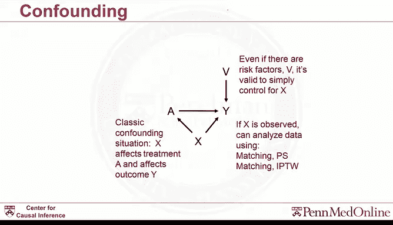

# 课程38：工具变量简介 🧩

在本节课中，我们将学习工具变量的基本概念。我们将首先讨论未测量的混杂因素及其对标准因果推断方法带来的问题，然后介绍工具变量及其性质，并解释为何它在存在未测量混杂的情况下可能有用。

## 未测量混杂的问题

上一节我们回顾了经典的混杂设置。在标准情况下，我们有处理变量 **A** 和结果变量 **Y**，以及一组可观测的混杂因素 **X**。只要 **X** 被观测到，我们就可以使用匹配、倾向得分匹配或逆概率加权等方法估计 **A** 对 **Y** 的因果效应。

然而，在许多实际研究中，我们可能面临未测量的混杂因素 **U**。这些变量同时影响处理分配和结果，但由于未被观测，我们无法通过常规方法对其进行控制。这会导致可忽略性假设被违反，即使我们控制了观测到的 **X**，处理组和对照组之间仍可能存在系统性差异，从而产生有偏的因果效应估计。

## 工具变量的引入

面对未测量混杂的挑战，我们需要不同的统计方法。只要能够识别出一个有效的工具变量，问题并非完全无解。

工具变量 **Z** 的核心思想是：它影响处理变量 **A**，但不直接影响结果变量 **Y**。你可以将 **Z** 视为一种“随机化的鼓励”——例如，较高的 **Z** 值可能鼓励个体接受处理，而较低的 **Z** 值则相反。关键在于，这种鼓励本身不会直接影响结果。

**公式表示**：工具变量 **Z** 需满足以下条件：
1.  **相关性**：`Z` 与处理变量 `A` 相关。
2.  **排他性限制**：`Z` 只能通过 `A` 影响结果 `Y`，没有直接路径 `Z → Y`。
3.  **独立性**：`Z` 与未观测的混杂因素 `U` 独立（或在观测变量 `X` 的条件下独立）。

## 一个具体例子：孕期吸烟与婴儿体重

假设我们想研究孕期吸烟（处理 **A**）对婴儿出生体重（结果 **Y**）的影响。这里存在许多潜在的混杂因素（如母亲年龄、产次等），甚至可能存在未测量的混杂因素。显然，我们无法进行随机化试验要求孕妇吸烟或不吸烟。

此时，可以采用一种“鼓励设计”的随机试验：招募吸烟的孕妇，并将她们随机分为两组。
*   **干预组 (Z=1)**：接受旨在鼓励戒烟的积极干预。
*   **对照组 (Z=0)**：接受常规产前护理。

在这里，随机分配的鼓励 **Z** 就是一个工具变量。鼓励本身不应直接影响婴儿体重，其所有影响都应通过改变吸烟行为（**A**）来实现。

## 从“意向性治疗”效应到处理效应

在这种设计中，我们可以直接估计“意向性治疗”效应，即比较两组（鼓励 vs. 常规护理）的平均出生体重差异。这衡量的是鼓励本身对结果的影响。

然而，我们真正感兴趣的是吸烟本身（**A**）对出生体重（**Y**）的因果效应。工具变量方法的目标，正是利用工具 **Z**（这里的随机化鼓励）来估计这个我们无法直接观测的处理效应。

## 工具变量的来源

在鼓励设计的例子中，工具变量 **Z** 是由研究者通过随机化主动创造的。但在许多观察性研究中，工具变量可能以“自然实验”的形式存在。

以下是工具变量的一些常见来源：
*   **孟德尔随机化**：在遗传学研究中，使用基因型作为工具变量。
*   **出生季度**：已被用作影响教育年限的工具变量。
*   **地理距离**：到医疗机构的距离常被用作医疗干预的工具变量。

在后续课程中，我们将详细探讨这些例子。

## 总结

本节课我们一起学习了工具变量的基本概念。我们了解到，当存在未测量的混杂因素时，标准因果推断方法会失效。工具变量 **Z** 通过提供一个只通过处理变量 **A** 影响结果 **Y** 的“随机化”来源，为我们提供了估计因果效应的新途径。工具变量可以是研究者随机化分配的（如鼓励设计），也可以是自然界中存在的（如自然实验）。在接下来的课程中，我们将深入探讨如何利用工具变量进行因果效应估计。