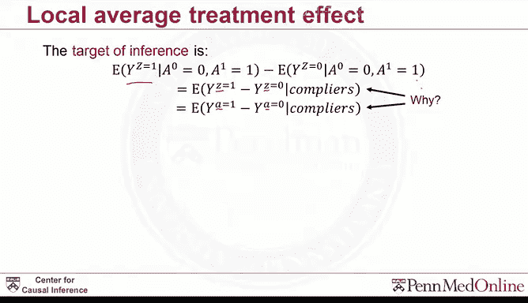
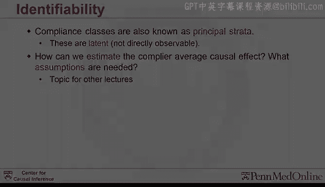

# 课程40：依从类别 🧩


在本节课中，我们将学习如何根据个体的潜在治疗接受情况，将其分类到不同的“依从类别”中。我们将理解“依从者”的含义，并区分总体因果效应与局部因果效应。

## 潜在治疗值与依从类别

上一节我们介绍了因果推断的基本概念，本节中我们来看看如何根据潜在治疗值对个体进行分类。

我们使用潜在治疗值 `A0` 和 `A1` 来描述个体。其中：
*   `A0` 表示如果个体被随机分配到对照组（即工具变量 `Z=0`）时，其将接受的治疗。
*   `A1` 表示如果个体被随机分配到处理组（即工具变量 `Z=1`）时，其将接受的治疗。

我们可以根据个体这对潜在值 `(A0, A1)` 的组合，将他们分为四类：

以下是四种主要的依从类别：
*   **从不接受者**：`(A0=0, A1=0)`。无论被分配到哪一组，他们都不会接受治疗。
*   **依从者**：`(A0=0, A1=1)`。他们完全遵从分配：分配到对照组就不接受治疗，分配到处理组就接受治疗。
*   **违抗者**：`(A0=1, A1=0)`。他们总是做与分配相反的事：分配到对照组反而接受治疗，分配到处理组反而不接受治疗。
*   **总是接受者**：`(A0=1, A1=1)`。无论被分配到哪一组，他们都会接受治疗。

这种分类框架是鲁宾因果模型的一部分，也被称为“主分层”方法。

## 各类别群体的特点

理解了分类后，我们来逐一分析这些子群体的特点。

**从不接受者**：对于这个群体，鼓励（工具变量 `Z`）无效。由于他们从不接受治疗，我们无法观察到他们接受治疗时的结果，因此在没有额外强假设的情况下，我们无法从数据中了解治疗对这个群体的因果效应。

**依从者**：这是工具变量方法最关注的群体。他们完全遵从随机分配，因此在这个群体内，实际接受的治疗 `A` 完全由随机分配 `Z` 决定。这为我们在这个子群体内估计治疗的因果效应提供了希望。

**违抗者**：这个群体的行为与鼓励相反。理论上，我们也可以在这个群体内估计因果效应。但在许多随机试验场景中（例如对照组无法获得治疗），我们通常假设这个群体不存在或规模极小。

**总是接受者**：与从不接受者类似，这个群体接受的治疗没有变化（总是接受），因此我们同样无法从数据中直接了解治疗对他们的因果效应。

## 局部平均处理效应

前面我们分析了不同群体，现在重点来看工具变量方法的核心目标——局部平均处理效应。

工具变量方法通常用于存在未测量混杂的情况。当存在未测量混杂时，我们很难估计整个总体的平均因果效应，因为无法对所有混杂因素进行调整。

因此，工具变量方法的目标不是估计总体效应，而是估计一个**局部平均处理效应**。其定义如下：

```
LATE = E[Y(1) - Y(0) | A0=0, A1=1]
```



这是一个有效的因果效应，因为它比较的是同一子群体（依从者）在不同治疗状态下的潜在结果均值。注意到我们条件于 `A0=0` 且 `A1=1`，这正是**依从者**的定义。

对于依从者，工具变量 `Z` 的赋值与实际治疗 `A` 完全一致（`Z=0` 时 `A=0`，`Z=1` 时 `A=1`）。因此，在依从者子群体内，我们可以将上述效应等价地写为：

```
LATE = E[Y(A=1) - Y(A=0) | A0=0, A1=1]
```

这被称为**依从者平均因果效应**。它是治疗 `A` 对依从者这个子群体的因果效应。

## 从观测数据识别依从类别

我们已经定义了目标参数，但如何从实际观测数据中识别出依从者呢？这是估计的关键挑战。

我们观测到的数据是工具变量 `Z`（分配的治疗）和实际接受的治疗 `A`。它们的组合有四种情况。

以下是根据观测数据 `(Z, A)` 推断潜在依从类别的情况：
*   若观测到 `(Z=0, A=0)`：该个体可能是**从不接受者**或**依从者**。
*   若观测到 `(Z=0, A=1)`：该个体可能是**总是接受者**或**违抗者**。
*   若观测到 `(Z=1, A=0)`：该个体可能是**从不接受者**或**违抗者**。
*   若观测到 `(Z=1, A=1)`：该个体可能是**总是接受者**或**依从者**。

可以看到，根据观测数据，我们只能将每个人的依从类别范围缩小到两种可能性，而无法唯一确定。这些依从类别是**潜在的**，无法直接观测。

## 总结



本节课中我们一起学习了依从类别的概念。我们了解到，可以根据个体的潜在治疗接受行为 `(A0, A1)` 将其分为从不接受者、依从者、违抗者和总是接受者四类。工具变量方法的核心目标是估计**依从者平均因果效应**，即治疗对依从者这个子群体的局部因果效应。然而，从观测数据中我们无法直接确定个体属于哪个依从类别，这为后续的估计带来了挑战，我们将在接下来的课程中探讨如何解决这个问题。