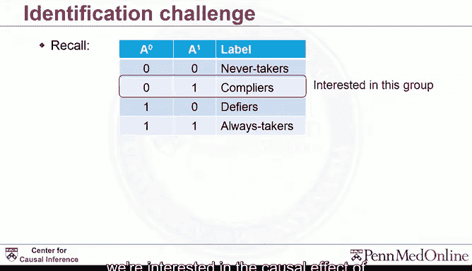

# 课程 41：工具变量假设详解 🎯

在本节课中，我们将学习工具变量分析中的核心假设。我们将首先探讨定义一个有效工具变量所需的条件，然后介绍单调性假设，并解释其重要性。

## 概述

工具变量分析是因果推断中的一种重要方法，用于处理存在未测量混杂因素的情况。为了确保分析的有效性，我们必须满足一系列关键假设。本节将详细讲解这些假设，特别是**关联性**、**排他性约束**和**单调性**。

## 工具变量的定义与核心假设

一个有效的工具变量必须满足两个核心条件。

以下是具体说明：

1.  **与处理变量（Treatment）相关联**：工具变量 **Z** 必须能够影响处理变量 **A**。在因果图中，这体现为一条从 **Z** 指向 **A** 的箭头。在随机对照试验中，随机分配通常就是一个强有力的工具变量，因为它直接影响患者接受的治疗。

2.  **排他性约束**：工具变量 **Z** 只能通过影响处理变量 **A** 来间接影响结果变量 **Y**，而不能对 **Y** 产生任何直接或通过其他未测量混杂因素 **U** 的间接影响。这意味着因果图中不能存在从 **Z** 直接指向 **Y** 的箭头，也不能存在从 **Z** 指向 **U** 的箭头。

排他性约束是工具变量分析中最关键也最具争议的假设。它无法仅凭数据直接验证，必须依靠研究设计和领域知识进行论证。例如，在一个非盲法的随机试验中，患者知晓自己的治疗分配可能会通过影响其行为（安慰剂效应或霍桑效应）而直接作用于结果，从而可能违反排他性约束。

## 单调性假设及其作用

上一节我们介绍了工具变量的基本假设，但在仅满足这些条件时，我们仍无法精确识别我们感兴趣的因果效应——即“依从者”群体的处理效应。本节中我们来看看**单调性假设**如何帮助我们解决这个难题。

单调性假设的核心内容是：不存在“违抗者”。所谓“违抗者”，是指那些总是做出与工具变量指示相反行为的人（例如，被鼓励服药时不服药，不被鼓励时反而服药）。该假设认为，工具变量的“鼓励”作用方向是一致的，增加鼓励强度不应降低接受治疗的概率。

在许多实际场景中，例如药物随机试验，患者通常无法轻易获得非分配组的药物，因此假设没有“违抗者”是合理的。

引入单调性假设后，我们对个体所属类别的识别能力大大增强。

以下是具体变化：

*   如果观察到某人 **Z = 0**（未分配治疗）但 **A = 1**（接受了治疗），那么在单调性假设下，他只能是“总是接受者”，而不可能是“违抗者”。
*   同理，如果观察到某人 **Z = 1**（分配治疗）但 **A = 0**（未接受治疗），那么他只能是“从不接受者”。

通过排除“违抗者”这一类别，我们获得了足够的信息来识别并最终估计“依从者”群体的局部平均处理效应。

## 总结

本节课中我们一起学习了工具变量分析的三项核心假设：
1.  **关联性**：工具变量必须与处理变量相关。
2.  **排他性约束**：工具变量只能通过处理变量影响结果。
3.  **单调性**：不存在“违抗者”。

其中，排他性约束依赖于逻辑论证，而单调性假设则通过简化问题结构，使得识别“依从者”的因果效应成为可能。理解并审慎评估这些假设，是正确应用工具变量方法进行可靠因果推断的基础。