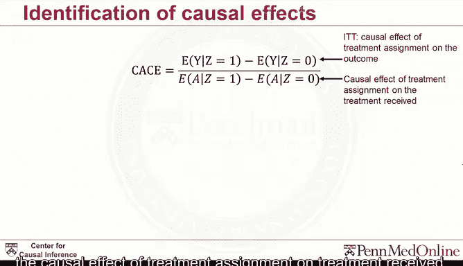

#  42：因果效应识别与估计 🎯

在本节课中，我们将讨论如何从工具变量分析中识别和估计因果效应。我们将理解如何从观测数据中估计“依从者平均因果效应”，并探讨该效应与“意向治疗效应”之间的关系。

## 核心假设回顾 🔍

在开始之前，我们先回顾一下所依赖的核心假设。

首先，我们假设 **Z 是一个有效的工具变量**。这意味着：
*   Z 会影响治疗分配。
*   我们同时做出**排他性限制假设**，即 Z 不会直接影响结果。

其次，我们做出**单调性假设**。在这个假设下，不存在“违抗者”。我们想象一个存在不依从情况的随机试验，并假设没有人会做出与他们被鼓励的行为相反的事情。

我们的目标是估计**依从者群体中接受治疗的平均因果效应**，即那些会按照分配接受治疗的人群子集。

为了识别这个感兴趣的因果效应，我们首先从一个已知可以识别的量开始：意向治疗效应。

## 意向治疗效应的分解 📊

上一节我们回顾了核心假设，本节我们来看看如何分解意向治疗效应。

意向治疗效应是基于治疗分配来对比潜在结果。它等于被分配到治疗组的人群结果期望值，减去被分配到对照组的人群结果期望值。由于随机化，这个对比可以直接从观测数据中获得：`E[Y|Z=1] - E[Y|Z=0]`。

然而，我们也可以根据依从性类型（总是接受者、从不接受者、依从者）来分解这个条件期望。以下是分解 `E[Y|Z=1]` 的步骤：

*   **总体期望分解**：`E[Y|Z=1]` 可以分解为在三种依从类型子群体中条件期望的加权平均。
*   **简化条件**：对于“总是接受者”和“从不接受者”，由于 Z 不影响他们的治疗选择，我们可以去掉条件 `Z=1`。例如，`E[Y|Z=1, Always Taker]` 简化为 `E[Y|Always Taker]`。
*   **概率不变性**：给定 Z 的条件下，成为某种依从类型的概率与 Z 无关，因为依从类型是先于随机分配存在的固有特征。

同理，我们可以对 `E[Y|Z=0]` 进行类似的分解和简化。

## 识别依从者平均因果效应 🧩

当我们计算意向治疗效应（即 `E[Y|Z=1] - E[Y|Z=0]`）时，分解式中的“总是接受者”和“从不接受者”部分会相互抵消。最终，我们得到以下等式：

`ITT = E[Y|Z=1] - E[Y|Z=0] = (E[Y|Z=1, Complier] - E[Y|Z=0, Complier]) * P(Complier)`

这个等式表明，意向治疗效应等于**依从者群体内部**因 Z 不同而导致的结果期望差异，再乘以依从者在总人口中的比例。

由此，我们可以推导出依从者平均因果效应。将上述等式两边同时除以依从者的比例 `P(Complier)`，得到：

`(E[Y|Z=1, Complier] - E[Y|Z=0, Complier]) = ITT / P(Complier)`

由于在依从者群体中，Z 的随机化直接导致了治疗 A 的随机化，因此左边的差值正是我们想估计的**依从者平均因果效应**。

## 效应的估计与解释 📈

上一节我们推导了识别公式，本节中我们来看看如何估计并解释它。

最终，依从者平均因果效应可以表示为以下可估计的比率：

**CACE = (E[Y|Z=1] - E[Y|Z=0]) / (E[A|Z=1] - E[A|Z=0])**

其中：
*   **分子**是意向治疗效应，即 Z 对 Y 的因果效应。
*   **分母**是工具变量对治疗接受的因果效应，它恰好等于依从者的比例 `P(Complier)`。因为 `E[A|Z=1]` 是总是接受者与依从者比例之和，`E[A|Z=0]` 是总是接受者的比例，两者相减后总是接受者抵消，剩下依从者的比例。

这个公式中的所有成分都可以从观测数据 `(Y, A, Z)` 中估计得到。

关于这个比率，有两点重要的解释：
1.  **完美依从情况**：如果所有人都依从，则分母等于 1，依从者平均因果效应就等于意向治疗效应。
2.  **一般情况**：由于分母是介于 0 和 1 之间的比例，**意向治疗效应会被“放大”**。这意味着意向治疗效应通常**低估**了治疗在依从者中的真实效果。原因在于，ITT 分析中包含了未实际接受治疗的个体，从而稀释了治疗效应。

## 总结与要点 🏁

本节课中，我们一起学习了如何从工具变量框架中识别和估计因果效应。

*   **核心前提**：工具变量分析需要两个关键假设：**工具变量有效性**（包含排他性限制）和**单调性假设**。
*   **识别目标**：在单调性假设下，我们可以识别**依从者平均因果效应**，也称为局部平均处理效应。
*   **估计公式**：该效应可以通过一个简单的比率来估计：**意向治疗效应估计值**除以**工具变量对治疗接受的影响**（即依从者比例）。
*   **关系**：意向治疗效应通常是依从者平均因果效应的一个保守估计（向下偏倚）。

通过这个框架，即使我们无法在个体层面确定谁是依从者，仍然可以估计出治疗对依从者子群体的平均因果效应。