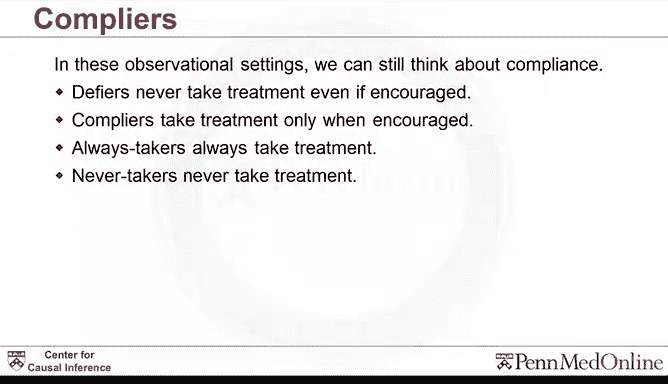

#  43：观察性研究中的工具变量 🧪

在本节课中，我们将学习如何在观察性研究中使用工具变量。我们将探讨工具变量的核心假设，并通过几个实际研究中的例子，来理解如何寻找和评估一个潜在的工具变量。

---

## 概述

在之前的课程中，我们讨论了随机化试验中因不依从性而使用的工具变量。本节我们将重点转向**观察性研究**。在观察性研究中，我们没有主动随机分配干预，但可以寻找一个类似“自然实验”的变量作为工具变量。我们将沿用之前的符号：`Z` 表示工具变量（鼓励接受治疗），`A` 表示实际接受的治疗，`Y` 表示结局，`X` 表示收集的协变量。

---

## 工具变量的核心假设

要使用一个变量作为有效的工具变量，必须满足几个关键假设。以下是这些假设的简要说明。

1.  **关联性**：工具变量 `Z` 必须与治疗分配 `A` 相关。这个假设可以通过数据来检验。
    *公式*：`Z` 与 `A` 相关。

2.  **排他性约束**：工具变量 `Z` 只能通过影响治疗 `A` 来影响结局 `Y`，而不能存在其他直接影响 `Y` 的路径。这个假设通常无法直接检验，必须依赖专业领域的知识进行论证，也是争议最多的地方。
    *公式*：`Z → A → Y`，且不存在 `Z → Y` 的直接路径。

在观察性研究中寻找工具变量时，最大的挑战往往在于论证“排他性约束”的合理性。

---

## 实际研究中的工具变量示例

以下是在医学和社会科学文献中提出的一些工具变量例子。每个例子都体现了研究者的巧妙构思，同时也伴随着对其有效性的广泛讨论。

### 日历时间

在一些研究中，尤其是比较药物效果时，治疗偏好可能在短时间内发生变化。例如，假设有两种治疗相同疾病的药物A和B。在早期，药物B更常用；但随着时间的推移，药物A变得流行，药物B使用减少。

*   **工具变量**：将患者确诊或接受治疗的“早期”与“晚期”时间点作为工具变量 `Z`。
*   **论证**：处于不同时间点的患者，接受哪种药物在某种程度上像是被“随机”分配的，因为时间本身可能主要只通过影响医生的处方偏好（治疗 `A`）来起作用。
*   **挑战**：必须论证在两个时间点之间，没有其他因素（如疾病管理指南、患者健康行为）发生系统性变化，从而直接影响结局 `Y`（如BMI）。如果两个时期相隔很近，论证会更有力。

### 距离与差旅时间

在研究专科医疗中心与普通医院的效果差异时，患者到不同医疗机构的距离可能影响其选择。

*   **工具变量**：患者住所到最近的高级专科中心与到最近普通医院的**差旅时间**作为工具变量 `Z`。
*   **论证**：差旅时间直接影响患者去哪类机构就诊（治疗 `A`），而差旅时间本身不太可能直接影响健康结局 `Y`（如新生儿死亡率）。
*   **挑战**：需要论证居住在专科中心附近的人群，在其他健康相关特征上与居住较远的人群没有系统性差异。使用“差值”而非绝对距离，可以部分控制“偏远地区”这个混杂因素。

### 孟德尔随机化

这是一种利用遗传变异作为工具变量的方法。

*   **工具变量**：与某个行为（如饮酒）相关的特定基因变异作为 `Z`。
*   **论证**：根据孟德尔随机化原理，基因型在受孕时随机分配，且通常只通过影响表型（如饮酒量，即治疗 `A`）来影响疾病结局 `Y`。
*   **挑战**：需要排除基因多效性，即该基因变异是否通过其他生物学途径直接影响结局 `Y`。

### 医生处方偏好

在比较两种药物时，医生个人的处方习惯可能影响患者最终接受哪种药。

*   **工具变量**：医生对**前一位类似患者**的处方选择作为工具变量 `Z`。
*   **论证**：医生之前的处方反映了其偏好，会影响对当前患者的处方（治疗 `A`），但医生之前对别人的治疗决定不应直接影响当前患者的结局 `Y`。
*   **挑战**：医生的处方偏好可能与其医术水平、患者群体特征等其他因素相关，这些因素也可能影响患者结局，从而违反排他性约束。

### 出生季度

在研究教育年限对收入的影响时，出生季度曾被用作工具变量。

*   **工具变量**：个人的**出生季度**作为 `Z`。
*   **论证**：出生季度近乎随机，但通过影响入学年龄和法定离校时间，与个人最终的教育年限（治疗 `A`）相关。
*   **挑战**：出生季度是否与家庭背景、季节性疾病等影响未来收入 `Y` 的因素完全无关？这存在很大争议。

---

## 观察性研究中的“依从者”

在随机试验中，我们关注“依从者”的因果效应。在观察性研究中，“依从”的概念需要调整。

*   **定义**：这里的“依从者”指的是那些**当受到工具变量 `Z` 的鼓励时就接受治疗，不鼓励时就不接受治疗**的个体。
*   **示例**：在以“医生前一位患者的处方”为工具变量的研究中，如果你的医生前一位患者用了药A（鼓励用药A），而你也用了药A，那么你在这个分析框架下就被视为“依从者”。
*   **核心**：工具变量分析估计的仍然是**依从者平均因果效应**，只不过这里的“鼓励”和“依从”是基于所选的工具变量 `Z` 来定义的。

---

## 总结

本节课我们一起学习了在观察性研究中应用工具变量的方法。我们回顾了工具变量必须满足的**关联性**和**排他性约束**两大核心假设。重点是通过多个实际例子（如日历时间、距离、遗传变异、医生偏好、出生季度），理解了研究者如何寻找和论证一个潜在的工具变量，以及每个例子面临的主要挑战。最后，我们明确了在观察性研究背景下，“依从者”的定义是如何对应于所选工具变量的。工具变量为处理观察性数据中的未测量混杂提供了一种强有力的思路，但其有效性高度依赖于对排他性约束的合理论证。