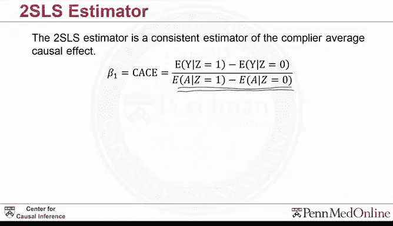

#  44：两阶段最小二乘法 🧮

在本节课中，我们将学习一种名为“两阶段最小二乘法”的统计方法。当研究中存在未测量的混杂因素，但我们可以找到一个有效的工具变量时，这种方法可以帮助我们估计因果效应。

## 概述 📋

两阶段最小二乘法是一种在工具变量设定下，用于估计因果效应的方法。当普通最小二乘法因存在混杂（特别是未测量的混杂）而失效时，它提供了一种解决方案。接下来，我们将详细探讨其原理和操作步骤。

## 普通最小二乘法的局限

在介绍新方法之前，我们先回顾一下普通最小二乘法，并思考当存在混杂时它为何会失效。

假设我们有一个处理变量 **A** 和一个结果变量 **y**。我们建立一个简单的线性模型：

`y = β₀ + A * β₁ + ε`

其中，**ε** 是随机误差项。应用普通最小二乘法的通常假设是，误差项 **ε** 与协变量 **A** 是独立的。这个假设在因果推断中至关重要。

如果 **A** 和 **ε** 相关，就意味着存在混杂。例如，接受处理的人可能本身就有更高的误差项期望值。在这种情况下，即使我们用最小二乘法估计出 **β₁**，它也不能代表因果效应，因为模型受到了混杂的干扰。即使我们在模型中加入了可测量的混杂因素，如果存在未测量的混杂，问题依然存在。

上一节我们指出了普通最小二乘法在存在混杂时的局限，本节中我们来看看如何利用工具变量和两阶段最小二乘法来解决这个问题。

## 两阶段最小二乘法介绍

两阶段最小二乘法，顾名思义，包含两个阶段。它用于在拥有一个有效的工具变量 **Z** 时，估计因果效应。我们首先假设 **Z** 是一个有效的工具变量：它影响处理 **A**，并且满足排他性约束（即 **Z** 只通过 **A** 影响 **y**）。

### 第一阶段

在第一阶段，我们将接受的处理 **A** 对工具变量 **Z** 进行回归。

`A = α₀ + Z * α₁ + υ`

我们假设误差项 **υ** 均值为零，具有恒定方差。由于我们假设（或通过设计使得）**Z** 是随机分配的，因此 **Z** 与误差项 **υ** 独立。这是一个标准的线性模型。

我们可以用最小二乘法估计参数 **α₀** 和 **α₁**，得到估计值 **α̂₀** 和 **α̂₁**。然后，我们可以为每个人计算一个处理 **A** 的预测值 **Â**：

`Âᵢ = α̂₀ + Zᵢ * α̂₁`

这里的 **Âᵢ** 是基于第 **i** 个人的工具变量值 **Zᵢ**，预测出的他们可能接受的处理。它并不等同于实际接受的处理 **A**，而是仅由工具变量 **Z** 决定的一个预测值。

第一阶段非常标准，你可以使用任何回归软件来完成并得到预测值。

### 第二阶段

在第二阶段，我们将结果变量 **y** 对第一阶段得到的拟合值 **Â** 进行回归。

`y = β₀ + Â * β₁ + ε‘`

请注意，这个模型看起来像标准回归，但这里的解释变量是 **Â**，而不是原始的处理变量 **A**。我们同样假设误差项 **ε‘** 均值为零，具有恒定方差。

由于排他性约束，**Z** 只通过 **A** 影响 **y**。而 **Â** 是 **A** 在由 **Z** 张成的空间上的投影，它在功能上很像 **Z**，因此 **Â** 与 **y** 之间的关系应该是无混杂的。原始的处理 **A** 和 **y** 之间可能存在混杂，但 **Â** 仅由随机的 **Z** 决定，所以情况不同。

可以证明，从这个第二阶段模型中用最小二乘法估计出的 **β₁** 就代表了一个因果效应。在实践中，你只需执行这两个阶段：第一阶段用 **A** 对 **Z** 回归得到 **Â**，第二阶段用 **y** 对 **Â** 回归，**Â** 的系数就是因果效应的估计值。这被称为两阶段最小二乘估计量。

我们已经了解了TSLS的基本步骤，接下来我们通过一个简单案例来深入理解其背后的逻辑。

## 方法原理：一个简单案例

为了更好地理解为什么两阶段最小二乘法能得到因果效应，我们考虑一个简单情况：工具变量 **Z** 和处理 **A** 都是二元的（例如，**Z**=1表示鼓励治疗，**Z**=0表示不鼓励；**A**=1表示接受治疗，**A**=0表示未接受）。

在第一阶段，**Â** 是给定 **Z** 时 **A** 的期望值的估计。对于个人 **i**，**Âᵢ** 可以理解为给定其 **Z** 值时接受治疗的概率。

在第二阶段，我们有以下模型：`y = β₀ + Â * β₁ + ε‘`。那么 **β₁** 如何解释？

在回归中，斜率系数 **β₁** 表示预测变量 **Â** 每变化一个单位，结果 **y** 的期望值变化多少。如果我们设 **Â = 1**，**y** 的期望值是 `β₀ + β₁`；设 **Â = 0**，期望值是 `β₀`。两者之差就是 **β₁**。所以 **β₁** 是 `E[y|Â=1]` 与 `E[y|Â=0]` 的对比。

但关键是要理解 **Â** 的含义。当 **Z** 是二元时，**Â** 只有两个可能的值：
*   若 **Z=0**，则 **Â = α̂₀**
*   若 **Z=1**，则 **Â = α̂₀ + α̂₁**

因此，**Â** 的变化完全由 **α̂₁** 这个量体现。**Z** 从 0 变为 1，会导致 **Â** 变化 **α̂₁** 个单位。

**β₁** 衡量的是 **Â** 变化 **1个完整单位** 时 **y** 的变化。而我们的“意向治疗效应”（即 **Z** 对 **y** 的效应）对应的是 **Â** 变化 **α̂₁** 个单位时 **y** 的变化。

因此，为了得到处理 **A** 变化一个单位（即从0到1）对 **y** 的效应，我们需要将“意向治疗效应”放大。具体来说，需要除以 **α̂₁**。这正是我们之前学过的“依从者平均因果效应”的公式：

`CACE = ITT效应 / 依从率`

而在这里，第一阶段回归的斜率 **α̂₁** 恰好估计了工具变量 **Z** 对实际处理 **A** 的因果效应（即依从率）。所以，从两阶段最小二乘法第二阶段得到的 **β₁**，正好等于依从者平均因果效应。

通过简单案例我们看到了TSLS如何估计CACE，实际上，该方法的应用范围要广泛得多。

## 方法的推广与注意事项

我们刚才看的是处理变量和工具变量都是二元且没有协变量的情况。两阶段最小二乘法的优势在于其更广泛的适用性。

### 包含协变量

如果你想控制一些协变量 **X**，方法可以轻松扩展：
*   **第一阶段**：将处理 **A** 对工具变量 **Z** **和** 协变量 **X** 进行回归，得到预测值 **Â**。
*   **第二阶段**：将结果 **y** 对第一阶段得到的 **Â** **和** 协变量 **X** 进行回归。

此时，**Â** 的系数仍然代表一个局部因果效应，即依从者中的因果效应。

### 连续型工具变量

即使工具变量 **Z** 是连续型的，你也可以使用两阶段最小二乘法。步骤完全相同。

### 敏感性分析

当然，应用此方法时，人们会非常关心你的假设是否成立，尤其是**排他性约束**和**单调性**假设。

为了进行严谨的分析，通常需要进行敏感性分析，即探究如果核心假设被轻微或严重违反，你的结论是否会改变。
*   **对于排他性约束**：可以分析如果 **Z** 对 **y** 有直接效应（设大小为 **ρ**），结论在 **ρ** 为多大时会改变。
*   **对于单调性**：可以分析如果人群中存在一定比例（设为 **π**）的“违抗者”，结论在 **π** 为多大时会改变。

已有一些成熟的统计方法和软件可以进行这类敏感性分析，这有助于评估研究结果的稳健性。

## 总结 🎯

本节课我们一起学习了两阶段最小二乘法。
*   我们首先回顾了普通最小二乘法在存在未测混杂时的局限。
*   接着，我们介绍了两阶段最小二乘法的两个阶段：第一阶段用工具变量 **Z** 预测处理 **A** 得到 **Â**；第二阶段用 **Â** 预测结果 **y**，**Â** 的系数即为因果效应估计值。
*   我们通过一个二元变量的例子，推导出该方法估计的正是**依从者平均因果效应**。
*   最后，我们讨论了该方法的推广形式（如加入协变量、处理连续工具变量）以及进行敏感性分析的重要性。

这种方法为在观察性研究或存在非依从性的随机试验中估计因果效应提供了一个强大的工具。