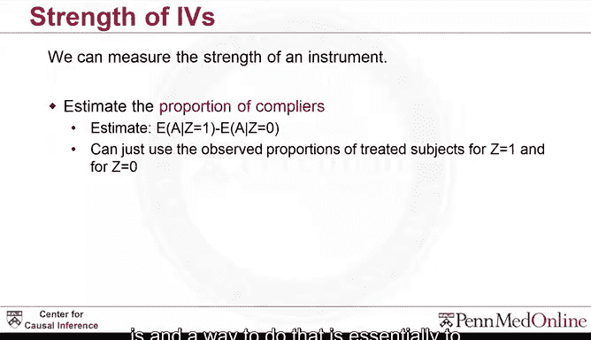

# 课程名称：因果推断速成课程 - P45：弱工具变量 📉


## 概述
在本节课中，我们将要学习**弱工具变量**的概念。我们将了解如何衡量工具变量的强度，以及为什么弱工具变量会给因果效应估计带来问题。

---

## 工具变量的强度

上一节我们介绍了工具变量的基本概念，本节中我们来看看如何衡量一个工具变量的“强度”。

工具变量的强度，本质上是指它**预测实际接受治疗情况**的能力。我们可以将工具变量视为一种“鼓励”，鼓励个体接受治疗。一个强工具变量意味着这种鼓励非常有效，大多数被鼓励的个体最终都会接受治疗。反之，一个弱工具变量对治疗接受情况的预测能力很弱，鼓励只能轻微地提高接受治疗的概率。

我们可以通过估计**依从者比例**来量化工具变量的强度。这个比例可以从观测数据中识别出来。



以下是计算依从者比例的公式：

```
依从者比例 = P(A=1 | Z=1) - P(A=1 | Z=0)
```

其中：
*   `P(A=1 | Z=1)` 表示在受到鼓励（Z=1）的条件下，接受治疗（A=1）的概率。
*   `P(A=1 | Z=0)` 表示在没有受到鼓励（Z=0）的条件下，接受治疗（A=1）的概率。

这个差值就是依从者（即那些是否接受治疗完全取决于是否被鼓励的人）在总体中的比例。在实践中，我们可以简单地用样本中 `Z=1` 组的治疗比例减去 `Z=0` 组的治疗比例来估计它。

如果这个比例接近1，说明工具变量很强；如果接近0，则说明工具变量很弱。

---

## 弱工具变量的问题

理解了如何衡量强度后，我们来看看为什么弱工具变量会带来麻烦。

工具变量分析的目标是估计**局部平均因果效应**，即依从者群体的因果效应。如果依从者在总体中的比例非常小（例如1%），那么实际上为因果效应估计提供信息的有效样本量也会变得非常小。

假设原始样本量为 `N`，那么有效样本量大约只有 `0.01 * N`。这会导致以下几个问题：

1.  **估计不稳定（高方差）**：基于小样本的估计会非常不稳定，因果效应估计值的方差会很大。
2.  **置信区间过宽**：由此计算出的置信区间会非常宽，使得我们难以得出确切的结论。
3.  **潜在的偏倚**：在某些情况下，弱工具变量还可能引入估计偏倚，尽管不稳定性通常是更主要的问题。

---

## 应对弱工具变量的策略

既然弱工具变量有这些问题，当我们遇到弱工具变量时该怎么办呢？

以下是几种可能的应对策略：

*   **考虑其他分析方法**：如果工具变量太弱，进行工具变量分析可能不是最佳选择。很多时候，研究者在提出一个潜在的工具变量后，第一步就是检验它是否真的能强有力地预测治疗。如果不能，可能需要寻找其他工具变量或采用不同的因果推断方法。
*   **尝试强化工具变量**：这是一个活跃的研究领域。例如，**近-远匹配** 方法就是一种策略。其思想是，在匹配时确保个体在协变量（可能的混杂因素）上相似，但同时使他们在工具变量上的取值差异尽可能大。这类似于随机试验中，各组协变量分布平衡但干预分配不同。此外，还有其他新的统计方法致力于强化工具变量。

---

## 总结
本节课中我们一起学习了弱工具变量的核心内容。我们了解到，工具变量的强度由其预测治疗的能力决定，可以通过估计依从者比例来量化。弱工具变量（依从者比例低）会导致因果效应估计不稳定、置信区间过宽，可能使分析结果不可靠。面对弱工具变量，我们可以选择寻找更强的工具变量、采用其他分析方法，或使用如近-远匹配等新技术来尝试强化它。