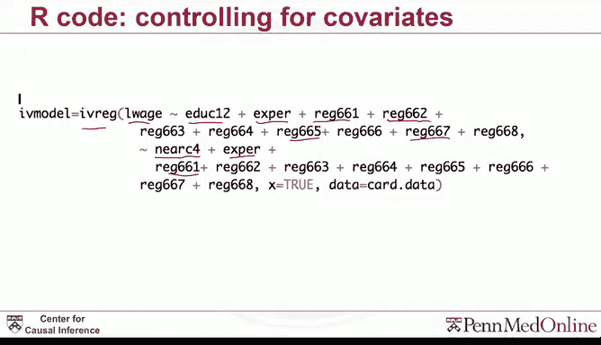

# 46：R语言工具变量分析 🛠️


在本节课中，我们将学习如何在R语言中执行工具变量分析。我们将通过一个真实的数据集，一步步演示如何利用工具变量来估计教育年限对收入的因果效应。

## 概述

我们将使用一个公开的数据集，研究居住地距离四年制大学的远近（作为工具变量）如何影响个人的教育年限，并最终影响其收入。核心目标是估计“多接受一年教育”对收入的因果效应，同时处理可能存在的未观测混杂因素。

---

## 数据介绍与准备

首先，我们需要了解数据和核心变量。我们将使用R包 `IVPack` 中的 `card` 数据集。

*   **工具变量 (Z)**：`nearc4`，表示个人是否在四年制大学附近长大。
*   **处理变量 (A)**：`educ`，表示接受教育的年限。
*   **结果变量 (Y)**：`lwage`，表示工资的对数值（常用于处理收入的偏态分布）。

以下是加载数据和初步查看的步骤：

```r
# 加载必要的包和数据
library(IVPack)
data(card)

# 查看工具变量的分布（接受“鼓励”的比例）
mean(card$nearc4)
# 绘制结果变量和处理变量的直方图，以了解数据分布
hist(card$lwage, main="Log Wages Distribution")
hist(card$educ, main="Education Years Distribution")
```

初步分析显示，约68%的样本居住在大学附近。工资对数分布相对对称，教育年限分布则在12年（高中毕业）处有一个明显的峰值。

---

## 估计依从者比例

上一节我们查看了数据分布，本节中我们来看看工具变量的强度。一个重要的指标是**依从者比例**，它反映了工具变量影响处理变量的能力。

为了简化并与随机试验类比，我们将教育年限二值化为是否大于12年。

```r
# 创建二值化处理变量：教育年限是否大于12年
card$educ12 <- as.numeric(card$educ > 12)

# 估计依从者比例 = E[A|Z=1] - E[A|Z=0]
comp_prop <- mean(card$educ12[card$nearc4==1]) - mean(card$educ12[card$nearc4==0])
comp_prop
```

计算得到的依从者比例约为0.12（12%）。这意味着，居住在大学附近能使一个人获得超过12年教育的概率平均增加12%。这个强度尚可，并非特别弱。

---

## 估计意向治疗效应与依从者平均因果效应

在得到依从者比例后，我们可以进一步估计两种效应。

首先，我们估计**意向治疗效应**，即工具变量（鼓励）对结果的因果效应。

```r
# 估计意向治疗效应 (ITT) = E[Y|Z=1] - E[Y|Z=0]
ITT <- mean(card$lwage[card$nearc4==1]) - mean(card$lwage[card$nearc4==0])
ITT
```

ITT的估计值约为0.16，意味着居住在大学附近的人，其对数工资平均高出0.16个单位。

接着，我们可以利用ITT和依从者比例来估计**依从者平均因果效应**。这是我们在工具变量假设下真正关心的处理效应。

```r
# 估计依从者平均因果效应 (CACE) = ITT / 依从者比例
CACE <- ITT / comp_prop
CACE
```

CACE的估计值约为1.28。其解释为：对于依从者（即那些如果住在大学附近就会获得超过12年教育，否则就不会的人），获得超过12年教育使其对数工资平均增加约1.28个单位。这个值大于ITT，这与我们的预期一致。

**注意**：此估计依赖于“无违抗者”的假设。在本例中，即假设不存在“住在大学附近反而减少教育，不住附近反而增加教育”的人。

---

## 使用两阶段最小二乘法

除了上述公式法，更通用的方法是**两阶段最小二乘法**。上一节我们使用了简单的公式计算，本节中我们来看看如何在R中手动实现两阶段最小二乘。

以下是分步实现：

```r
# 第一阶段：用工具变量(Z)预测处理变量(A)
stage1 <- lm(educ12 ~ nearc4, data=card)
card$pred_educ <- predict(stage1) # 获取预测值

# 第二阶段：用第一阶段的预测值代替实际处理变量，对结果变量(Y)进行回归
stage2 <- lm(lwage ~ pred_educ, data=card)
summary(stage2)
```

第二阶段回归中 `pred_educ` 的系数即为CACE的估计，结果同样约为1.28。这验证了公式法与两阶段最小二乘法在简单情况下的等价性。

---

## 使用IVPack包进行工具变量回归

手动进行两阶段回归较为繁琐，且不易计算稳健标准误。更便捷的方法是直接使用 `IVPack` 包中的 `ivreg` 函数。

以下是具体操作：

```r
# 使用ivreg函数进行工具变量回归
# 公式格式：Y ~ A | Z， 表示用Z作为A的工具变量
iv_model <- ivreg(lwage ~ educ | nearc4, data=card)
summary(iv_model, diagnostics=TRUE)
```

运行此代码，在输出中查看 `educ` 的系数，它同样是约1.28。`ivreg` 的优势在于能直接提供系数估计、标准误、p值以及一些诊断检验，使分析更加完整和稳健。

---

## 控制协变量

在实际分析中，工具变量的外生性假设（即工具变量与误差项不相关）可能只在控制了某些协变量后才成立。例如，居住地可能与家庭收入、父母教育水平等相关。

`ivreg` 函数可以方便地加入协变量：

```r
# 在模型中加入需要控制的协变量
# 格式：Y ~ A + X1 + X2 | Z + X1 + X2
# 其中X为协变量，需要在处理方程和工具方程中都加入
iv_model_cov <- ivreg(lwage ~ educ + exper + black + south + smsa + reg661 + reg662 + reg663 + reg664 + reg665 + reg666 + reg667 + reg668 + smsa66 |
                        nearc4 + exper + black + south + smsa + reg661 + reg662 + reg663 + reg664 + reg665 + reg666 + reg667 + reg668 + smsa66,
                      data=card)
summary(iv_model_cov)
```

加入一系列人口统计学和地区变量作为协变量后，教育年限 (`educ`) 的系数估计值仍然显著为正（约为1.2）。这表明在控制了这些变量后，教育对收入的正面因果效应依然存在。

---

## 总结



本节课中我们一起学习了在R语言中执行工具变量分析的完整流程：

1.  **准备数据与变量**：识别工具变量(Z)、处理变量(A)和结果变量(Y)。
2.  **评估工具变量强度**：通过估计**依从者比例**来完成。
3.  **计算因果效应**：可以通过公式 **CACE = ITT / 依从者比例** 计算，也可以通过**两阶段最小二乘法**估计。
4.  **使用专业包**：利用 `IVPack` 包的 `ivreg` 函数可以简洁、高效地完成工具变量回归，并得到标准误等统计量。
5.  **控制协变量**：通过在 `ivreg` 模型中加入协变量，可以使工具变量的假设更可能被满足，从而得到更可靠的因果估计。

通过本教程的示例，你应能掌握使用R语言进行基本工具变量分析的方法，并将其应用于自己的研究之中。