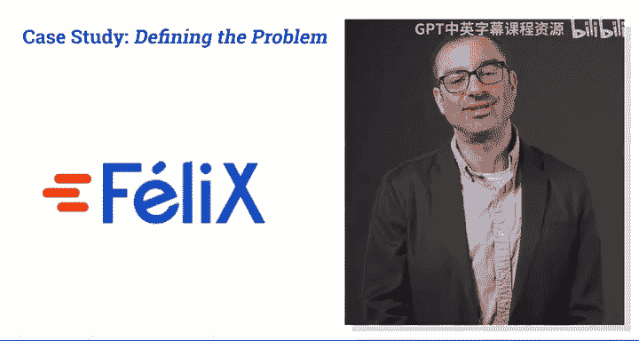
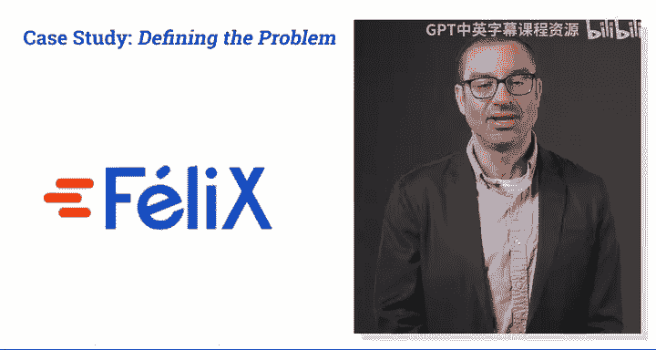
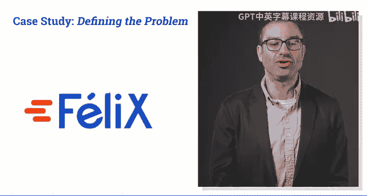
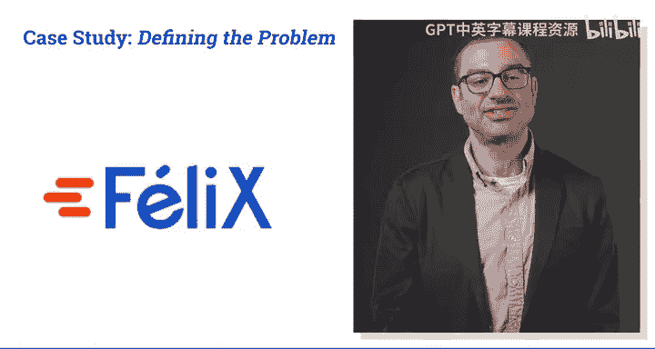
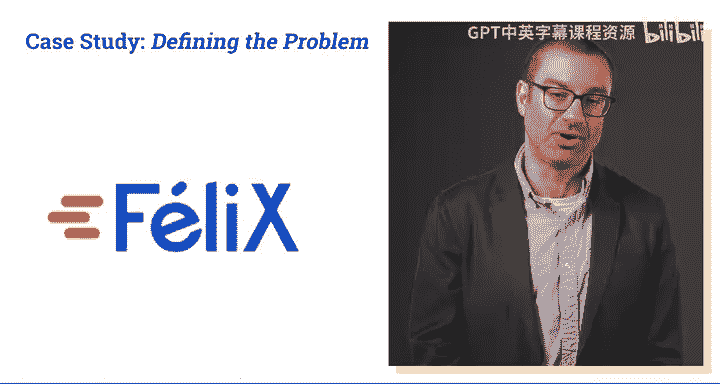
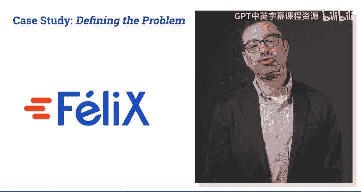
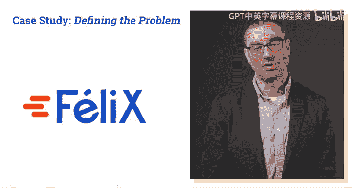
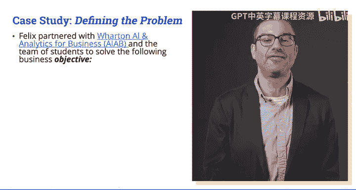
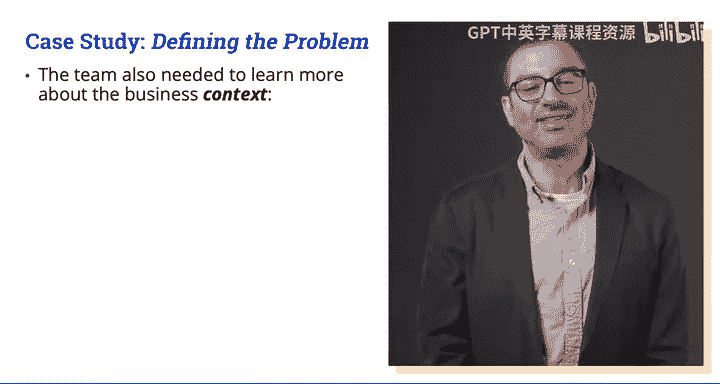

# 课程10：Felix案例研究——问题定义详解 📊

在本节课中，我们将通过一个真实案例，深入探讨数据分析项目的第一步：如何清晰定义业务问题。我们将跟随一支学生数据分析师与数据科学家团队，看他们如何与金融科技公司Felix合作，解决一个实际的商业挑战。

---

## 🌍 案例背景介绍

上一节我们了解了数据分析的一般流程，本节中我们来看看一个具体的实战案例。

Felix是一家技术公司，其使命是让向拉丁美洲的跨境支付变得像在WhatsApp上发送消息一样简单。该公司是一个基于聊天的平台，专门处理从美国向墨西哥的汇款业务。

Felix与AIAB以及学生团队合作，旨在解决以下业务目标：**通过在有欺诈企图之前识别不良行为者，来预测其平台上的欺诈行为。**

---

## 🎯 项目范围与目标

明确了合作方与核心使命后，接下来我们需要界定项目的具体范围。

团队制定了以下项目范围，并明确了需要达成的具体目标：
*   **探索客户交易数据**，识别整体的欺诈趋势。
*   **开发一个新的欺诈检测模型**，该模型能够在交易流程的早期识别欺诈。

对于这个项目，团队深刻理解业务背景至关重要。

---

## 🔍 深入理解业务现状

在着手数据探索和模型构建之前，我们必须充分理解客户当前的运营情况和痛点。

Felix当时已经有一套第三方欺诈检测机制在运行。但是，每次识别出欺诈交易时，公司都会遭受**退单（chargebacks）** 的损失。因此，他们希望开发自己的、新的欺诈检测代理程序，使其更加健壮，从而防止这些退单发生。

此外，团队还需要深入了解Felix当前的欺诈检测模型：
*   当前用于标记欺诈的**特征（features）** 是什么？
*   这些特征在数据集中是否提供？它们能否作为新欺诈检测模型的一部分？
*   当前检测欺诈的**规则**是什么？

---

## 📝 本节总结

本节课中，我们一起学习了Felix案例研究的问题定义阶段。我们了解到，一个成功的数据分析项目始于对业务目标（预测并防止欺诈）、项目范围（探索数据、开发新模型）以及现有业务上下文（现有机制的不足、对退单的关切）的清晰界定。这为后续的数据收集、分析与建模工作奠定了坚实的基础。