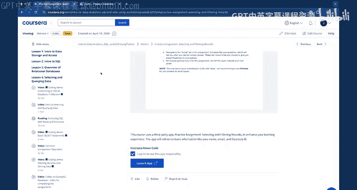
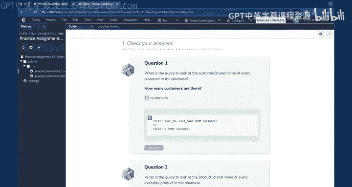

# 课程P11：Codio平台SQL作业实践指南 🗂️

在本节课中，我们将学习如何在Codio平台上完成本课程的SQL实践作业。Codio是一个优秀的在线平台，它提供了预配置的环境，让你可以无缝地运行代码，无论你使用的是Mac、Windows还是Linux系统。

## 概述

我们将逐步介绍如何在Codio中处理不需要Jupyter Notebook的作业。这类作业类似于测验，但需要操作外部软件，如DBeaver和SQLite。以下是完成作业的核心步骤。

## 作业准备

上一节我们介绍了Codio平台的基本情况，本节中我们来看看如何开始一项具体的作业。

你在此处看到的是一项家庭作业，它不要求使用Jupyter Notebook。

请下载本页面上列出的文件，并按照本课程早期提供的PDF说明和编码演示，将这些文件加载到DBeaver中。

以下是开始作业前的准备步骤列表：
*   向下滚动并勾选页面底部的复选框。
*   如果是首次使用，请输入你的法定全名，然后点击“启动应用”。
*   启动过程通常需要20秒到1分钟。如果没有任何反应，请刷新页面。

## 在Codio中操作

成功启动后，你将看到一个包含额外说明的指南页面。页面左侧是一个文件管理器。

如果你不熟悉如何在DBeaver中加载数据库文件，请回顾本课程早期的编码演示。

以下是完成每道题目的操作流程：
*   阅读题目描述。
*   在DBeaver中构思并编写查询语句。
*   将编写好的查询语句复制到Codio中对应的SQL文件里。

请注意，你无法直接在Codio中运行查询。需要滚动到指南页面来检查你的答案。

## 答案检查与提交

为了测试系统，你可以先输入一个错误答案，此时你将看不到任何响应。

现在，输入正确答案并点击“检查”。如果答案正确，你将看到一个显示解决方案的文本框。

请注意，一道题可能存在多种解决方案，我们鼓励你探索不同的解题方法。

当你完成指南页面上的所有问题，并将本地工作空间中的所有查询语句复制粘贴到Codio后，即可将其标记为完成。你的分数将自动同步到Codio和Coursera平台。

## 总结

本节课中，我们一起学习了在Codio平台上完成SQL实践作业的完整流程。关键步骤包括：下载文件并在DBeaver中操作、在Codio中提交查询语句、以及通过指南页面检查和验证答案。记住，将代码从本地环境复制到Codio是必要步骤，并且要善用系统提供的答案反馈来学习多种解决方案。