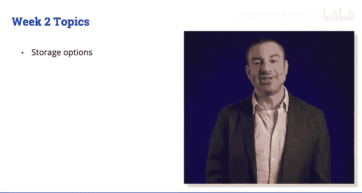
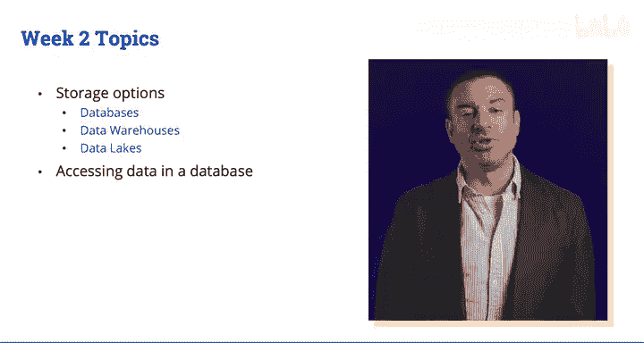
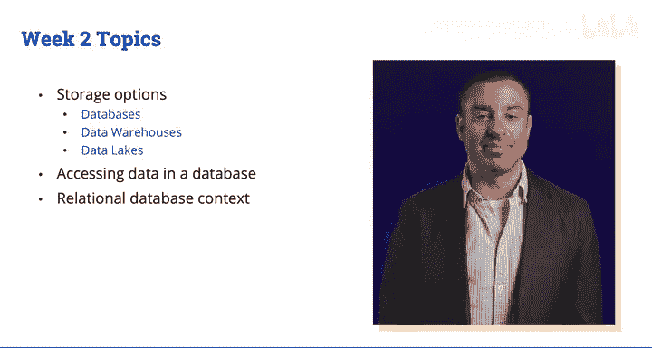
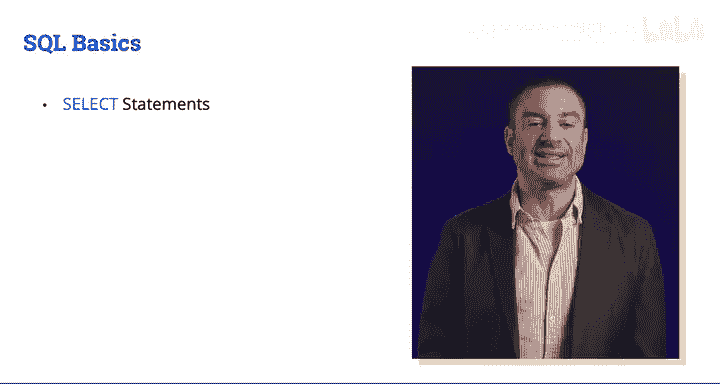
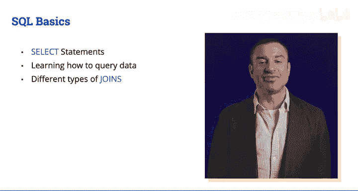

# 课程P12：SQL数据预处理导论 🗃️

在本节课中，我们将学习数据存储与访问的不同方式，并重点介绍如何从数据库中访问数据。我们将了解关系型数据库的背景知识，并深入学习用于访问和更新数据库的查询语言——SQL。

## 数据存储与访问方式概述

有多种方式可以存储和访问数据，它们具有不同的部署策略和存储选项。

以下是几种主要的数据存储系统：

*   数据库
*   数据仓库
*   数据湖

## 本模块学习重点

上一节我们概述了数据存储的几种形式，本节中我们来看看本模块的核心内容。

在本模块中，我们将重点学习如何访问数据库中的数据。我们会先介绍关系型数据库的相关背景，然后深入探讨SQL语言。

SQL是一种用于访问和更新数据库的查询语言。

## 你将学到的SQL技能

了解了本模块的目标后，接下来我们具体看看你将掌握哪些SQL核心技能。

你将学习SQL的基础知识，从SELECT语句开始，掌握如何查询数据库中的数据。

以下是本模块涵盖的关键技能列表：

*   学习不同类型的JOIN操作及其各自的优势。
*   学习如何使用单行（标量）函数以及分组（聚合）函数来操作数据。
*   学习如何创建数据库和表。
*   学习如何插入、更新和删除数据。

## 实践练习安排

为了最大化实践体验，本模块包含了多个简短的SQL练习，确保你能够获得实际的操作能力。

本节课中，我们一起学习了数据存储的多种途径，明确了本模块将专注于从关系型数据库中获取数据，并预览了即将学习的SQL核心技能，包括数据查询、操作以及数据库的基本管理。通过后续的实践练习，你将逐步掌握这些技能。