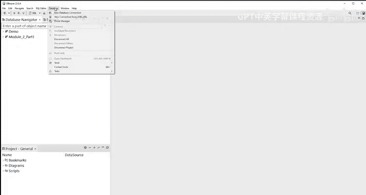
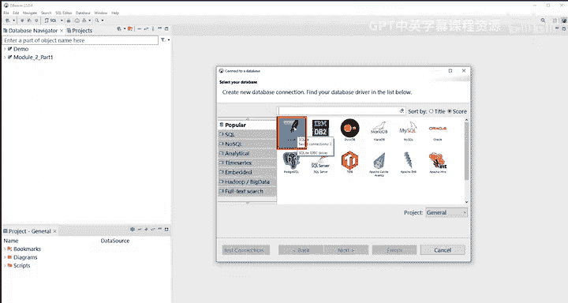
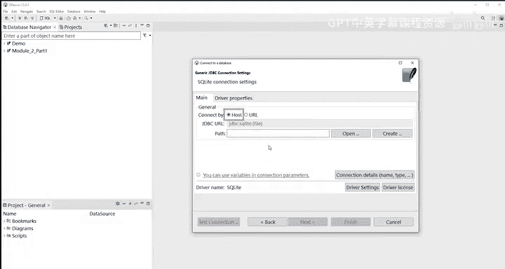
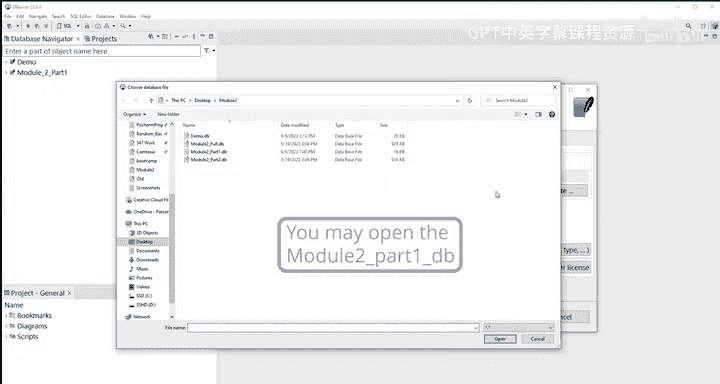
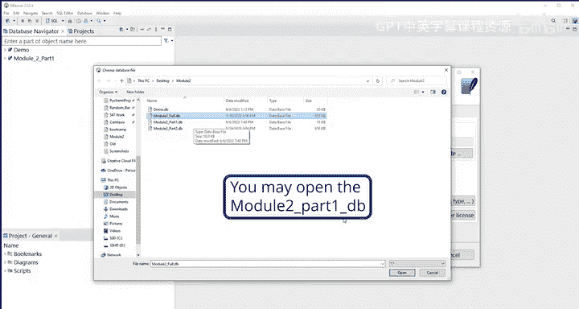
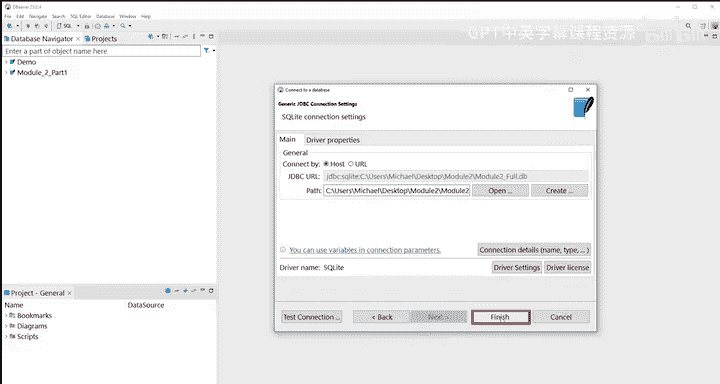
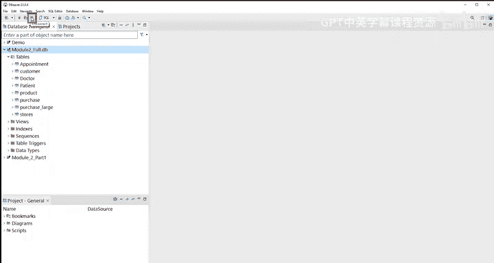

# 课程名称：uPenn《如何运用数据1》第15课：在DBeaver中连接SQLite数据库 🗄️

在本节课中，我们将学习如何使用DBeaver这款数据库管理工具来连接一个SQLite数据库文件。这是一个非常实用的操作，能让你轻松地查看和管理数据库中的内容。

## 概述

DBeaver是一个功能强大的开源数据库工具，支持多种数据库。本节教程将一步步指导你完成连接SQLite数据库的整个过程。

## 连接步骤详解

上一节我们介绍了DBeaver的基本用途，本节中我们来看看具体的连接操作。

首先，启动DBeaver，你需要创建一个新的数据库连接。

以下是创建新连接的具体步骤：
1.  在顶部菜单栏，点击 **“数据库”**。
2.  在下拉菜单中选择 **“新建数据库连接”**。

接下来，在弹出的连接类型选择窗口中，找到并选择SQLite。

3.  在“热门”或“全部”标签页下，找到并点击 **“SQLite”** 图标。
4.  然后，点击窗口右下角的 **“下一步”** 按钮。

现在，我们需要指定数据库文件的位置。这是连接过程中最关键的一步。

5.  在设置页面，点击 **“数据库”** 输入框右侧的 **“…”** 或 **“浏览”** 按钮。
6.  在弹出的文件选择器中，找到并选中你的 `.db` 或 `.sqlite` 数据库文件。
7.  点击 **“打开”**。

完成路径设置后，即可建立连接。

8.  确认文件路径无误后，点击窗口底部的 **“完成”** 按钮。

## 连接成功与浏览

如果一切顺利，你的数据库连接就建立成功了。

新连接的数据库会出现在左侧的 **“数据库导航器”** 面板中。你可以展开它来查看数据库的结构。

例如，要查看其中包含哪些数据表：
*   点击数据库连接名称左侧的 **“+”** 号展开。
*   找到并右键点击 **“表”** 文件夹。
*   选择 **“查看表”** 或直接双击“表”文件夹，右侧主面板就会显示所有数据表的列表。

## 总结

本节课中，我们一起学习了在DBeaver中连接SQLite数据库的完整流程。从创建新连接、选择数据库类型、定位数据库文件到最终成功连接并浏览表结构，每一步都是管理数据库的基础。掌握这个技能后，你就能方便地使用DBeaver来探索和分析SQLite数据库中的数据了。