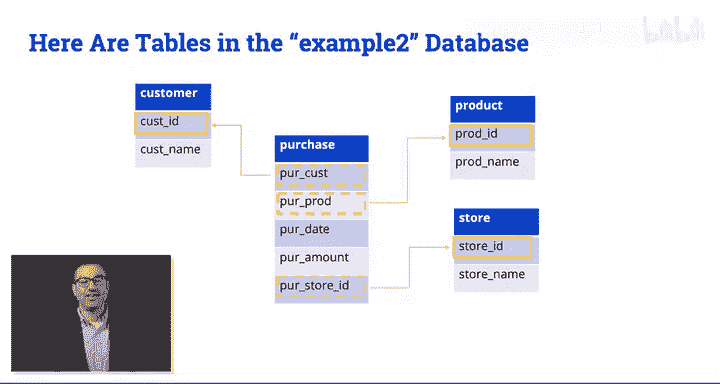

# 课程22：数据库主键与外键示例详解 🔑

在本节课中，我们将通过一个具体示例，深入理解数据库中的两个核心概念：主键与外键。我们将分析一个名为`example2`的数据库结构，并解释各表之间的关系。

## 数据库表结构概述

首先，我们来看一下`example2`数据库中的表。

以下是数据库中的三个核心表及其关键字段：

*   **客户表 (customer table)**：`Cust_I` 是该表的主键。它能唯一标识表中的每一行，即每一位客户。
*   **产品表 (product table)**：`pro_Id` 是该表的主键。它能唯一标识表中的每一行，即每一件产品。
*   **商店表 (store table)**：`store_Id` 是该表的主键。它能唯一标识表中的每一行，即每一家商店。

## 理解外键关系

上一节我们介绍了各个表的主键，本节中我们来看看这些表是如何通过外键联系在一起的。

在记录购买行为的表中，每一次购买都包含了对客户、产品和商店的引用。具体来说，它包含以下字段：

*   `custom_I D`：引用客户表中的`Cust_I`。
*   `prod_I D`：引用产品表中的`pro_Id`。
*   `store_I D`：引用商店表中的`store_Id`。

这些字段被称为**外键**。它们的定义可以概括为：**一个表中的字段，其值指向另一个表中的主键值**。正是通过这些外键，数据库将独立的表连接成一个有意义的整体。

## 可视化关系图

为了更直观地理解表与表之间的关系，请参考以下结构示意图。它清晰地展示了主键如何被其他表的外键所引用。

## 总结

本节课中，我们一起学习了主键与外键在实际数据库中的应用。我们了解到，主键（如 `Cust_I`、`pro_Id`）用于唯一标识本表的记录，而外键（如 `custom_I D`、`prod_I D`）则用于建立表与表之间的关联，确保数据的一致性与完整性。理解这两个概念是进行有效数据管理和分析的基础。