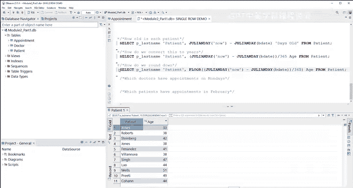

# 课程 P25：SQL 单行函数应用编程演示 🧑‍💻

在本节课中，我们将学习如何在 SQL 查询中应用单行函数。我们将通过几个具体的例子，演示如何使用字符串拼接、条件判断、日期计算和字符串格式化等函数来处理和转换数据，以满足特定的查询需求。

---

## 拼接医生全名与职称

首先，我们希望展示每位医生的全名（包含名、姓和职称）及其专业。

SQLite 数据库不支持 `CONCAT` 函数，但支持使用 `||` 运算符进行字符串拼接。

以下是实现此目标的基本查询：

```sql
SELECT first_name || last_name || title AS doctor_name, specialty AS specialty
FROM doctor;
```

这个查询将医生的名、姓和职称拼接成一个值，并显示其专业。

---

### 处理空值问题

运行上述查询后，你可能会发现结果存在一些问题。例如，第7行医生的拼接名显示为 `SamuelChetonull`，这是因为该医生的 `title` 字段值为 `NULL`。

我们可以使用 `COALESCE` 函数或 `CASE` 表达式来处理 `NULL` 值，将其替换为空字符串。

```sql
SELECT first_name || last_name || COALESCE(title, '') AS doctor_name, specialty AS specialty
FROM doctor;
```

现在，第7行医生的名字显示为 `Samuel Cheto`，后面没有多余的 `null`，因为 `NULL` 已被替换为空字符串。

---

### 优化标题格式

虽然空值问题解决了，但名字和职称之间没有分隔符，阅读起来不够清晰。我们希望在有职称时，名字和职称之间用逗号和空格分隔。

我们可以使用 `IIF` 函数（SQLite 中的条件函数）来实现这个逻辑：

```sql
SELECT
    first_name || last_name ||
    IIF(title IS NULL OR title = '', '', ', ' || title) AS doctor_name,
    specialty AS specialty
FROM doctor;
```

现在，查询结果中，有职称的医生名字后会跟随一个逗号和职称，例如 `Samuel Cheto, MD`。

---

### 规范姓名大小写

最后，我们希望规范医生姓名的大小写格式，确保名和姓的首字母大写，其余字母小写。

我们可以结合使用 `SUBSTR`、`UPPER` 和 `LOWER` 函数来实现：

```sql
SELECT
    UPPER(SUBSTR(first_name, 1, 1)) || LOWER(SUBSTR(first_name, 2)) ||
    UPPER(SUBSTR(last_name, 1, 1)) || LOWER(SUBSTR(last_name, 2)) ||
    IIF(title IS NULL OR title = '', '', ', ' || title) AS doctor_name,
    specialty AS specialty
FROM doctor;
```

运行此查询后，所有医生的姓名都将以首字母大写的形式规范显示。

---

## 计算患者年龄

上一节我们介绍了如何使用字符串函数处理文本数据，本节中我们来看看如何使用日期函数进行计算。

现在，我们希望计算每位患者的年龄。思路是计算当前日期与患者出生日期之间的天数差。

SQLite 的 `JULIANDAY` 函数可以将日期转换为儒略日数，便于进行日期运算。

```sql
SELECT last_name AS patient, JULIANDAY('now') - JULIANDAY(birth_date) AS days_old
FROM patient;
```

此查询会返回每位患者的年龄（以天为单位）。

---

### 将天数转换为年数

要将天数转换为年数，只需将天数除以 365。

```sql
SELECT last_name AS patient, (JULIANDAY('now') - JULIANDAY(birth_date)) / 365 AS age
FROM patient;
```

现在，年龄以带小数的年数形式显示。

---

### 取整为整数年龄

通常，我们更习惯用整数表示年龄。可以使用 `CAST` 函数或 `ROUND` 函数向下取整。

```sql
SELECT last_name AS patient, CAST((JULIANDAY('now') - JULIANDAY(birth_date)) / 365 AS INTEGER) AS age
FROM patient;
```

或者使用 `ROUND` 函数进行四舍五入：

```sql
SELECT last_name AS patient, ROUND((JULIANDAY('now') - JULIANDAY(birth_date)) / 365) AS age
FROM patient;
```

现在，患者的年龄以整数的形式清晰地展示出来。

---

## 基于日期部分的查询

除了计算，日期函数还常用于过滤数据。例如，我们想查询哪些医生在星期一有预约。

这需要从 `appointment` 表中提取预约日期的星期几信息。SQLite 的 `strftime` 函数可以用于提取日期的特定部分。

以下是查询在星期一有预约的医生的步骤：

```sql
SELECT d.last_name, a.appt_date
FROM doctor d
JOIN appointment a ON d.did = a.did
WHERE strftime('%w', a.appt_date) = '1';
```



在 `strftime` 函数中，`%w` 格式符表示星期几，其中 `0` 代表星期日，`1` 代表星期一，依此类推。

---

### 查询特定月份的预约

类似地，我们可以查询在特定月份（例如二月）有预约的患者。

以下是实现方法：

```sql
SELECT p.last_name, a.appt_date
FROM patient p
JOIN appointment a ON p.pid = a.pid
WHERE strftime('%m', a.appt_date) = '02';
```

这里，`strftime('%m', ...)` 用于提取月份，`02` 代表二月。

---

## 总结 📝

本节课中我们一起学习了 SQL 单行函数的多种应用。

我们首先使用字符串拼接运算符 `||` 和 `IIF` 条件函数，组合并格式化了医生的全名与职称，同时处理了空值和大小写规范问题。

接着，我们利用 `JULIANDAY` 日期函数计算了患者的年龄，并通过除法和类型转换将其表示为整数。

最后，我们探索了 `strftime` 函数的强大功能，用它来提取日期的特定部分（如星期几和月份），从而实现了基于时间条件的复杂数据过滤。


掌握这些单行函数，能让你更灵活地处理和转换数据库中的数据，使查询结果更符合实际需求。