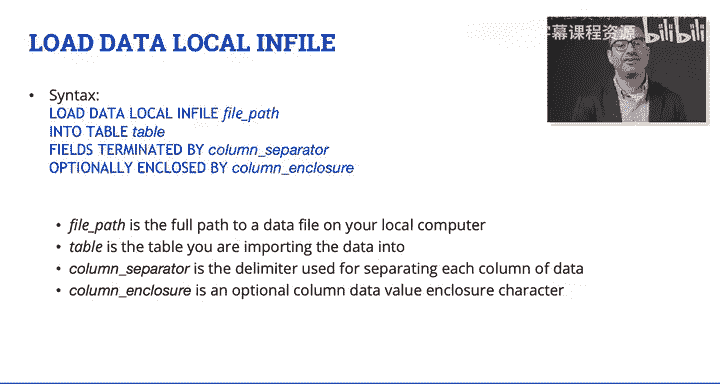
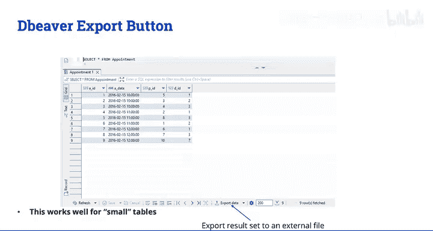

# 课程名称：数据导入与导出 🗃️

## 概述

在本节课中，我们将学习如何将数据从文件导入到数据库表中，以及如何将数据库中的查询结果或表导出到外部文件。这是数据管理中的基础且关键的操作。

---

## 数据导入 📥

上一节我们概述了数据导入导出的重要性，本节中我们来看看如何将本地数据文件导入到数据库表中。一种方法是使用 `LOAD DATA LOCAL INFILE` 语句。

以下是使用该语句导入数据的关键步骤：

1.  **指定数据文件**：使用 `LOAD DATA LOCAL INFILE` 并指定要加载的数据文件。请确保使用本地计算机上文件的完整路径。
2.  **指定目标表**：使用 `INTO TABLE` 来指定要将数据导入的数据库表。
3.  **指定列分隔符**：使用 `FIELDS TERMINATED BY` 来指定列分隔符，即文件中用于分隔每列数据的定界符。
4.  **指定列包围符**：使用 `OPTIONALLY ENCLOSED BY` 来指定列包围符，即文件中可选的数据值包围字符。
5.  **指定行终止符**：使用 `LINES TERMINATED BY` 来指定换行指示符，即数据文件中用于表示新行的字符。
6.  **指定跳过的行数**：使用 `IGNORE` 来指定要跳过的行数，即数据文件中开头部分不加载的行数。例如，你可能希望跳过文件中的标题行。

---

## 数据导出 📤

了解了数据导入后，我们接下来学习数据导出。将结果集或表导出到外部文件的一种方法是使用数据库管理工具（如 DBeaver）中的导出选项，或你偏好的 SQL 开发软件中的类似功能。

请注意，这种方法适用于较小的结果集或表。

对于导出较大的结果集或表，你可以使用 `SELECT INTO OUTFILE` 语句，该语句将结果行写入指定的文件。

请注意，此输出文件必须位于数据库系统有写入权限的目录中。

关于 `SELECT INTO OUTFILE` 的更多信息，请查阅本模块的后续阅读材料。

要从数据库导出数据的其他方法，请查阅你的数据库服务设置的文档。

---

## 总结

本节课中，我们一起学习了两种核心的数据操作。我们掌握了使用 `LOAD DATA LOCAL INFILE` 语句将本地文件数据导入数据库表的方法，也了解了通过数据库管理工具或 `SELECT INTO OUTFILE` 语句将数据从数据库导出到文件的过程。这些是进行数据交换和管理的基础技能。