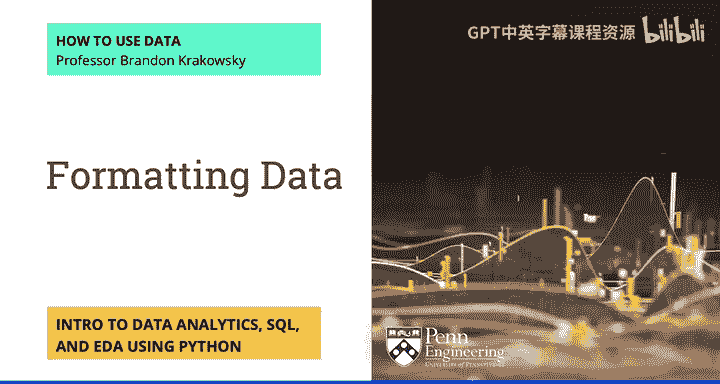
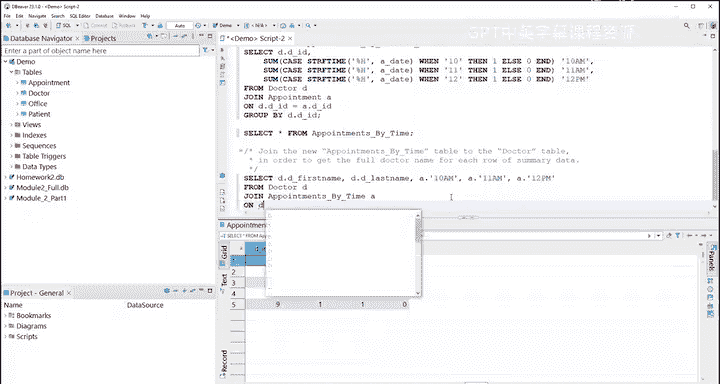

# 课程 P33：数据格式化编程演示 📊



在本节课中，我们将学习如何使用SQL进行数据格式化，具体目标是统计每位医生在每个时间段（如10 AM、11 AM、12 PM）的预约数量，并将结果整理成清晰的交叉表格式。

## 概述与目标

上一节我们介绍了数据查询的基础，本节我们将重点学习如何对查询结果进行**格式化**和**重塑**。我们将通过一个具体案例：统计医生在每个时间段的预约数，并最终生成一个易于阅读的汇总表。

## 核心任务：生成时间段预约交叉表

我们的目标是展示每位医生在每个时间段的预约数量，每个时间段应作为独立的列显示。

以下是实现此目标的主要步骤：

1.  **使用条件聚合查询**：编写SQL查询，利用条件函数（`IIF`或`CASE`）将预约按小时归类到不同的时间段列中。
2.  **创建存储表**：将查询结果持久化存储到一个新表中，方便后续使用。
3.  **关联详细信息**：将汇总数据表与医生表连接，以获取医生的完整姓名。

接下来，我们将详细分解每个步骤。

## 步骤一：使用条件聚合进行查询

我们首先需要从`doctor`表和`appointment`表中提取数据，并按医生分组，计算每个时间段的预约总数。

### 方法A：使用 `IIF` 函数

`IIF`函数是SQLite中的一个条件函数，语法为 `IIF(条件, 为真时的值, 为假时的值)`。

以下是查询语句：

```sql
SELECT
    d.DID AS `Doctor ID`,
    d.LastName AS `Last Name`,
    SUM(IIF(STRFTIME('%H', a.AppointmentDate) = '10', 1, 0)) AS `10 AM`,
    SUM(IIF(STRFTIME('%H', a.AppointmentDate) = '11', 1, 0)) AS `11 AM`,
    SUM(IIF(STRFTIME('%H', a.AppointmentDate) = '12', 1, 0)) AS `12 PM`
FROM doctor d
JOIN appointment a ON d.DID = a.DID
GROUP BY d.DID, d.LastName;
```

**代码解释**：
*   `STRFTIME(‘%H’, a.AppointmentDate)` 用于从预约日期中提取小时数。
*   `IIF(...)` 判断小时数是否等于目标值（如10），如果是则返回1，否则返回0。
*   `SUM(...)` 将所有医生的1（代表有预约）累加起来，得到该时间段的总预约数。

### 方法B：使用 `CASE` 表达式

`CASE`表达式是更标准的SQL条件语句，功能更强大。

以下是等效的查询语句：

```sql
SELECT
    d.DID AS `Doctor ID`,
    d.LastName AS `Last Name`,
    SUM(
        CASE
            WHEN STRFTIME('%H', a.AppointmentDate) = '10' THEN 1
            ELSE 0
        END
    ) AS `10 AM`,
    SUM(
        CASE
            WHEN STRFTIME('%H', a.AppointmentDate) = '11' THEN 1
            ELSE 0
        END
    ) AS `11 AM`,
    SUM(
        CASE
            WHEN STRFTIME('%H', a.AppointmentDate) = '12' THEN 1
            ELSE 0
        END
    ) AS `12 PM`
FROM doctor d
JOIN appointment a ON d.DID = a.DID
GROUP BY d.DID, d.LastName;
```

两种方法执行结果完全相同，都会生成一个显示医生ID、姓氏以及各时间段预约数量的结果集。

## 步骤二：创建永久汇总表

为了后续分析方便，我们可以将上一步的查询结果保存到一个新表中。

首先，创建用于存储结果的新表结构：

```sql
CREATE TABLE appointments_by_time (
    DoctorID INTEGER,
    `10 AM` INTEGER,
    `11 AM` INTEGER,
    `12 PM` INTEGER
);
```

**表结构说明**：
*   `DoctorID`：医生ID，整数类型。
*   `10 AM`, `11 AM`, `12 PM`：均为整数类型，分别存储对应时间段的预约数量。

创建后，可以确认表为空：

```sql
SELECT * FROM appointments_by_time;
```

接下来，使用`INSERT INTO ... SELECT`语句将我们的查询结果插入新表。这里我们选用`CASE`版本的查询：

```sql
INSERT INTO appointments_by_time (DoctorID, `10 AM`, `11 AM`, `12 PM`)
SELECT
    d.DID,
    SUM(CASE WHEN STRFTIME('%H', a.AppointmentDate) = '10' THEN 1 ELSE 0 END),
    SUM(CASE WHEN STRFTIME('%H', a.AppointmentDate) = '11' THEN 1 ELSE 0 END),
    SUM(CASE WHEN STRFTIME('%H', a.AppointmentDate) = '12' THEN 1 ELSE 0 END)
FROM doctor d
JOIN appointment a ON d.DID = a.DID
GROUP BY d.DID;
```

插入完成后，再次查询该表，即可看到每位医生在每个时间段的预约统计：

```sql
SELECT * FROM appointments_by_time;
```

## 步骤三：关联医生详细信息

`appointments_by_time`表只有医生ID。为了生成最终报告，我们通常需要显示医生的姓名。

通过`JOIN`操作将汇总表与`doctor`表连接，即可获取完整信息：

```sql
SELECT
    d.FirstName,
    d.LastName,
    a.`10 AM`,
    a.`11 AM`,
    a.`12 PM`
FROM doctor d
JOIN appointments_by_time a ON d.DID = a.DoctorID;
```

**查询解释**：
*   从`doctor`表（别名`d`）中选择`FirstName`和`LastName`。
*   从`appointments_by_time`表（别名`a`）中选择各时间段的预约数列。
*   通过`d.DID = a.DoctorID`将两表连接起来。



运行此查询，我们将得到一个包含医生全名和分时段预约数量的清晰、完整的汇总视图。

## 总结

本节课我们一起学习了数据格式化的关键技巧。我们掌握了如何使用 **`IIF`** 或 **`CASE`** 表达式配合 **`SUM`** 聚合函数来创建条件计数，从而将行数据转换为列格式的交叉表。接着，我们学习了如何将查询结果保存到新表中以实现数据持久化。最后，通过表连接操作，我们整合了汇总数据与详细维度信息，生成了最终易于理解的报告。这些技能是进行数据汇总、报告生成和进一步分析的基础。