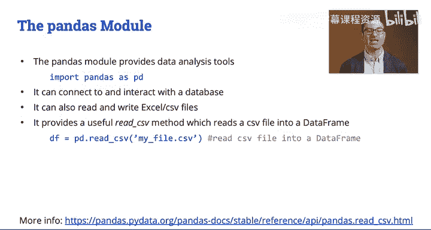
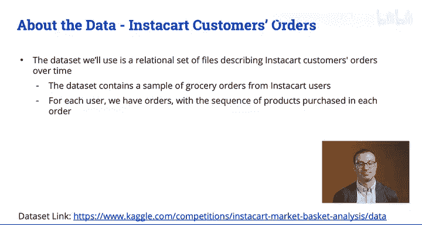
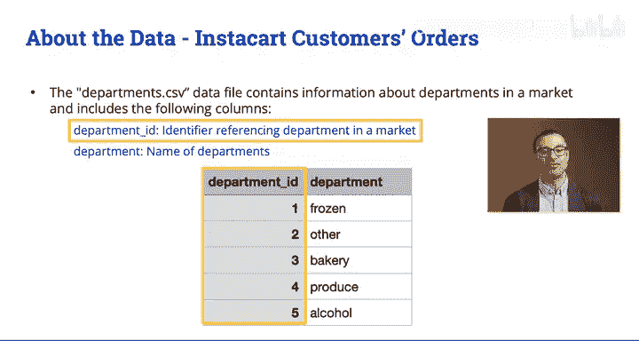
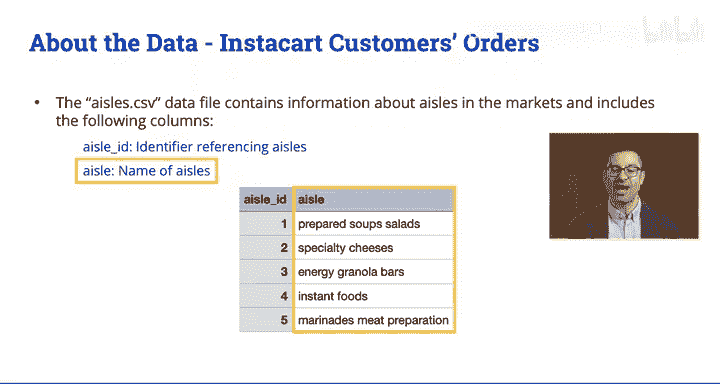
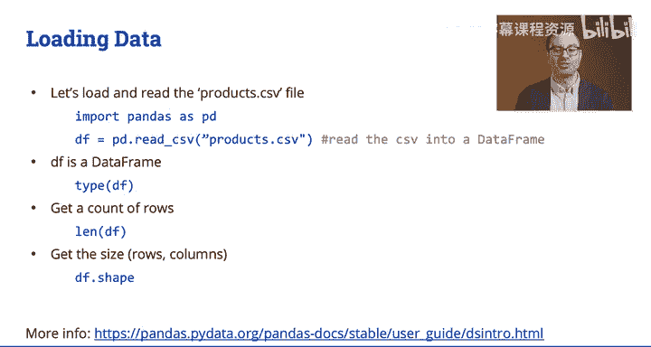
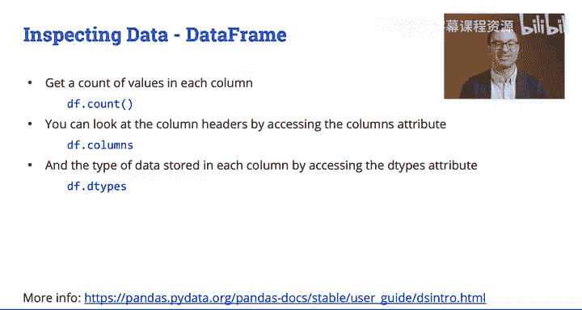
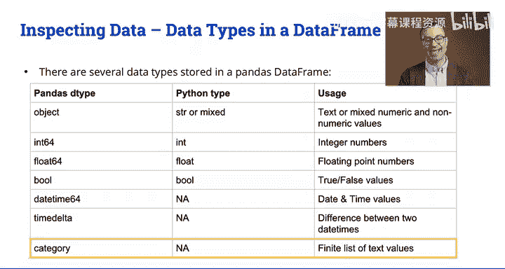
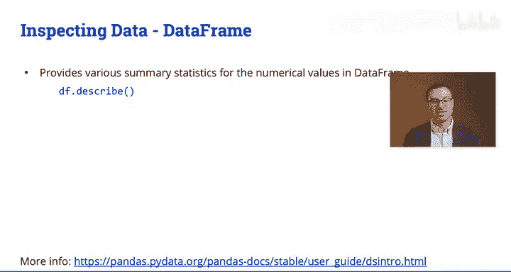
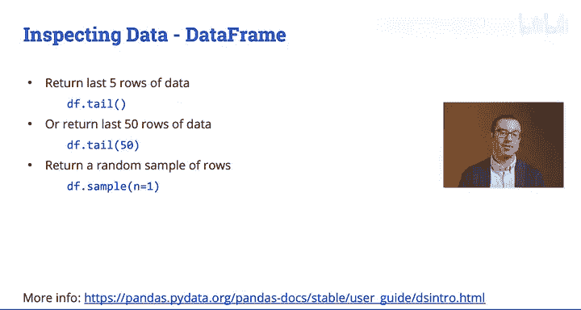

# 课程 35：📊 数据加载、审查与查询

在本节课中，我们将学习如何使用 pandas 模块加载、审查和查询数据。我们将从 CSV 文件中读取数据，并探索数据框的基本属性和方法。

---

## 概述



Pandas 模块提供了多种数据分析工具，它可以连接并与数据库交互，也能读写 Excel 文件和 CSV 文件。导入 Pandas 模块后，我们可以使用 `read_csv` 方法将 CSV 文件读取到一个数据框中。

一个**数据框**是一个二维的、带标签的数据结构。你可以把它想象成一个电子表格或数据库表。

在开始之前，请确认你已经下载了所需的数据文件。我们将使用一个描述 Instacart 用户历史订单的关系型数据集。该数据集包含了 Instacart 用户的杂货订单样本。对于每个用户，我们有订单信息，包括每个订单中购买的产品序列；对于每个订单，我们还有下单的星期几和一天中的小时，以及订单之间的相对时间间隔。

---

## 数据集文件说明

以下是数据集中各个 CSV 文件的说明。



### 产品文件 (`products.csv`)
此文件包含所购产品的信息。
*   `product_id`: 引用单个产品的标识符。
*   `product_name`: 产品名称。
*   `aisle_id`: 引用市场内货道的标识符。
*   `department_id`: 引用产品所属部门的标识符。

### 部门文件 (`departments.csv`)
此文件包含市场内部门的信息。
*   `department_id`: 引用部门的标识符。
*   `department`: 部门名称。

### 货道文件 (`aisles.csv`)
此文件包含市场内货道的信息。
*   `aisle_id`: 引用货道的标识符。
*   `aisle`: 货道名称。

### 订单文件 (`orders.csv`)
此文件包含客户订单的信息。
*   `order_id`: 引用不同订单的标识符。
*   `user_id`: 引用下单用户的标识符。
*   `order_number`: 订单编号。
*   `order_dow`: 订单的星期几。
*   `order_hour_of_day`: 订单的时间（一天中的小时）。
*   `days_since_prior_order`: 距离上次订单的天数。

### 订单产品文件 (`order_products__prior.csv`)
此文件包含每个订单中购买了哪些产品的信息，以及客户之前的订单内容。
*   `order_id`: 引用不同订单的标识符。
*   `product_id`: 引用产品的标识符。
*   `add_to_cart_order`: 订单购物车中商品的顺序 ID。
*   `reordered`: 指示客户以前是否订购过此产品。

---



## 加载与读取数据

现在，让我们加载并读取产品 CSV 数据文件。首先导入 pandas，然后使用 `read_csv` 方法将数据加载到数据框中。

```python
import pandas as pd
df = pd.read_csv('products.csv')
```



我们可以看到 `df` 的类型是一个数据框。

```python
type(df)
# 输出: pandas.core.frame.DataFrame
```

---

## 审查数据框

加载数据后，我们需要了解其基本结构。以下是几种审查数据框的方法。

### 查看数据维度
我们可以获取行数，并通过访问 `shape` 属性来获取数据框的行数和列数。

```python
df.shape
# 输出: (行数, 列数)
```

### 查看列信息
你可以通过访问 `columns` 属性来检查列标题。

```python
df.columns
```

通过访问 `dtypes` 属性，可以获取每列存储的数据类型。

```python
df.dtypes
```

### Pandas 数据类型简介
以下是一个描述数据框中可存储的不同数据类型的实用表格。



*   **`object`**: Python 字符串或混合类型，包含文本或混合的数字与非数字值。
*   **`int64`**: Python `int` 或整数。
*   **`float64`**: Python `float` 或浮点数（小数）。
*   **`bool`**: `True` 或 `False` 值。
*   **`datetime64`**: 包含日期和时间值。
*   **`timedelta`**: 两个日期时间之间的差值。
*   **`category`**: 包含有限的文本值列表。

### 获取数值摘要
`describe` 方法为数据框中的数值提供各种汇总统计信息。



```python
df.describe()
```

---

## 查看数据内容

了解数据结构后，我们来看看具体的数据内容。以下是查看数据的不同方法。

### 查看头部数据
`head` 方法默认显示数据的前五行。如果提供参数，它将显示给定数量的行。

```python
df.head()      # 显示前5行
df.head(50)    # 显示前50行
```



### 查看尾部数据
`tail` 方法默认显示数据的最后五行。如果提供参数，它将显示最后给定数量的行。

```python
df.tail()      # 显示最后5行
df.tail(50)    # 显示最后50行
```



### 查看随机样本
`sample` 方法返回给定数量的随机行。

```python
df.sample(10)  # 随机返回10行
```

### 删除重复行
你可以使用 `drop_duplicates` 方法从数据框中删除重复项。默认情况下，此方法会查看所有列以识别并删除数据中的重复行。

```python
df_deduped = df.drop_duplicates()
```

---

## 总结



在本节课中，我们一起学习了如何使用 pandas 加载 CSV 数据到数据框中。我们介绍了如何审查数据框的基本属性，如形状、列名和数据类型。我们还探索了多种查看数据内容的方法，包括查看头部、尾部、随机样本以及删除重复行。这些是进行数据分析和探索性数据分析（EDA）的基础步骤。