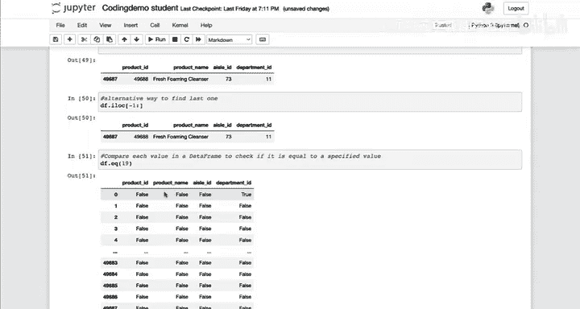

# 课程 37：数据查询编程演示 🧐

在本节课中，我们将学习如何使用Pandas库来查询数据。我们将从查看一个包含所有产品的数据框开始，并逐步探索多种基于索引选择数据行的方法，以及如何比较数据框中的值。


---

## 查看数据框

我们从一个包含所有产品的数据框开始。首先，让我们查看它的前几行。

以下是数据框的前五行。第一列是自动为每一行分配的索引。

索引从0开始。

---

## 基于索引选择数据行

Pandas提供了多种基于索引获取数据行切片的方法。

让我们查看数据框中列出的第100到200行。

我们可以使用 `iloc` 函数，在方括号内使用冒号来获取行的切片。

我们需要指定想要选择的索引范围。我们将输入 `100:200`。

Pandas中范围的规则与Python中的规则相同：左边的索引包含在内，右边的索引不包含在内。

```python
# 使用 iloc 选择第100到199行（索引从0开始）
df.iloc[100:200]
```

这是另一种实现方式。我们可以直接对数据框使用方括号，并提供一个索引范围来获取行的切片。

```python
# 直接使用方括号选择行
df[100:200]
```

同样，这显示了数据框中的第二组一百行。

---

## 获取最后一行数据

现在，让我们获取数据中列出的最后一个产品的名称。

为此，我们需要获取数据框中的最后一个索引。

我们可以通过数据框的长度减1来计算最后一个索引。

我们将创建一个变量 `last_index`，并将其设置为数据框的长度减1。

```python
# 计算最后一个索引
last_index = len(df) - 1
```

然后，我们创建另一个变量 `last_product`，将其设置为数据框 `iloc` 的切片，索引范围从 `last_index` 到数据框的末尾。

```python
# 选择最后一行
last_product = df.iloc[last_index:]
```

这给了我们一个单行数据框，然后我们显示这一行。结果显示为“Fresh foaming cleanser”。

---

## 使用负索引的简便方法

这里有另一个非常简单的方法来实现同样的效果。使用 `iloc` 函数，你可以指定 `-1` 到数据框的末尾。

`-1` 是指示数据框中最后一个索引的另一种方式。

```python
# 使用负索引选择最后一行
last_product = df.iloc[-1:]
```

同样，我们得到了一个包含单行的切片，即“Fresh foaming cleanser”。

---

## 比较数据框中的值

我们可以使用 `eq` 函数来比较数据框中的每个值，看它是否等于指定的值。

例如，如果我想检查数据框中等于19的值，我可以直接应用 `eq` 函数并提供一个参数19。

```python
# 检查哪些值等于19
df.eq(19)
```

这将显示整个数据框。对于任何等于19的特定值，它显示为 `True`，否则显示为 `False`。

---

## 总结



在本节课中，我们一起学习了如何使用Pandas进行数据查询。我们探讨了如何查看数据框、基于索引选择特定的数据行（包括使用正索引和负索引），以及如何使用 `eq` 函数比较数据框中的值。这些基本操作是进行有效数据分析的重要步骤。