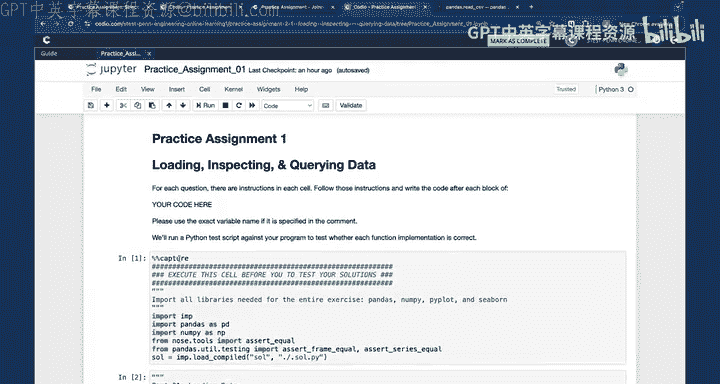

# 课程 P38：Codio平台Jupyter Notebook作业指南 📘


在本节课中，我们将学习如何在Codio平台上使用Jupyter Notebook完成课程作业。Codio是一个优秀的在线平台，它为你提供了预配置的环境，让你能在Mac、Windows或Linux系统上无缝运行代码。

## 概述

我们将逐步介绍从打开作业到最终提交的完整流程，包括如何运行代码、排查常见错误以及确保作业正确完成。

## 启动作业环境

首先，你会看到一个需要Jupyter Notebook的作业页面。

你可以选择跟随本页的Jupyter Notebook指引，或者向下滚动，按照提供的PDF文件中的详细作业说明进行操作。

以下是启动环境的步骤：
1.  向下滚动至页面底部。
2.  勾选确认框。
3.  如果是首次使用，请输入你的法定姓名。
4.  点击“启动应用”按钮。


环境设置通常需要20秒到1分钟。如果页面没有反应，请尝试刷新。

启动后，你将看到一个包含额外说明的引导页面。请从该页面打开Jupyter Notebook。

## 在Notebook中工作

Codio环境已为你预先配置好。

要运行第一个代码单元，请按 `Shift + Enter`（在Mac上是 `Shift + Return`）。这个操作会导入整个练习所需的所有库以及参考答案。

问题已按步骤列出。请仔细遵循，在标有“你的代码在这里”的地方编写代码来回答问题。

请按顺序执行每个代码单元。测试单元会将你的变量与环境存储的答案变量进行比较。按 `Shift + Enter` 来验证你的变量，你将在单元格下方看到每个测试的结果。

## 故障排除与调试

上一节我们介绍了如何运行代码，本节中我们来看看如何处理一些常见问题。

### 文件路径错误

加载数据文件时，一个常见错误是文件路径不正确，这会导致“文件未找到”错误。

错误示例如下：
```python
FileNotFoundError: [Errno 2] No such file or directory: 'wrong_path/data.csv'
```
代码编辑器中会高亮显示引发错误的那行代码。

修复方法是更正代码中的文件路径。例如，将路径改为正确的：
```python
df = pd.read_csv('correct_path/data.csv')
```
修正后重新运行单元格，错误便会消失。

### 逻辑错误

如果你的代码能运行但返回错误结果，请将你的逻辑与项目要求进行对比。仔细检查变量和计算以确保准确性。

例如，假设我们将错误的数据信息存储到了变量中：
```python
# 错误：获取了错误DataFrame的长度
num_restaurants = len(restaurant_except_df)

# 正确：应获取目标DataFrame的长度
num_restaurants = len(restaurant_location_df)
```
运行这类代码时可能不会报错，但后续的测试会失败，并显示断言错误，指出你的变量与答案不匹配。

修复逻辑后重新运行测试，即可通过。

### 查阅文档

遇到不熟悉的函数时，可以利用官方文档（如Pandas文档）来理解函数参数。例如，对于 `read_csv` 函数，你可以查阅其具体用法。

## 提交前的检查

在提交作业之前，请重置内核并按顺序运行所有单元格。在Jupyter Notebook中，选择 `Kernel` -> `Restart & Run All`。

验证你的Notebook。如果所有测试都通过，即可将作业标记为完成。

## 总结

本节课中我们一起学习了在Codio平台使用Jupyter Notebook完成作业的完整流程。我们涵盖了从启动环境、编写和运行代码，到调试常见错误以及最终验证提交的各个环节。遵循这些步骤，你将能顺利在Codio和Jupyter Notebook中完成作业。如果遇到挑战，请回顾本指南或查阅课程资料。



祝你编程愉快，好运！