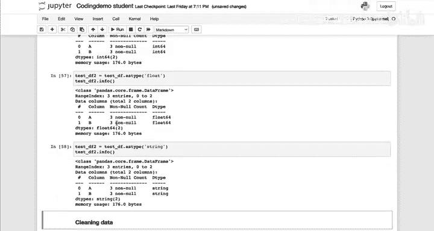

# 课程39：数据类型转换 🧱


在本节课中，我们将学习如何使用Pandas库进行数据类型转换。数据框中的列有时会存储为不理想的数据类型，例如通用的“对象”类型。通过转换数据类型，我们可以让数据更适合进行数学计算或其他分析操作。

## 数据类型转换基础

上一节我们介绍了数据框的基本结构，本节中我们来看看如何改变其中列的数据类型。Pandas数据框可以存储多种数据类型。有时，特定列中的值类型并非我们预期或所需。

例如，观察我们创建的名为`technologies`的数据框，可以看到列A和列B的数据类型是通用的“对象”类型。我们可以将这些列转换为其他类型。

## 使用`astype()`函数进行转换

一种转换数据类型的方法是使用`astype()`函数。以下是具体操作步骤。

首先，我们将数据框中的所有值从“对象”类型转换为整数类型。

```python
technologies = technologies.astype(int)
```

运行此代码后，检查列A和列B的数据类型，可以看到它们现在的数据类型是`int64`。如果我们需要对这些列中的值进行数学计算，这种转换会非常有用。

## 转换为其他数据类型

如果我们想转换为其他数据类型，例如浮点数，同样可以使用`astype()`函数。

```python
technologies = technologies.astype(float)
```

现在，列A和列B的数据类型显示为`float64`。

字符串类型也是可接受的转换目标。以下是将数据框中的值转换为字符串的示例。

```python
technologies = technologies.astype(str)
```

转换后，列A和列B的数据类型变为`string`。

## 总结



本节课中我们一起学习了Pandas中数据类型转换的核心方法。我们了解到，使用`astype()`函数可以轻松地将数据框中的列从一种类型（如通用的“对象”类型）转换为更具体的类型，如整数(`int`)、浮点数(`float`)或字符串(`str`)。这为后续的数据分析和计算奠定了正确的基础。