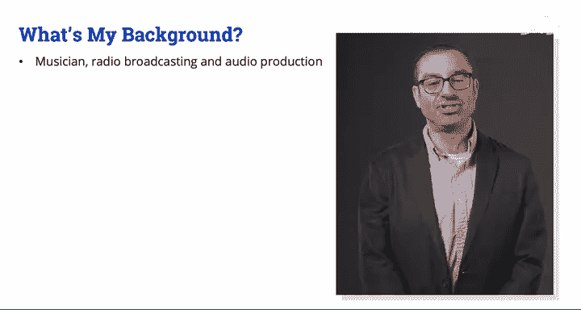
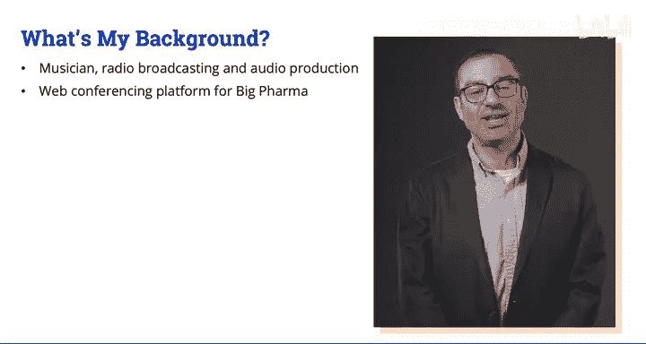
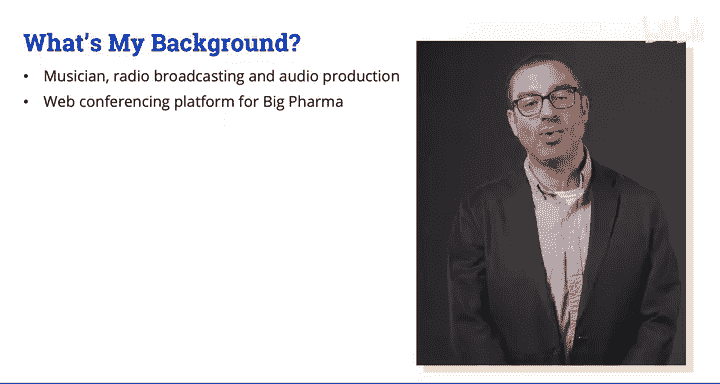
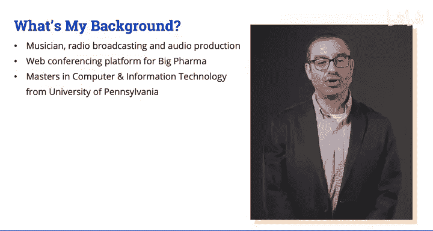
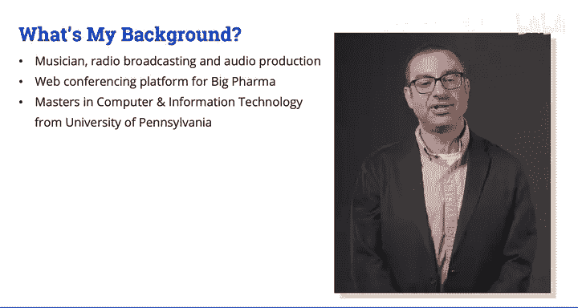

# 课程P3：讲师简介 🧑‍🏫

在本节课中，我们将了解本课程讲师的背景与经历，并明确本课程的目标受众。

---

我的名字是布兰登·克劳斯基，我是这门“如何运用数据”课程的讲师。

关于我的背景：我最初是一名音乐家，随后在广播和音频制作领域工作。

我的编程经验始于Adobe Flash，我曾使用该工具为大型制药公司开发一个实时网络会议平台。

我于2009年左右从宾夕法尼亚大学获得了计算机与信息技术硕士学位。

之后，我在宾夕法尼亚大学设计学院担任程序员。

随后，我在沃顿商学院计算部门担任应用开发人员，与教职员工合作开发技术以推进学生项目。

在此期间，我创立了自己的公司Bleak LLC，为各类公司提供编程和自由职业应用开发服务。

我后来转型进入数据与分析领域，并成为“商业人工智能与分析”部门的研究与教育主任。

2018年，我成为宾夕法尼亚大学工程学院的讲师。

关于我的更多信息：我是一名贝斯手，演奏贝斯多年。我演奏多种风格的音乐，但更偏爱放克风格的音乐。

我最近大幅减少了咖啡摄入，并学会了花更多时间冥想。

最重要的是，我是一个重视家庭的人。

---

本课程面向对数据、数据分析或数据工作几乎没有或完全没有先验知识或经验的学生和专业人士。

虽然本课程要求具备编程经验，但它不要求任何数据分析、数据科学或数据可视化的背景。

总的来说，本课程非常适合那些希望学习数据运作机制、通过执行数据分析获取洞察、应用数据科学技术进行预测，以及应用数据分析来解答问题和解决有趣商业问题的人士。

---

本节课中，我们一起了解了讲师的多元化背景——从音乐、编程到数据科学，并明确了本课程是为具备基础编程能力、但希望入门数据分析领域的初学者所设计的。