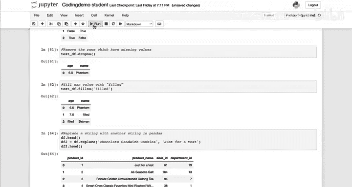

# 课程P40：数据清洗编程演示 🧹


在本节课中，我们将学习数据清洗的核心环节：检测与处理数据框中的缺失值。我们将通过具体的Python代码示例，演示如何识别、删除或填充缺失值，以及如何替换数据框中的特定值。

## 检测缺失值

上一节我们提到了数据清洗的重要性，本节中我们来看看如何具体检测数据中的缺失值。在Pandas中，缺失值通常以`NaN`（Not a Number）或`None`的形式存在。

假设我们有以下包含缺失值的数据框`test_df`：

```python
import pandas as pd
import numpy as np

data = {
    'name': ['Alice', None, 'Charlie'],
    'age': [25, 30, np.nan]
}
test_df = pd.DataFrame(data)
print(test_df)
```

输出结果中，`name`列的第二行和`age`列的第三行即为缺失值。

我们可以使用`.isna()`方法来检测这些缺失值。该方法会返回一个布尔值数据框，其中`True`表示该位置是缺失值。

```python
missing_mask = test_df.isna()
print(missing_mask)
```

执行上述代码后，你会看到一个布尔矩阵，清晰地标出了每个单元格是否为缺失值。

## 处理缺失值：删除

检测到缺失值后，常见的处理方式之一是直接删除包含缺失值的行。Pandas提供了`.dropna()`方法来实现这一操作。

以下是使用`.dropna()`方法的示例：

```python
cleaned_df = test_df.dropna()
print(cleaned_df)
```

运行后，原始数据框中第二行和第三行（因为包含缺失值）会被删除，只保留完整的行。

## 处理缺失值：填充

有时我们并不希望直接删除数据，而是想用其他值来填充缺失的部分。这时可以使用`.fillna()`方法。

例如，我们可以用字符串“filled”来填充所有缺失值：

```python
filled_df = test_df.fillna('filled')
print(filled_df)
```

现在，所有原本是`NaN`或`None`的位置都被替换成了“filled”。

## 替换特定值

除了处理缺失值，数据清洗还经常涉及替换数据框中某些特定的值。我们可以使用`.replace()`方法。

让我们回到之前使用过的产品数据框示例。假设我们想将第一行中产品名“chocolate sandwich cookies”替换为其他名称。

首先，查看原始数据：

```python
# 假设df是已有的产品数据框
print(df.head())
```

然后，使用`.replace()`方法进行替换：

```python
df2 = df.replace('chocolate sandwich cookies', 'just for a test')
print(df2.head())
```

执行后，你会发现目标产品名称已被成功替换。

## 总结



本节课中我们一起学习了数据清洗的几个关键操作。我们首先介绍了如何使用`.isna()`检测缺失值，然后探讨了两种处理方式：用`.dropna()`删除缺失行，或用`.fillna()`填充缺失值。最后，我们还学习了如何使用`.replace()`方法替换数据框中的特定值。掌握这些方法是进行有效数据分析的重要基础。