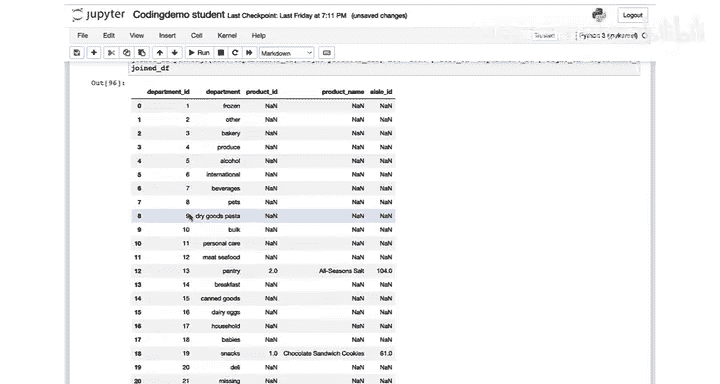

# 课程 42：数据连接编程演示 🧩


在本节课中，我们将学习如何使用Python的pandas库来连接（Join）不同的数据集。数据连接是数据分析中的核心操作，它允许我们基于共同的列将多个表格的信息合并在一起。

## 概述

我们将演示如何连接四个相互关联的表格：`products`（产品）、`aisles`（通道）、`departments`（部门）和`orders`（订单）。本节重点展示`products`和`departments`表的连接过程。

## 查看数据

首先，我们快速查看`products`（产品）和`departments`（部门）这两个数据框。

`products`数据框包含四列，`departments`数据框包含两列。我们可以观察到两个数据框都包含一个名为`department_id`的列。我们将使用此列作为连接两个数据框的索引。

## 执行内连接（Inner Join）

在声明一个新的数据框后，我们将调用pandas库中的`merge`函数。

以下是连接操作的代码：
```python
joined_df = pd.merge(left=products_df,
                     right=departments_df,
                     how='inner',
                     left_on='department_id',
                     right_on='department_id')
```

我们指定`products_df`为左表，`departments_df`为右表。我们使用内连接方式，并指定左右两表的连接键均为`department_id`列。运行合并后，连接操作将匹配这两列中的值。

一旦运行`merge`，我们显示连接后的数据框。对于每个产品，我们都能看到其对应的详细部门信息。由于我们使用了内连接，结果中只包含`products`数据框里那些在`departments`数据框中有匹配部门的记录。

## 执行左连接（Left Join）

现在，让我们重新运行合并操作，但将`how`参数改为左连接，看看会发生什么。

以下是左连接的代码：
```python
joined_df_left = pd.merge(left=products_df,
                          right=departments_df,
                          how='left',
                          left_on='department_id',
                          right_on='department_id')
```

运行此代码后，可以看到结果遵循左表（`products_df`）的顺序，并保留了左表的所有产品记录，然后将右表（`departments_df`）中任何匹配的部门信息合并进来。

## 左连接与内连接的区别

有时，左连接和内连接会返回相同的合并信息。但假设我们遇到一种特殊情况：左表中只有两个产品。

让我们看看在这种情况下使用左连接会发生什么。为此，我们从`products`数据框中选取前两个产品，存储到`products_df2`中。

首先，演示用内连接将部门信息与这两个产品合并。

以下是针对子集的内连接代码：
```python
joined_df_inner_subset = pd.merge(left=departments_df,
                                  right=products_df2,
                                  how='inner',
                                  left_on='department_id',
                                  right_on='department_id')
```

运行并显示连接后的数据框，结果中只包含左表`departments`数据框里那些在右表`products_df2`中有匹配产品信息的部门。

接下来，使用左连接将部门信息与这两个产品合并。我们复制上面的代码，但将`how`参数改为`'left'`。

以下是针对子集的左连接代码：
```python
joined_df_left_subset = pd.merge(left=departments_df,
                                 right=products_df2,
                                 how='left',
                                 left_on='department_id',
                                 right_on='department_id')
```

运行此代码并显示连接后的数据框。现在，我们可以看到左表`departments`数据框中的所有信息，以及右表`products_df2`中的任何信息。对于左表中那些在右表没有匹配产品的部门，我们会看到空值（null）或`NaN`值。这是因为我们执行了左连接，并且部门数据框在左侧，所以它保留或“保持”了该数据框中的所有行。

## 总结



本节课中，我们一起学习了数据连接的基本操作。我们演示了如何使用pandas的`merge`函数执行内连接和左连接，理解了它们之间的关键区别：内连接只返回两个表中键值匹配的行，而左连接会返回左表的所有行，无论它们在右表中是否有匹配项，无匹配的位置会用`NaN`填充。这是整合来自不同来源数据的重要工具。