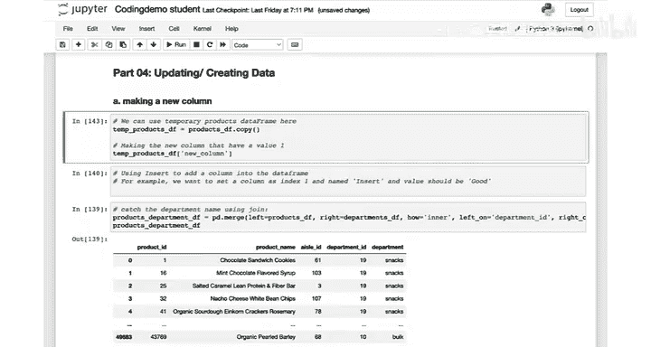
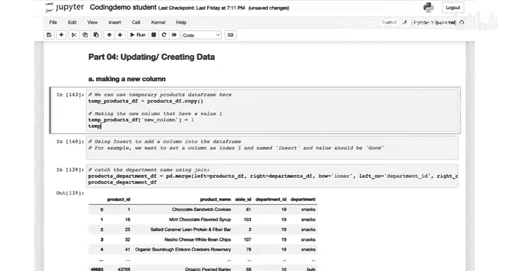
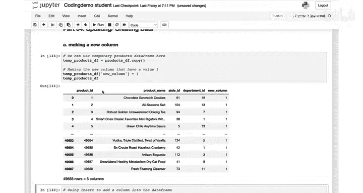
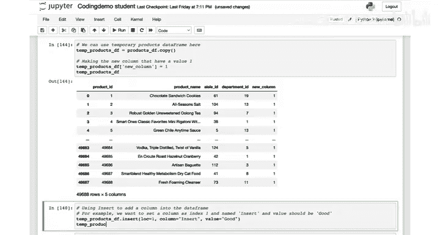
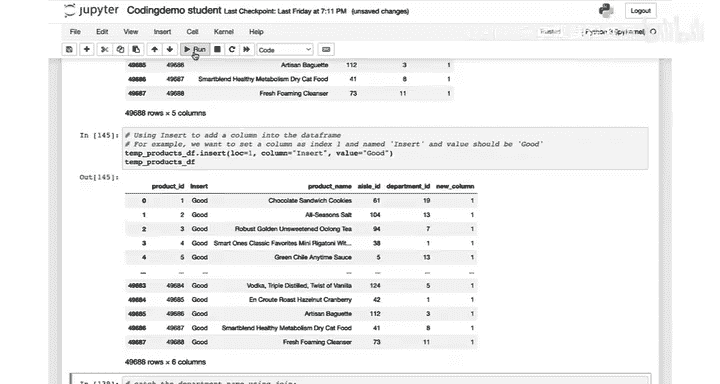
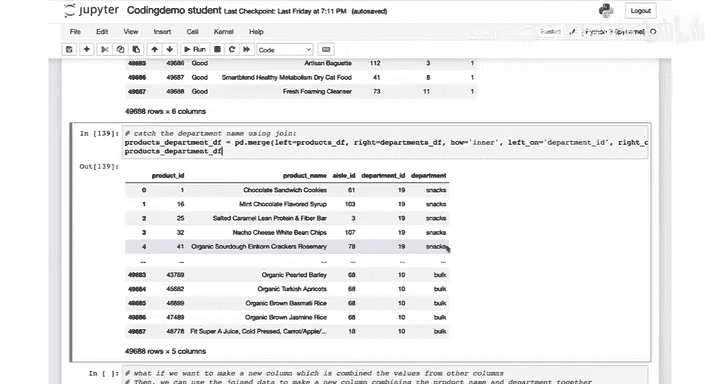
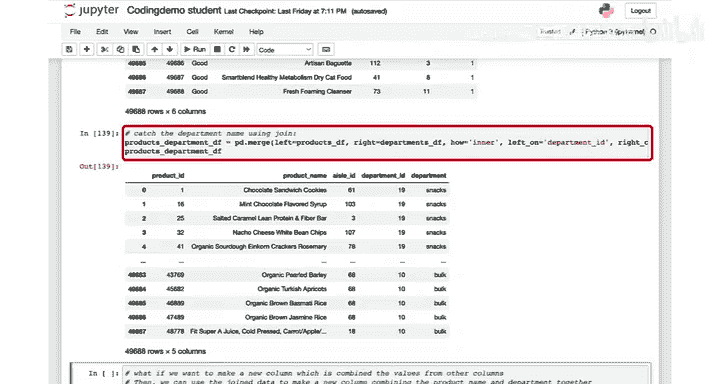
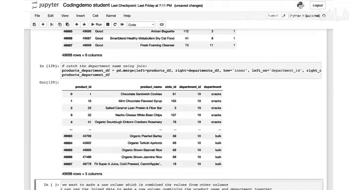
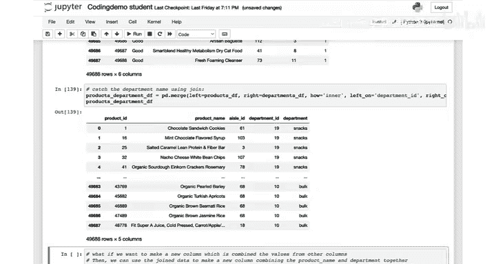

# 课程名称：uPenn《如何运用数据1》 - P47：数据更新与创建 🛠️

在本节课中，我们将学习如何在Pandas数据框架中更新和创建数据。具体来说，我们将掌握三种创建新列的方法：直接赋值、使用`insert`函数在指定位置插入列，以及基于现有列的值进行计算来创建新列。

---

## 创建新列：直接赋值法

上一节我们介绍了课程概述，本节中我们来看看第一种创建新列的方法——直接赋值。



假设我们有一个名为`Temp_Products_DF`的数据框架，它是从`Product_DF`复制而来。我们可以通过直接指定一个新列名并为其赋值来创建列。

```python
Temp_Products_DF[‘new_column’] = 1
```



以上代码意味着新列`new_column`中的每一行都将被赋值为1。



如果显示该数据框架，可以看到新列`new_column`中每一行的值都是1。

---

## 创建新列：使用`insert`函数

在学习了直接赋值法后，我们来看看第二种方法。`insert`函数允许我们在数据框架的特定位置插入新列。

以下是如何使用`insert`函数在索引位置1（即第二列）插入一个新列的示例：



```python
Temp_Products_DF.insert(1, ‘insert_column’, ‘good’)
```

在这行代码中，我们指定了列的位置（索引1）、新列的名称（‘insert_column’）以及该列每一行的值（‘good’）。

如果现在显示`Temp_Products_DF`，可以看到名为`insert_column`的新列被添加到了`product_id`列的右侧（因为我们使用了索引1），并且该列每一行的值都是‘good’。



---

## 创建新列：基于现有列计算



在掌握了前两种方法后，本节我们将学习如何通过组合现有列的值来创建新列。这是一种非常实用的数据操作技巧。

假设我们有一个名为`Products_department_DF`的数据框架，它是由`Product_DF`和`Departments_DF`合并而成的。



我们希望创建一个新列，其值是`product_name`列和`department`列值的组合，中间用逗号分隔。

以下是实现此操作的代码：

```python
Products_department_DF[‘new_name’] = Products_department_DF[‘product_name’] + ‘, ‘ + Products_department_DF[‘department’]
```

如果显示该数据框架，可以看到新增的`new_name`列。该列中每一行的值都是对应行的产品名称和部门名称，中间以逗号连接。



---

## 课程总结

本节课中，我们一起学习了在Pandas数据框架中创建新列的三种核心方法：
1.  **直接赋值法**：通过`df[‘new_column’] = value`快速创建具有统一值的列。
2.  **`insert`函数法**：使用`df.insert(loc, column, value)`在指定位置插入新列。
3.  **基于计算创建**：通过对现有列进行运算（如字符串拼接）来生成新列的值。



掌握这些数据更新与创建的基本操作，是进行有效数据分析和处理的重要一步。