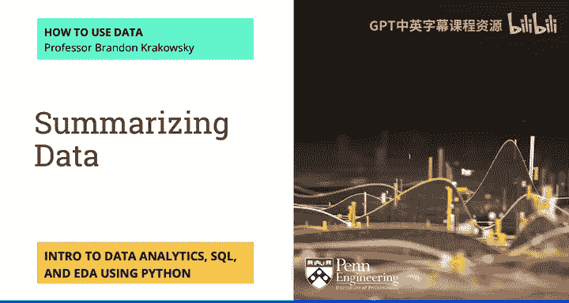
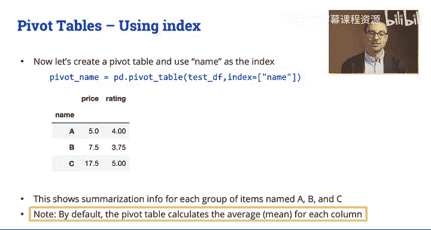

# 课程名称：uPenn《如何运用数据1》第48课 - 数据汇总 📊



在本节课中，我们将学习如何使用Pandas进行数据汇总，包括分组、聚合计算以及创建数据透视表。这些是数据分析中整理和理解数据的关键技术。

## 分组操作（Group By） 🔍

上一节我们介绍了数据的基本结构，本节中我们来看看如何对数据进行分组。`groupby`方法可以根据您选择的变量将数据拆分为不同的组。这个过程与SQL中的`GROUP BY`语句类似。

`groupby`方法返回一个`groupby`对象，该对象提供了一个字典，其键是计算出的唯一分组，对应的值是该组的数据。例如，当我们按“通道”分组时，键将是所有可能的通道名称。

我们可以使用`get_group`属性来获取特定组的记录。例如，查询“特色奶酪”通道中有多少产品。

然而，这类信息本身并不十分有用。我们真正需要的是能够对每个组内的数据执行聚合计算。

## 聚合计算与NumPy 🧮

为了进行聚合计算，我们首先需要了解NumPy。NumPy是一个流行的Python科学计算库，常用于处理数组和矩阵，并包含大量用于操作这些数组的高级数学方法。

以下是NumPy的一些基本操作：

*   **创建数组**：NumPy的`array`方法可以创建数组。
    ```python
    import numpy as np
    # 创建一维数组
    arr_1d = np.array([1, 2, 3, 4, 5])
    # 创建二维数组
    arr_2d = np.array([[1, 2, 3], [4, 5, 6]])
    ```
*   **查看形状**：`shape`方法返回给定数组的形状。
    ```python
    print(arr_2d.shape)  # 输出：(2, 3)
    ```

## 对分组数据应用聚合计算 ⚙️

现在，让我们结合分组和NumPy进行聚合计算。`agg`方法允许我们对`groupby`对象中的分组数据执行聚合计算。

您可以传递一个聚合函数列表作为参数。为了演示，我们首先创建一个包含五行三列数据的数据框。

以下是具体步骤：
1.  导入NumPy。
2.  按“名称”列对数据进行分组并调用`agg`方法。
3.  将NumPy的`sum`、`mean`和`std`方法作为参数传入。
4.  最后，显示将这些聚合计算应用于“价格”属性的结果。

示例代码如下：
```python
import pandas as pd
import numpy as np

# 假设df是已存在的DataFrame，包含‘name’和‘price’列
grouped = df.groupby('name')['price']
result = grouped.agg([np.sum, np.mean, np.std])
print(result)
```

## 数据透视表（Pivot Table） 📈

数据透视表是一种有用的数据汇总工具，它可以根据数据框的内容创建一个新表格。

为了创建数据透视表，我们至少需要一个索引列来进行分组。这个索引类似于`groupby`方法中用于分组的变量。数据透视表将沿着该索引提供有用的汇总信息，例如求和或平均值。

再次，我们首先创建一个包含五行三列数据的数据框。

现在，让我们创建一个数据透视表，并使用“名称”作为索引。请注意，默认情况下，数据透视表会计算每列的平均值。

示例代码如下：
```python
# 假设df是已存在的DataFrame
pivot_table = df.pivot_table(index='name', values='price', aggfunc=np.mean)
print(pivot_table)
```

## 总结 📝




本节课中我们一起学习了数据汇总的核心技术。我们首先使用`groupby`方法对数据进行分组，然后利用NumPy库和`agg`方法对分组后的数据执行求和、平均值和标准差等聚合计算。最后，我们介绍了如何创建数据透视表，这是一种强大的工具，可以按照指定的索引对数据进行多维度的汇总分析。掌握这些方法将帮助您更高效地从数据中提取洞察。