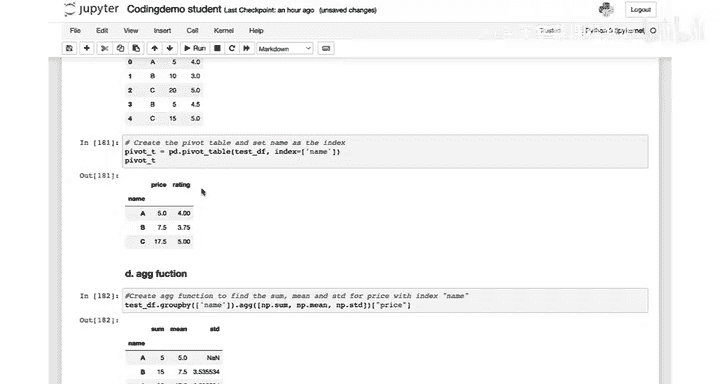

# 课程 P49：数据汇总编程演示 📊


在本节课中，我们将学习如何使用Python的Pandas和NumPy库对数据进行汇总。我们将重点介绍`groupby`函数、NumPy数组的基本操作、数据透视表的创建以及聚合函数`agg`的使用。

---

## 使用Group By汇总数据

上一节我们介绍了数据汇总的概念，本节中我们来看看如何使用`groupby`函数对数据进行分组和汇总。

让我们根据`aisle_id`对产品数据进行分组，分组键将是所有的通道ID。

```python
# 对产品数据框按aisle_id进行分组
grouped = product_df.groupby('aisle_id')
# 获取所有分组键
keys = grouped.groups.keys()
```

我们可以使用`groups`属性来获取特定组的记录。

如果我们想回答“通道19中有多少产品？”这个问题，可以这样做：

```python
# 获取aisle_id为19的分组，并计算其长度（产品数量）
num_products_in_aisle_19 = len(grouped.get_group(19))
```
结果显示，与通道ID 19相关联的产品有375个。

---

## NumPy数组简介

在深入更多数据汇总技巧之前，我们先简要了解一下NumPy包，它是进行数值计算的基础。

首先，我们需要导入NumPy库。

```python
import numpy as np
```

接下来，我们初始化一个一维NumPy数组，它类似于一个值列表。

```python
# 创建一个一维数组
arr1 = np.array([1, 2, 3, 4, 5])
```

现在，让我们初始化一个二维NumPy数组，它将有两行。

```python
# 创建一个二维数组
arr2 = np.array([[1, 2, 3],
                 [4, 5, 6]])
```

我们可以检查这个二维数组的形状。

```python
# 检查数组形状：行数和列数
shape_of_arr2 = arr2.shape  # 结果为 (2, 3)，表示2行3列
```
从概念上讲，二维数组非常像一张表格。

---

## 创建数据透视表

了解了数组的基本概念后，我们来看看如何创建数据透视表，这是另一种对数据框中的数据进行分组和汇总的方法。

假设我们有一个名为`test_df`的数据框，包含三列：`name`、`price`和`rating`。

我们想创建一个数据透视表，并将`name`设置为索引。

```python
# 创建数据透视表，按name分组并默认计算平均值
pivot_table = test_df.pivot_table(values=['price', 'rating'], index='name')
```
这样，我们可以看到每个唯一名称（A、B、C）对应的平均价格和平均评分。

---

## 使用Agg函数进行聚合计算

除了数据透视表，`groupby`对象还可以配合`agg`函数，对每个分组内的数据执行更灵活的聚合计算。

你可以传递一个聚合函数列表作为参数。例如，我们想从测试数据框中找出每个`name`对应的价格的总和、平均值和标准差。

以下是具体步骤：

```python
# 按name分组，并对price列应用多个聚合函数
aggregated_data = test_df.groupby('name')['price'].agg([np.sum, np.mean, np.std])
```
这样，我们就得到了每个`name`值对应的价格总和、平均值和标准差。

---

## 总结

本节课中我们一起学习了两种从数据框中汇总信息的主要方法：
1.  **数据透视表**：默认计算分组平均值。
2.  **Group By 与 Agg 函数**：允许我们指定要应用的聚合函数（如总和、均值、标准差）。



通过掌握这些工具，你可以更有效地对数据进行分组、汇总和分析，从而提取出有意义的见解。