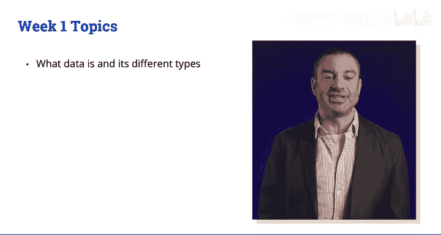
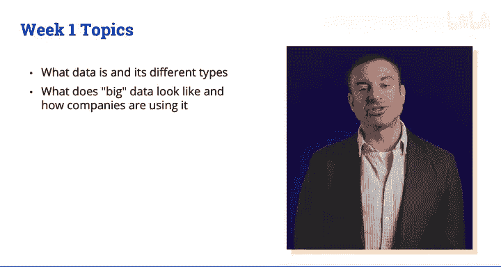
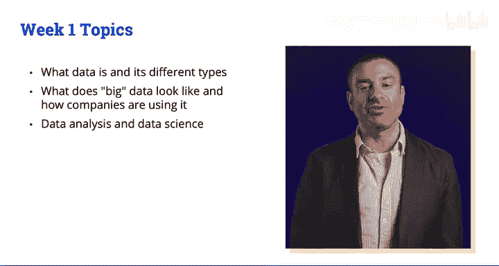
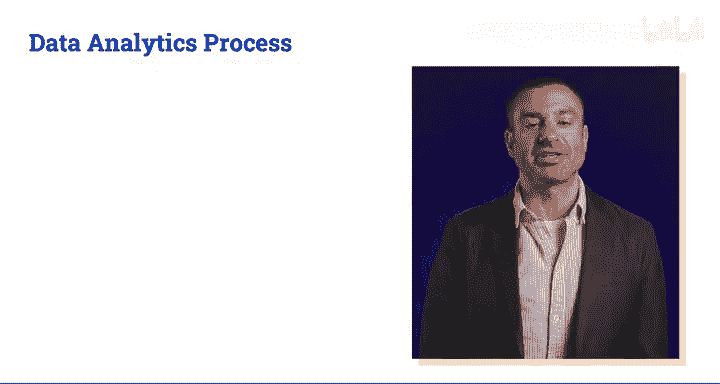
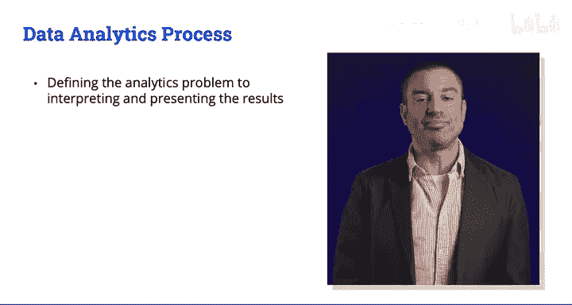
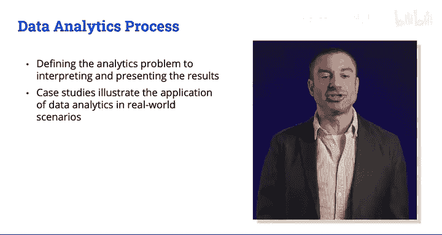

# 课程一：数据基础与问题定义 📊

在本节课中，我们将要学习数据科学的基础概念，包括数据的定义、类型、大数据的特点，以及数据分析与数据科学的关系。我们还将概述数据分析的全过程，并通过案例研究来理解其实际应用。

理解和运用数据的能力在当今世界变得日益重要，因为数据无处不在且极具价值。

## 什么是数据？🔍

数据是关于世界的原始事实和数字。它本身可能没有意义，但经过处理和分析后，可以转化为有价值的信息。

数据主要分为两种类型：
*   **定性数据**：描述性质或特征，通常是非数值的。例如，颜色、品牌名称、客户反馈文本。
*   **定量数据**：表示数量，是数值型的。例如，身高、温度、销售额。定量数据可进一步分为**离散型**（如员工人数）和**连续型**（如温度）。

## 认识大数据 🌐

上一节我们介绍了数据的基本类型，本节中我们来看看当数据规模变得巨大、复杂时的情况，即“大数据”。

大数据通常用**4个V**来描述：
*   **Volume（体量）**：数据的规模极其庞大。
*   **Velocity（速度）**：数据生成和流动的速度非常快。
*   **Variety（多样性）**：数据的形式多样，包括结构化数据（如数据库表格）、半结构化数据（如JSON、XML）和非结构化数据（如文本、图像、视频）。
*   **Veracity（真实性）**：数据的质量和可靠性。

公司利用大数据进行市场分析、预测趋势、优化运营和个性化推荐。



## 数据分析与数据科学 🤝



理解了数据本身后，我们来看看处理数据的两个核心领域：数据分析与数据科学。它们共同构成了数据分析学这一领域。



*   **数据分析** 侧重于检查、清理、转换和建模数据，以发现有用信息、得出结论并支持决策。它更偏向于回答特定的业务问题。
*   **数据科学** 是一个更广泛的跨学科领域，它使用科学方法、流程、算法和系统从结构化和非结构化数据中提取知识和见解。它结合了统计学、计算机科学和领域专业知识。

两者的关系可以概括为：**数据科学为数据分析提供了更强大的方法论和工具基础，而数据分析是数据科学成果的具体应用和体现。**

## 数据分析的全过程 🔄

现在，我们知道了处理数据的领域，接下来让我们系统地了解数据分析是如何一步步进行的。以下是数据分析的典型流程：

1.  **问题定义**：明确需要解决的业务或研究问题。这是所有工作的起点。
2.  **数据收集**：从各种来源（数据库、调查、传感器等）获取相关数据。
3.  **数据清洗与整理**：处理缺失值、异常值，将数据转换为适合分析的格式。这个过程可以用代码来描述其核心操作：
    ```python
    # 示例：使用Pandas处理缺失值
    cleaned_data = raw_data.dropna()  # 删除缺失值
    # 或
    filled_data = raw_data.fillna(method='ffill')  # 向前填充缺失值
    ```
4.  **数据探索与分析**：通过统计和可视化方法初步了解数据，并运用模型进行深入分析。
5.  **结果解释与呈现**：将分析结果转化为易于理解的见解，并通过报告、图表等方式呈现给决策者。

## 案例分析 📈

为了将理论应用于实践，我们将看一些案例研究。这些案例旨在说明数据分析在真实世界场景中的应用。



例如，一个零售公司可能通过分析销售数据（**定量数据**）和客户评论（**定性数据**），来定义“如何提高季度销售额”的问题，随后收集线上线下数据，清洗整理后，分析出热销产品和客户偏好，最终制定出精准的营销策略。



---



本节课中我们一起学习了数据的基础概念、大数据的特征、数据分析与数据科学的联系与区别，并梳理了数据分析从问题定义到结果呈现的完整流程。理解这些基础是后续学习Python、SQL等具体工具和技术，并进行有效探索性数据分析（EDA）的基石。