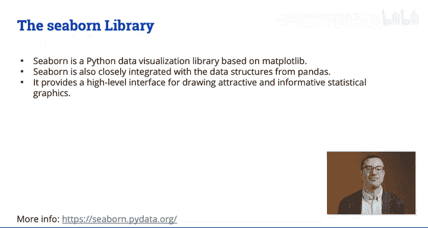

# 课程名称：Python数据分析与可视化入门 🐍📊
## 课程编号：P50

在本节课中，我们将要学习Python中两个核心的数据可视化库：Matplotlib和Seaborn。我们将了解它们的基本概念、特点以及如何协同工作，以创建清晰、美观的图表来展示数据。

---

Matplotlib是一个流行的Python绘图库。Matplotlib被包含在P lab包中。

它是一个非常强大的工具，可以绘制多种多样的图形，甚至制作动画。

上一节我们介绍了Matplotlib的基本概念，本节中我们来看看另一个基于它的库。

Seaborn是一个基于Matplotlib的Python数据可视化库。

Seaborn也与pandas的数据结构紧密集成。

它提供了一个高级接口，用于绘制美观且信息丰富的统计图形。

以下是Seaborn的核心特点列表：

*   基于Matplotlib构建。
*   与pandas数据结构深度集成。
*   提供高级统计图形绘制接口。

此外，Seaborn也可以用来增强Matplotlib绘制的图形。

以下是Seaborn的常见用途：

*   绘制统计关系图（如散点图、线图）。
*   可视化分类数据分布。
*   绘制数据分布图（如直方图、核密度估计图）。
*   美化Matplotlib的默认图表样式。

---

本节课中我们一起学习了Python数据可视化的两个重要工具。我们了解到，**Matplotlib**是一个功能强大且灵活的基础绘图库，而**Seaborn**则是在其基础上构建的、专注于统计图形且与pandas无缝集成的库，两者结合使用可以高效地创建出专业的可视化图表。