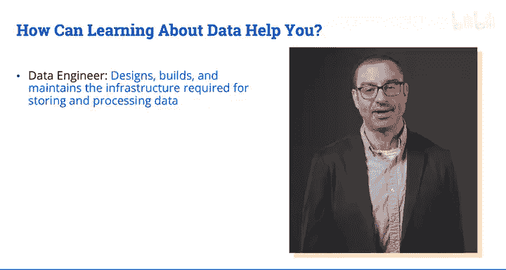
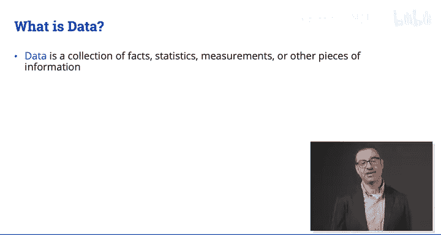
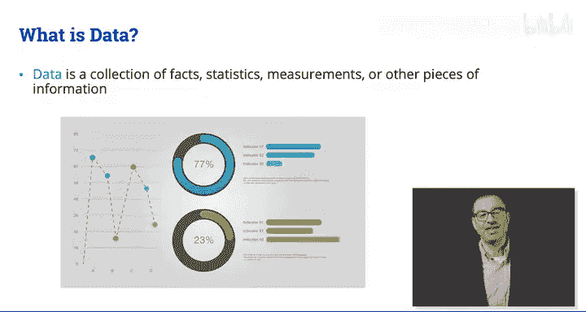
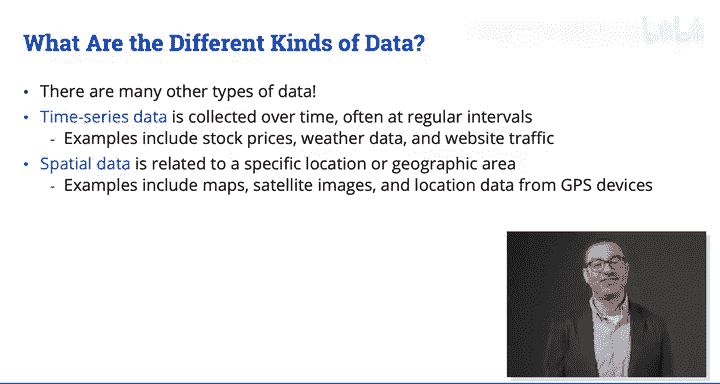
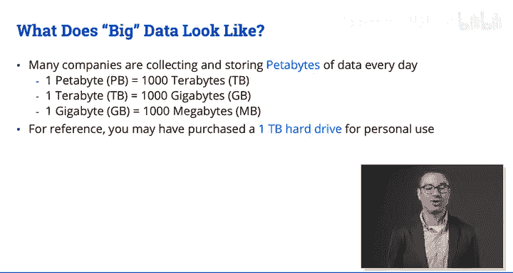
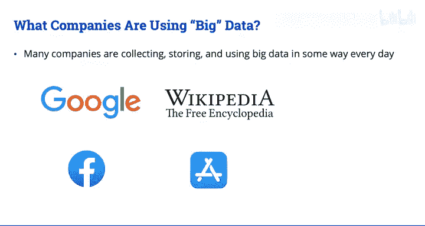
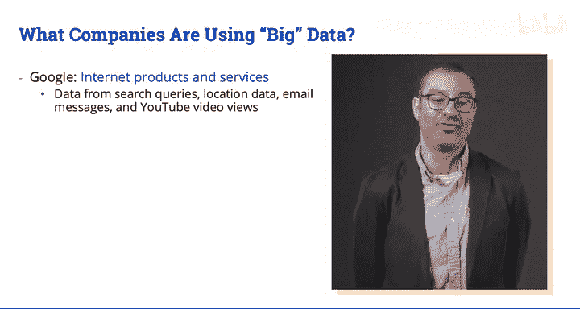
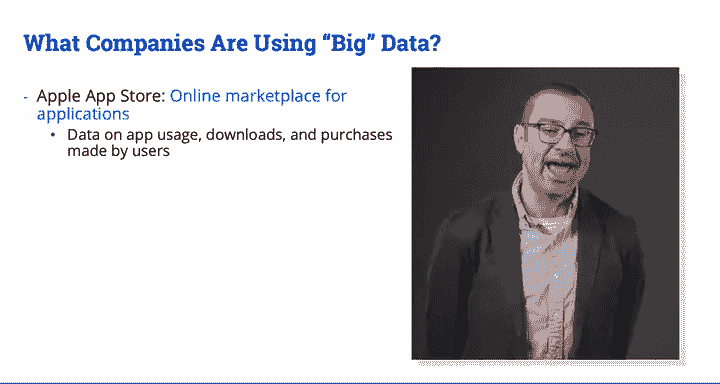
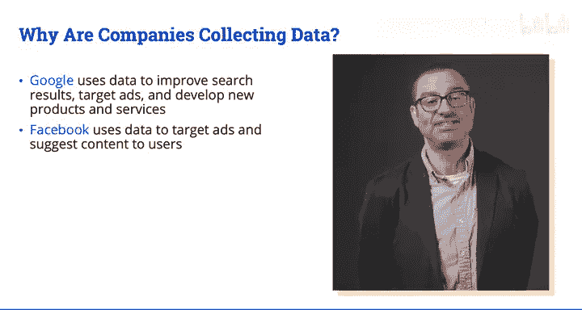
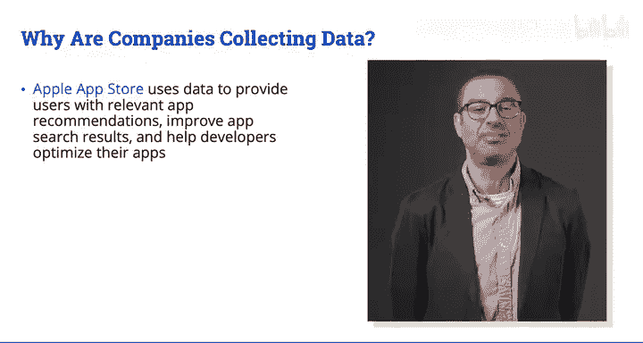

# 课程1：数据与数据分析导论 📊

在本节课中，我们将要学习数据的基本概念、不同类型以及大数据的特点。我们还将探讨数据分析与数据科学领域，并了解数据分析的完整流程及其在现实世界中的应用。

---

在当今世界，理解和运用数据的能力变得越来越重要，因为数据无处不在且极具价值。

学习数据知识对许多工作都有帮助。例如，数据工程师负责设计、构建和维护存储与处理数据所需的基础设施。或者数据分析师，他们分析和解释数据以提取洞察、趋势和模式。又或是数据科学家，他们开发并应用先进的机器学习和统计技术，从数据中提取洞察并构建预测模型。数据知识对产品经理、业务分析师、软件工程师、网络安全专家等众多其他角色也同样重要。

学习数据知识对任何受数据影响的领域都有帮助，其应用范围横跨医疗保健、金融、市场营销、教育、交通、政治学、科学和体育等众多行业。

以下是哈尔·瓦里安关于网络如何挑战管理者的一句话：“获取数据、理解数据、处理数据、从中提取价值、将其可视化并进行沟通的能力，在未来几十年将是一项极其重要的技能。”

那么，从技术上讲，什么是数据？数据是事实、统计数字、测量值或其他信息的集合。

数据可以来自传感器、调查、实验、交易、社交媒体和网络浏览等无数来源。数据可以呈现为数字、文本、图像、音频或视频等多种形式。数据可用于分析、研究和沟通等多种目的。数据还可用于获得对特定主题或现象的洞察，以解决业务问题并辅助决策。事实上，数据的最大价值在于其提供洞察和辅助明智决策的能力。

---

上一节我们介绍了数据的基本定义和价值，本节中我们来看看数据的多种类型。

数据有许多不同的类型。以下是主要的数据类型：

*   **结构化数据**：以特定格式组织，通常存在于数据库或电子表格中。这类数据通常易于搜索、排序和分析，因为其组织良好。
*   **非结构化数据**：没有预定义的格式或结构。例如包括电子邮件、社交媒体帖子和多媒体文件。这类数据通常更难分析，因为它需要更复杂的处理和分析。
*   **半结构化数据**：部分结构化的数据，例如存储在XML文件或JSON格式中的数据。通常，半结构化数据比结构化数据更具挑战性，但比非结构化数据更容易分析。

除了按结构分类，数据还可以按内容分为以下类型：

*   **时间序列数据**：随时间收集的数据，通常以固定间隔进行。例如包括股票价格、天气数据和网站流量。
*   **空间数据**：与特定位置或地理区域相关的数据。例如包括地图、卫星图像和GPS设备的位置数据。
*   **分类数据**：分为不同类别或组的数据。例如包括性别、年龄组和产品类型。
*   **数值数据**：由数值组成的数据。例如包括价格、数量和测量值。
*   **文本数据**：由书面或口头语言组成的数据。例如包括电子邮件、文章和客户评论。

由此可见，数据可以以各种不同的格式和规模存在。

---

了解了数据的多样性后，我们接下来探讨一种特殊的数据形态：大数据。

关于大数据的信息非常多。基本上，大数据是指极其庞大的数据集，其规模之大或复杂程度之高，使得传统的数据处理应用程序难以应对。

与较小规模的数据一样，大数据也可以通过计算分析来揭示模式、趋势并提取价值。

那么大数据是什么样的？许多公司每天都在收集和存储PB级的数据。作为参考，1 PB = 1000 TB，1 TB = 1000 GB，1 GB = 1000 MB。你可能为自己购买过1 TB的硬盘。

公司拥有和/或使用着占地数百英亩的大型数据中心，其中运行着大量服务器和复杂软件，以处理TB和PB级的数据。

许多公司每天都在以某种方式收集、存储和使用大数据。我们当然可以看看一些真正的大公司，如谷歌、Facebook、维基百科、苹果应用商店、Pandora和微软。

数据集增长迅速，每一项活动都会产生数据。以下是这些公司收集数据的例子：

*   **谷歌**：从搜索查询、位置数据、电子邮件和YouTube视频观看量中收集数据。
*   **Facebook**：从用户资料、帖子、点赞和分享中收集数据，为其用户创建详细档案。
*   **维基百科**：收集用户与其网站的互动数据，如页面浏览量、编辑和搜索。
*   **苹果应用商店**：收集有关应用使用情况、下载量以及用户购买行为的数据。
*   **Pandora**：收集用户音乐偏好、收听历史和对歌曲的反馈数据。
*   **微软**：从其用户设备收集数据，包括搜索查询、电子邮件和应用使用情况。

那么，公司为什么要收集所有这些数据？因为他们负担得起（存储成本低廉），并且能够将其货币化。数据经过处理和分析后可以产生价值。以下是这些公司利用数据的方式：

*   **谷歌**：利用数据改进搜索结果、投放广告以及开发新产品和服务。
*   **Facebook**：利用数据向用户定向投放广告和推荐内容。
*   **维基百科**：利用数据监控网站性能、识别改进领域并跟踪用户参与度。
*   **苹果应用商店**：利用数据为用户提供相关的应用推荐、改进应用搜索结果，并帮助开发者优化他们的应用。
*   **Pandora**：利用数据为每个用户个性化定制收听体验。
*   **微软**：利用数据改进搜索结果、开发新产品以及个性化广告。

---

本节课中我们一起学习了数据的核心定义、主要类型（结构化、非结构化、半结构化、时间序列、空间数据等），并深入探讨了大数据的概念及其在大型科技公司中的实际应用与价值创造方式。理解这些基础知识是步入数据分析领域的第一步。