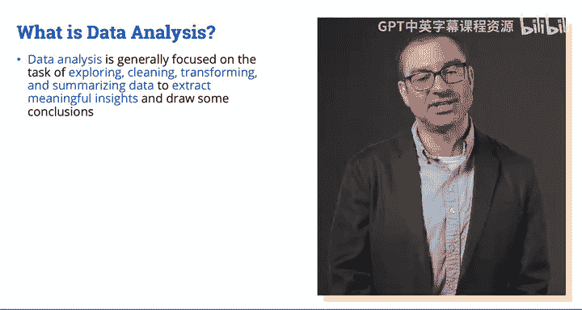
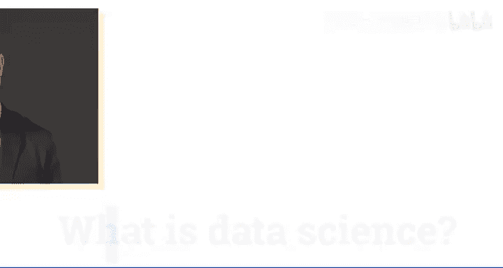
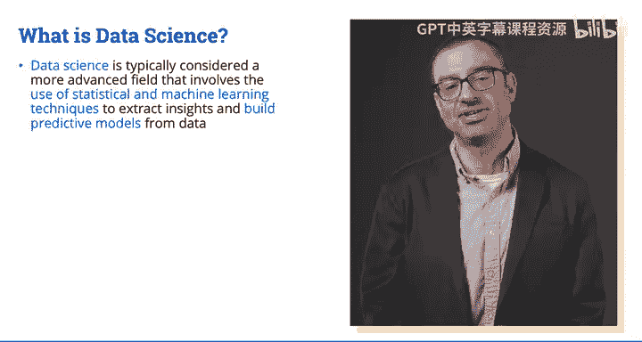

# 课程名称：数据科学与数据分析导论 | 课程编号：P6 📊

在本节课中，我们将要学习数据科学与数据分析的基本概念，了解它们的定义、核心任务以及典型应用场景。通过对比分析，我们将清晰地理解这两个紧密相关但又有所区别的领域。

---



## 🔍 什么是数据分析？

数据分析通常聚焦于探索、清洗、转换和总结数据，以提取有意义的见解并得出某些结论。

数据分析通常带有特定的目的，例如识别趋势或模式，或提出建议。例如，一家公司可以使用数据分析来评估按地区、产品类别或销售渠道划分的销售业绩，从而识别高绩效的细分市场和改进机会。

以下是数据分析的核心任务：
*   **探索**：初步了解数据的结构和特征。
*   **清洗**：处理缺失值、异常值和不一致的数据。
*   **转换**：将数据转换为更适合分析的格式（例如，数据归一化）。
*   **总结**：通过统计量（如均值、中位数）或可视化来概括数据。



---

## 🧠 那么，什么是数据科学？

上一节我们介绍了数据分析，本节中我们来看看数据科学。数据科学通常被认为是一个更高级的领域，它涉及使用统计和机器学习技术从数据中提取见解并构建预测模型。



数据科学通常用于解决复杂问题，例如预测客户行为、检测欺诈，或在医疗保健环境中识别高风险患者。延续前面的例子，一家公司可能会使用机器学习等数据科学技术来预测未来对产品或服务的需求。

以下是数据科学中常用的技术：
*   **统计技术**：例如假设检验、回归分析。
*   **机器学习技术**：例如使用 `scikit-learn` 库构建分类或回归模型。

```python
# 示例：使用Python的scikit-learn进行简单的线性回归预测
from sklearn.linear_model import LinearRegression
model = LinearRegression()
model.fit(X_train, y_train) # 训练模型
predictions = model.predict(X_test) # 进行预测
```

---

## ⚖️ 总结与对比

总而言之，数据分析通常侧重于探索和解释数据以获取见解，而数据科学则更侧重于创建能够基于数据预测或解释现象的模型。

本节课中我们一起学习了数据分析和数据科学的核心定义、任务差异以及典型应用。数据分析是理解过去和现在的基础，而数据科学则在此基础上，利用更高级的技术来预测未来和解决更复杂的问题。理解这两者的关系是进入数据领域的重要第一步。