# 课程9：如何定义数据分析问题 📊

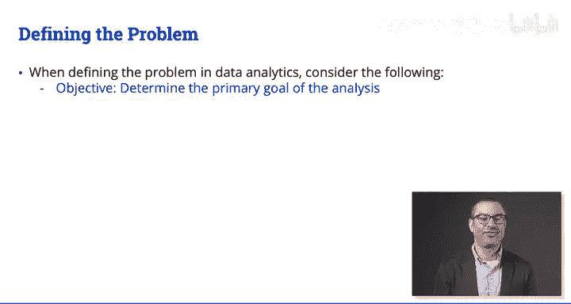

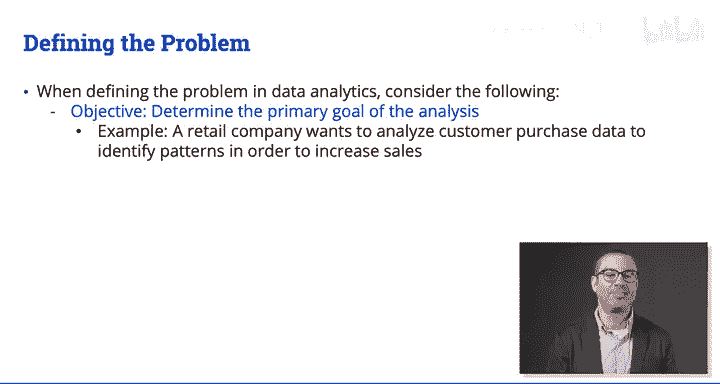

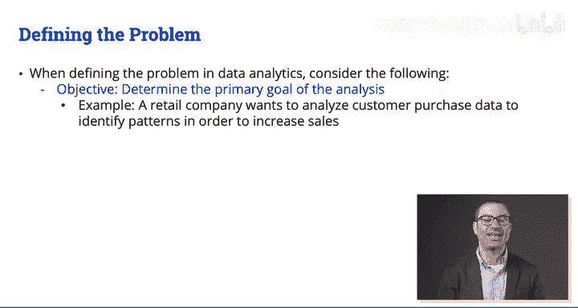

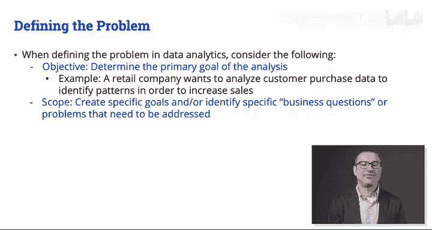

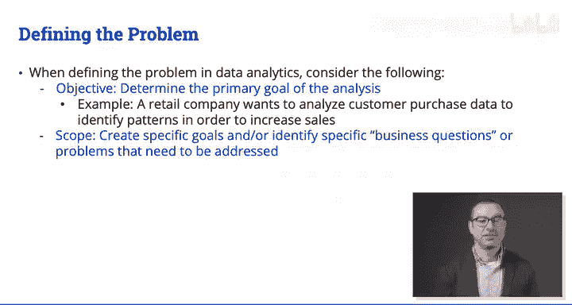

在本节课中，我们将学习数据分析流程的第一步：如何清晰地定义分析问题。这是整个分析工作的基石，决定了后续所有步骤的方向和范围。

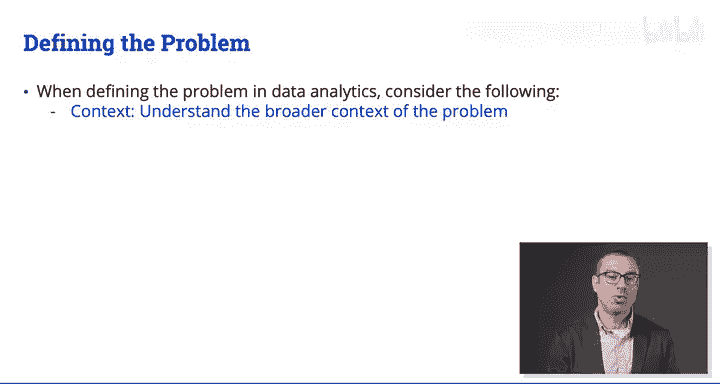

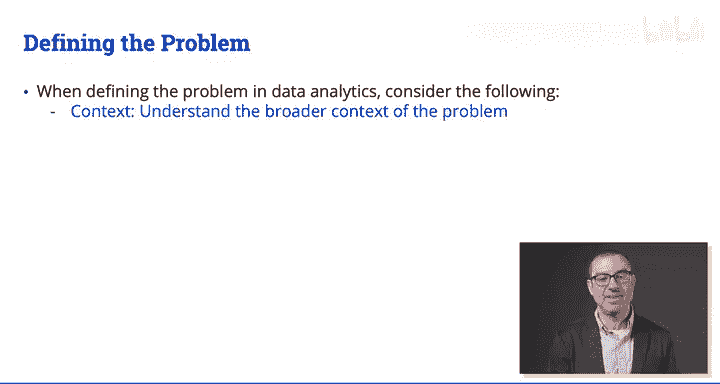

数据分析流程始于定义问题。也就是说，需要识别出数据分析旨在解决的业务问题或疑问。

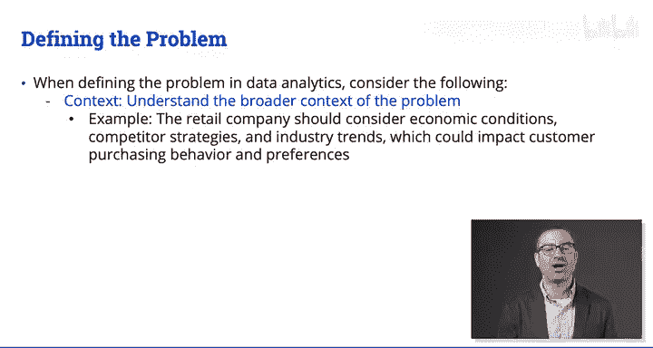

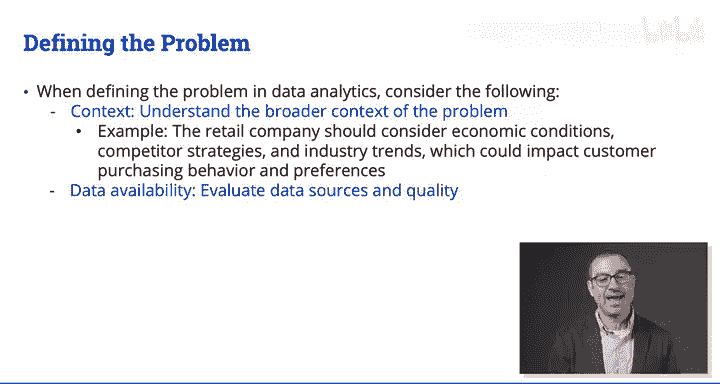

在定义数据分析问题时，需要考虑以下几个关键方面。

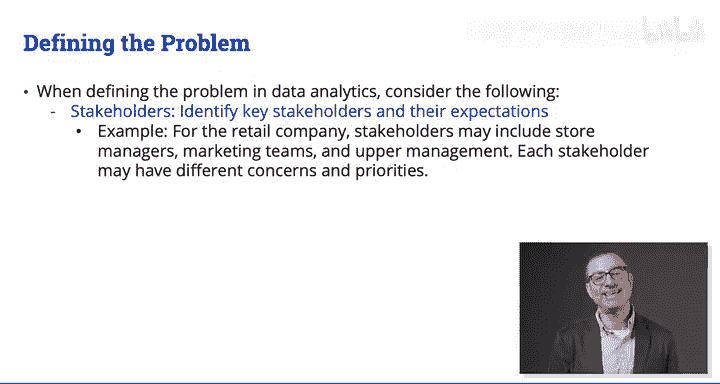

以下是定义问题时需要考虑的核心要素列表：

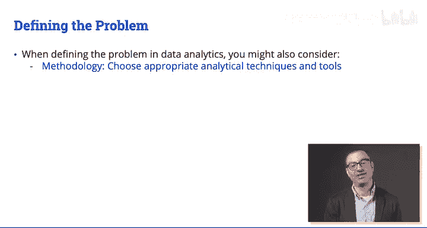

*   **目标**：确定分析的主要目标。
    *   **示例**：一家零售公司希望分析客户购买数据以识别模式，从而提升销售额。
*   **范围**：设定具体目标，并/或识别需要解决的具体业务问题。
    *   **示例目标**：分析应聚焦于客户人口统计特征和季节性趋势。
    *   **示例业务问题1**：我们最有价值客户的人口统计特征是什么？我们如何调整营销和促销活动来针对这些客户？
    *   **示例业务问题2**：销售数据中有哪些季节性趋势？我们如何调整库存水平以匹配需求？
*   **背景**：理解问题的更广泛背景。
    *   **示例**：零售公司应考虑可能影响客户购买行为和偏好的经济状况、竞争对手策略和行业趋势。
*   **数据可用性**：评估可用数据源及其质量。
    *   **示例**：公司可能拥有交易记录、客户档案和市场调研数据。他们需要确保数据可靠、完整，并尽可能无偏见。
*   **利益相关者**：识别关键利益相关者及其期望。
    *   **示例**：对于零售公司，利益相关者可能包括门店经理、营销团队和高层管理人员。每位利益相关者可能有不同的关注点和优先级。
*   **约束与限制**：考虑可能影响分析的约束和限制。
    *   **示例**：零售公司可能面临数据有限、数据收集预算有限，或需要遵守限制使用特定客户数据的隐私或安全法规。
*   **方法论**：确定适合的分析技术和工具。
    *   **示例**：零售公司可能希望使用聚类技术来细分客户，并使用时间序列分析来识别季节性趋势。公司也可能希望使用特定的工具或编程语言进行分析。
*   **交付成果**：明确期望的成果和交付物格式。

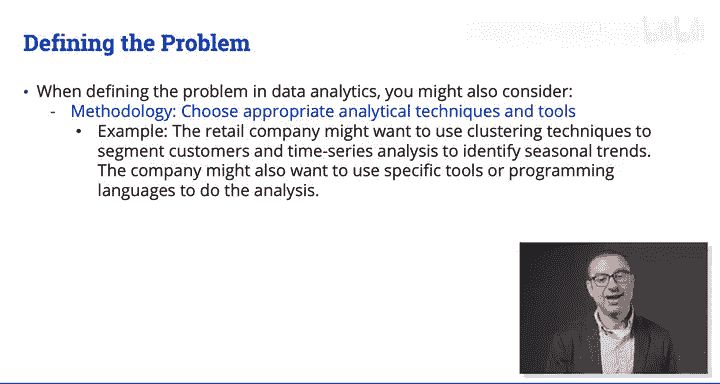

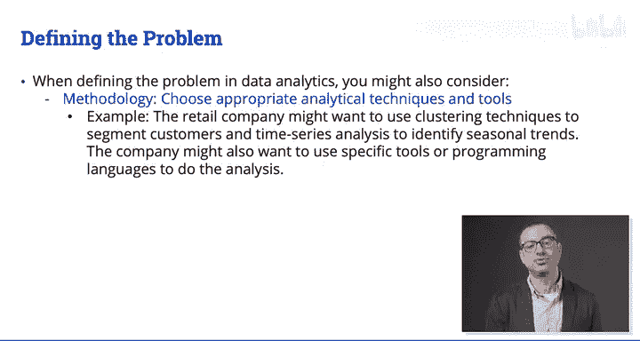

本节课中，我们一起学习了定义数据分析问题的完整框架。我们了解到，一个清晰的问题定义需要明确目标、范围、背景、数据、利益相关者、约束、方法以及最终交付成果。这是确保数据分析项目成功、高效且能产生实际业务价值的关键第一步。