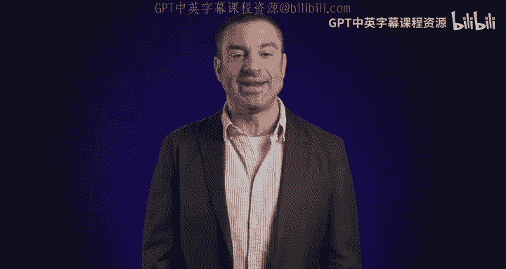
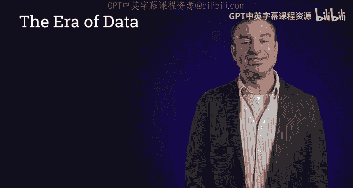

# 1：如何运用数据专项课程简介 📊

在本节课中，我们将要学习“如何运用数据”专项课程的整体框架与核心内容。该课程旨在帮助初学者掌握数据分析、数据科学和数据分析的基础知识与实用技能。

---

在数字时代，数据无处不在，塑造着我们日常的决策。它正在改变行业，推动创新，并创造新的机遇。

欢迎来到我们的Coursera专项课程“如何运用数据”。这是一个关键的门户，专为任何渴望利用数据潜力的人设计，无论其先前经验如何。

数据之旅从这里开始。在这里，你将解锁数据分析、数据科学和数据分析的基础知识。本专项课程是你穿越不断发展的数据领域的综合指南，提供随着技术进步仍将保持相关性的实用技能和见解。

我们生活在一个数据触及我们存在每个角落的时代，从企业的战略制定到最小的个人便利。数据是塑造我们世界看不见的力量。然而，尽管数据无处不在，驾驭这片广阔信息海洋的能力仍未普及。

本专项课程弥合了这一差距，为你提供工具，使数据不仅可理解，而且可操作。这是关于将信息转化为洞察，并将洞察转化为影响。

数据分析、预测分析和数据可视化不仅仅是当代的流行语，更是现代技能组合的支柱，这些技能在未来技术演进时仍将保持相关性。我们与数据交互的方式也会随之变化。然而，你将在此学到的核心原则是不变的，为你提供坚实的基础，无论数字环境如何变化。

---

上一节我们介绍了课程的整体目标和重要性，本节中我们来看看课程的具体结构。

我们的专项课程精心构建为三个结构严谨的课程，每个课程都建立在前一个课程的基础上，确保全面而连贯的学习体验。

以下是三个核心课程的概述：

**第一门课程** 为你数据分析之旅奠定基石，分为三个关键模块。
*   **模块1** 打开通往数据世界的大门，提供对数据分析、数据科学和数据分析的见解。它涵盖整个数据分析流程，介绍本课程至关重要的编程语言和工具，并通过案例研究让你将理论概念带入现实世界背景。
*   **模块2** 深入数据整理，重点介绍SQL。你将探索数据存储和访问，通过关系数据库的视角学习SQL基础知识，并掌握数据操作技术。这个模块对于希望理解SQL以及如何为分析准备数据的人来说至关重要。
*   **模块3** 将重点转向使用Python进行探索性数据分析，你将学习检查、查询和汇总数据，同时通过可视化信息来挖掘洞察。该模块旨在让你掌握数据分析库（如`pandas`）和可视化工具（如`Matplotlib`和`Seaborn`）的实践技能。

**第二门课程** 将你的技能进一步带入预测领域，分为三个丰富的模块。
*   **模块1** 向你介绍预测分析，涵盖线性回归和逻辑回归等基本模型。这是你开始学习如何从历史数据预测未来趋势的地方。
*   **模块2** 将你的知识扩展到决策树和随机森林，更深入地探讨更复杂的监督学习模型，以增强你的预测分析能力。
*   **模块3** 探索无监督学习和聚类，指导你了解模型比较的细微差别，以及在没有预定义标签的情况下识别模式的艺术。

**第三门课程** 是你的数据之旅的顶峰，通过三个重点模块将分析转化为行动。
*   **模块1** 让你沉浸在使用Tableau进行数据可视化的学习中，你将掌握创建有影响力的视觉数据故事背后的概念和原则，重点是一维和时间序列可视化。
*   **模块2** 介绍多维可视化和复杂关系，扩展你分析和可视化多表数据的能力，增强数据解读的深度和清晰度。
*   **模块3** 致力于洞察呈现和数据叙事，在这里你将学习如何将分析综合成连贯且有说服力的叙述，这是向利益相关者有效传达数据洞察的关键技能。

每门课程相互关联，在前一门的基础上构建，以形成对数据分析的全面理解。

---

为了获得专项课程证书，按顺序完成所有三门课程是必不可少的。这份证书向潜在雇主证明了你的投入和专业知识。

本专项课程需要投入，沿途有评分作业、定期测验和实践练习，让你能够批判性和创造性地将所学知识应用于现实世界场景。

它不仅仅是一个专项课程，更是对你未来的投资，为你配备随着技术进步仍将保持相关性的长青技能。

总而言之，“如何运用数据”是成为下一代数据专业人士的门户。通过理解数据分析，你不仅仅是在跟上数字时代的步伐，更是在帮助塑造它。

加入我们这个激动人心的旅程，释放数据的全部潜力，改变你的职业生涯。欢迎来到数据分析的世界。让我们一起开始这段变革之旅。

---

本节课中我们一起学习了“如何运用数据”专项课程的目标、重要性以及由三门核心课程组成的详细结构。我们了解到，该课程从数据分析基础、SQL和Python技能开始，逐步深入到预测分析和高级可视化，最终目标是培养将数据洞察转化为有效行动和沟通的能力。