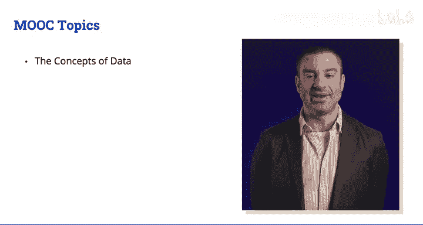
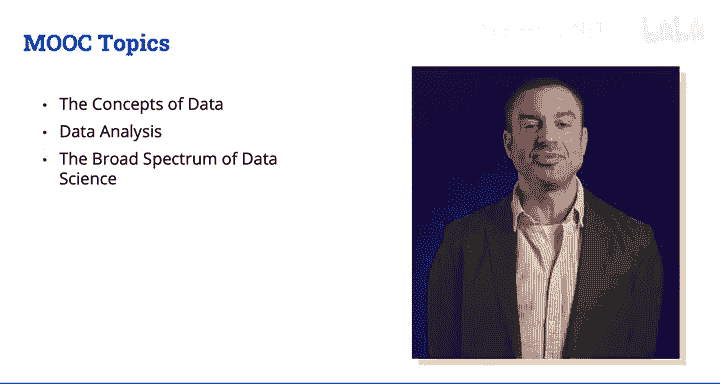
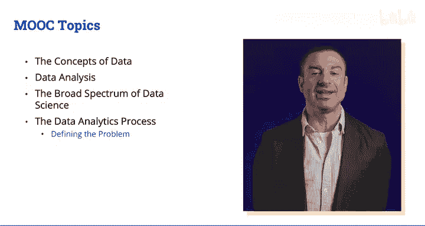
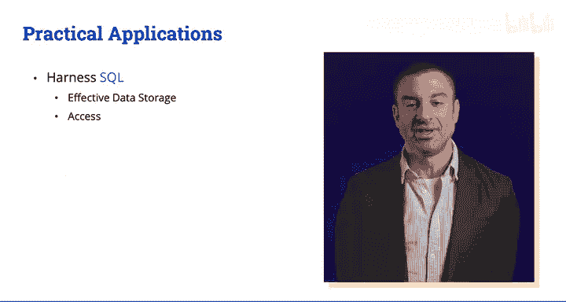
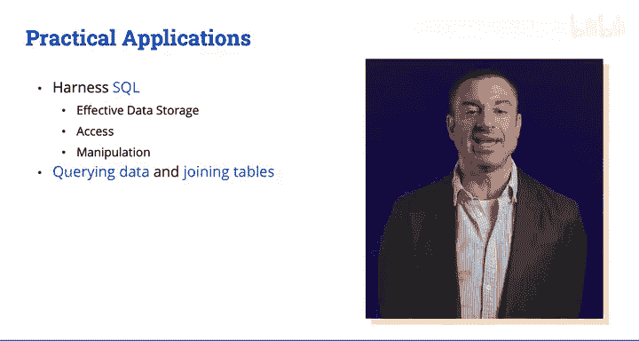
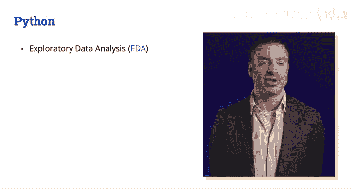
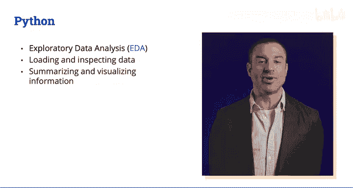

# 2：数据分析、SQL与Python探索性分析导论 🚀

在本课程中，我们将学习数据分析、SQL数据操作以及使用Python进行探索性数据分析的基础知识。课程旨在为初学者揭开数据分析的神秘面纱，并建立坚实的实践技能基础。

## 概述 📋

欢迎来到数据分析、SQL与Python探索性分析导论课程。这是本系列专项课程的门户课程，旨在阐明数据分析的核心要素。课程从坚实的基础开始，介绍数据、数据分析以及数据科学的广泛领域。同时，课程将引导你了解数据分析流程中的关键步骤，包括定义问题，以及理解对任何数据分析师都至关重要的工具和语言。

## 深入SQL数据操作 🗃️

上一节我们介绍了数据分析的基础概念，本节中我们来看看如何利用SQL进行实际的数据操作。

随着课程的深入，我们将探讨SQL的实际应用，教你如何利用SQL进行有效的数据存储、访问和操作。这包括查询数据、连接表以及使用函数来精炼数据等操作。

以下是SQL中一些核心操作的概念：
*   **查询数据**：使用 `SELECT` 语句从数据库中检索数据。
*   **连接表**：使用 `JOIN` 语句（如 `INNER JOIN`, `LEFT JOIN`）合并多个表中的相关数据。
*   **使用函数**：应用聚合函数（如 `SUM()`, `AVG()`, `COUNT()`）或字符串函数来处理和汇总数据。

## 过渡到Python探索性数据分析 🐍

掌握了SQL的数据操作后，我们将过渡到Python，探索其在探索性数据分析中的强大能力。

在Python部分，我们将探索其在探索性数据分析中的强大能力。课程将指导你加载和检查数据，以及汇总和可视化信息，以识别潜在的模式和洞察。

😡

以下是使用Python进行EDA的典型步骤：
*   **加载与检查数据**：使用 `pandas` 库的 `read_csv()` 或 `read_sql()` 函数加载数据，并使用 `df.head()` 或 `df.info()` 进行初步检查。
*   **数据汇总**：使用 `df.describe()` 获取数值型数据的统计摘要。
*   **数据可视化**：使用 `matplotlib` 或 `seaborn` 库创建图表，例如 `plt.scatter(x, y)` 绘制散点图，以发现趋势和异常值。

## 总结 🎯

在本课程中，我们一起学习了数据分析的基础知识、使用SQL进行数据操作以及利用Python进行探索性数据分析的核心技能。到课程结束时，你将熟练掌握数据分析的基础方面，能够将这些技能应用于现实世界的挑战，并为学习更复杂的预测分析和高级数据可视化主题做好准备。