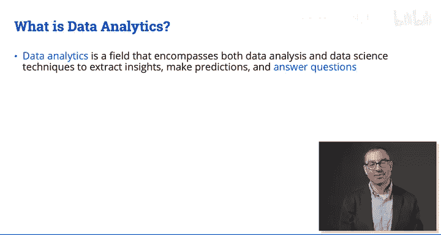
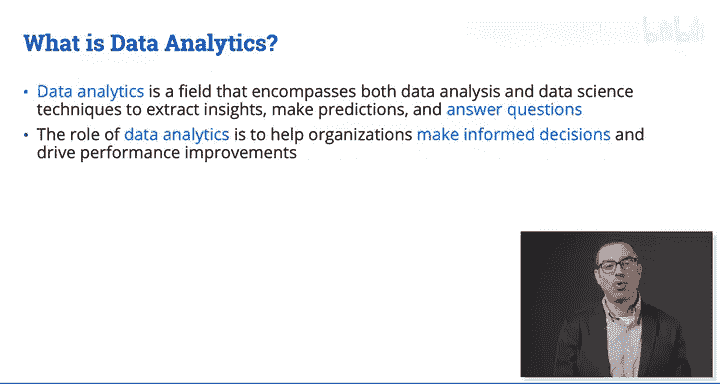
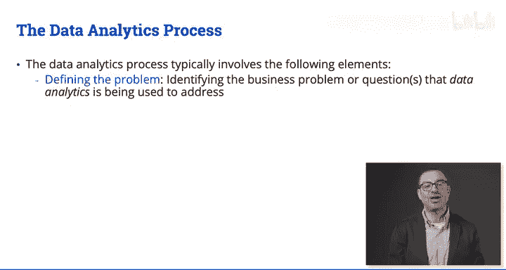
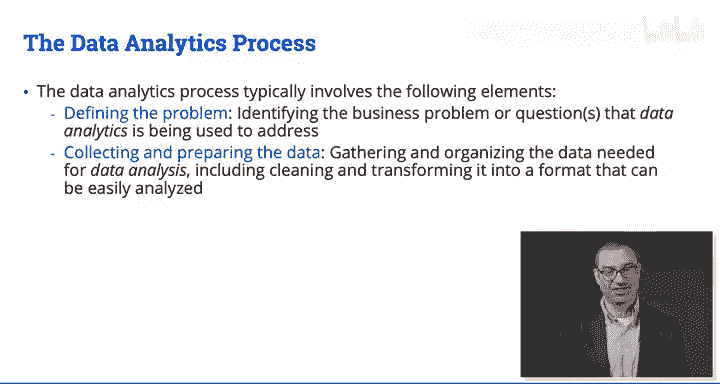
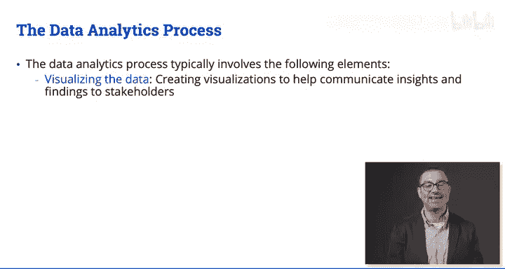
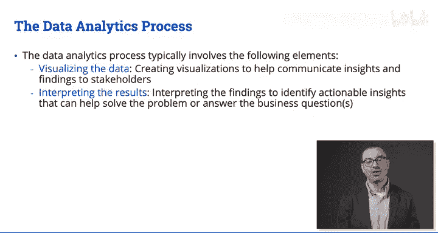
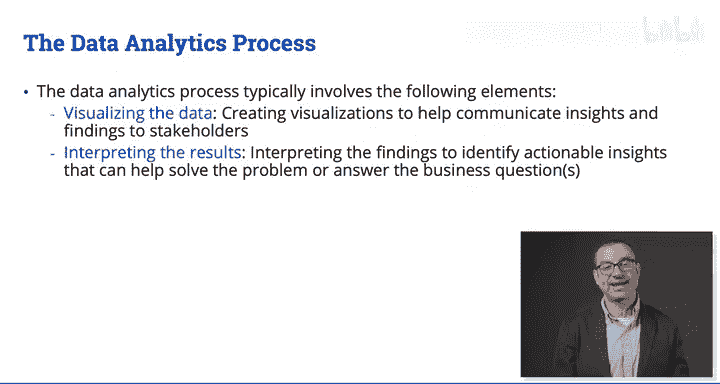

# 7：数据分析基础 📊

在本节课中，我们将学习数据分析的基本概念、流程及其核心要素。数据分析是一个结合了数据分析与数据科学技术的领域，旨在提取洞见、进行预测并回答问题。



数据分析的作用是帮助组织做出明智决策并推动绩效改进。

## 数据分析流程概述 🔄



上一节我们介绍了数据分析的定义与作用，本节中我们来看看典型的数据分析流程包含哪些关键步骤。数据分析流程通常涉及以下要素。

以下是数据分析流程的核心步骤列表：

1.  **定义问题**：识别需要通过数据分析来解决的业务问题或疑问。
2.  **收集与准备数据**：收集并整理数据分析所需的数据，包括清洗数据并将其转换为易于分析的格式。
3.  **探索数据**：进行初步的数据分析，以识别数据中的模式、异常值和趋势。
4.  **应用统计与机器学习技术**：运用数据科学技术分析数据，生成洞见并进行预测。
5.  **数据可视化**：创建可视化图表，以帮助向利益相关者传达洞见和发现。
6.  **解释结果**：解读分析结果，识别可操作的洞见，以帮助解决问题或回答业务问题。
7.  **传达结果**：以易于理解和可操作的方式向利益相关者呈现洞见和发现。
8.  **实施解决方案**：利用数据分析产生的洞见和发现来制定解决方案并采取行动。

## 流程步骤详解 📝



### 1. 定义问题

定义问题是数据分析的起点，其核心是明确分析的目标。公式可表示为：
**分析目标 = 待解决的业务问题**

### 2. 收集与准备数据




此步骤涉及数据的获取与预处理。在实际操作中，可能包括使用类似以下的Python代码进行数据清洗：
```python
import pandas as pd
# 读取数据并处理缺失值
data = pd.read_csv('data.csv')
data_cleaned = data.dropna()
```

### 3. 探索数据

探索性数据分析旨在初步了解数据特征，例如使用描述性统计：
```python
data_cleaned.describe()
```

### 4. 应用分析技术

此阶段运用统计模型或机器学习算法从数据中学习并预测。一个简单的线性回归模型公式为：
**y = β₀ + β₁x + ε**



### 5. 数据可视化

可视化是将复杂数据转化为直观图表的过程，例如使用Matplotlib库：
```python
import matplotlib.pyplot as plt
plt.plot(x, y)
plt.show()
```

### 6. 解释与传达结果



将分析结果转化为业务语言，并确保其能指导决策。



### 7. 实施解决方案

将数据分析的结论应用于实际业务场景，例如优化库存管理、资源分配和定价策略。

## 总结 🎯

本节课中我们一起学习了数据分析的基础。我们明确了数据分析是一个旨在提取洞见、支持决策的领域。我们详细剖析了数据分析的标准流程，该流程始于定义业务问题，历经数据收集、清洗、探索、建模、可视化，终于结果的解释、传达以及最终解决方案的实施。本课程后续将涵盖此流程中每个环节所涉及的基本概念、技能和工具。