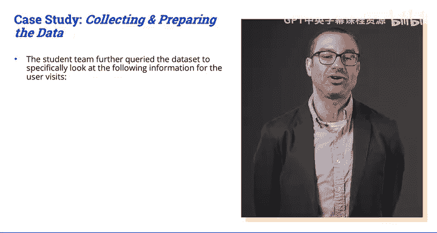
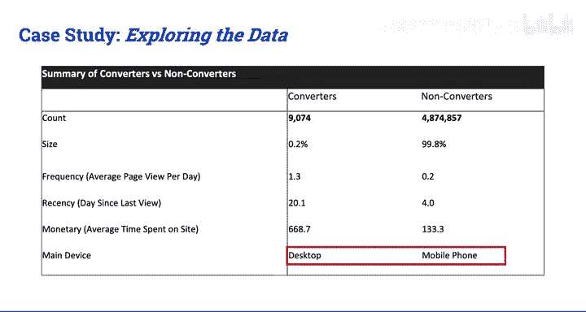
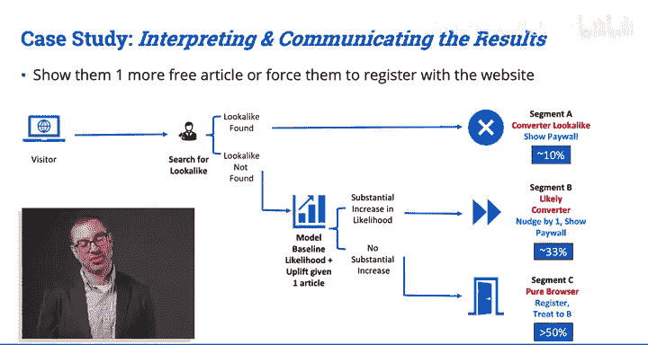

# 8：数据分析流程  📊

在本节课中，我们将通过一个真实世界的案例，学习学生数据分析团队如何运用数据分析流程，与赫斯特公司合作解决实际的商业问题。

---

## 🏢 案例背景

上一节我们介绍了数据分析流程的基本框架，本节中我们来看看它在真实商业场景中的应用。

赫斯特是一家美国跨国大众媒体和商业信息集团。它旗下拥有包括《旧金山纪事报》、《休斯顿纪事报》、《Cosmopolitan》和《Esquire》在内的报纸、杂志和电视频道。赫斯特与沃顿商学院AI与商业分析中心以及学生团队合作，旨在解决以下商业目标：通过增加数字订阅用户来提升新闻品牌的消费者收入。具体而言，赫斯特希望将访问其新闻网站的匿名用户或非订阅用户转化为付费客户或订阅用户。

---

## 📂 数据准备

为了达成目标，团队首先需要处理和理解数据。本节中我们来看看他们获取并处理了哪些数据。

赫斯特向学生团队提供了一个数据集，其中包含了访问赫斯特新闻网站的匿名用户或非订阅用户的历史信息。学生团队对数据集进行了筛选，专注于2023年1月至3月的《休斯顿纪事报》数据。他们进一步查询数据集，专门查看了用户访问的以下信息：

以下是数据集中包含的关键信息类别：

*   **页面浏览量**：对特定网站页面的访问，包括流量来源和地理位置。
*   **内容信息**：在网站页面上浏览的内容，包括类别、照片和URL。
*   **付费墙信息**：访客遇到付费墙的事件，包括会话和时间戳。
*   **订阅信息**：匿名用户转化为网站订阅者的信息，包括订阅时长和支付类型。

---

## 🔍 探索性数据分析

在准备好数据后，下一步是探索数据以发现模式。本节中我们来看看团队如何比较不同用户群体。

学生团队希望理解最终成为付费客户或订阅用户的匿名用户与那些没有转化、保持非订阅状态的用户之间的相似性和差异性。他们首先探索并总结了转化者与非转化者之间的差异。

以下是初步探索的主要发现：

*   数据主要由非转化者构成。
*   转化者与非转化者在**日均页面浏览量**上存在差异。
*   转化者与非转化者在**自上次浏览以来的天数**上存在差异。
*   转化者与非转化者在**网站平均停留时间**上存在差异。
*   转化者与非转化者使用的主要设备类型不同。

---

## 🧩 用户分群与建模

为了更深入地理解用户，团队采用了更高级的分析技术。上一节我们比较了基础差异，本节中我们使用模型进行更精细的分组和预测。

为了进一步理解订阅用户与非订阅用户之间的异同，团队使用**K均值聚类模型**生成了转化者和非转化者的用户群。该模型根据距离将具有相似用户特征的用户分组在一起，彼此距离更近的用户属于同一个群组。**K均值**是最广为人知且易于理解的聚类模型之一。

公式表示聚类目标：最小化组内平方和 `arg min Σ Σ ||x - μ_i||²`，其中 `x` 是样本点，`μ_i` 是第 `i` 个簇的中心点。

随后，他们通过定义“接近程度”，识别出那些与转化者特征相似的“相似非转化者”，这些用户可以被视为潜在转化者的“相似用户”。

---

## 🎯 策略建议

基于分析结果，团队需要提出 actionable 的建议。上一节我们识别了不同类型的用户，本节中我们来看看针对每类用户的行动方案。

团队希望据此为每种类型的用户提出相应的行动建议。

以下是针对不同用户群体的具体策略：

*   **对于与转化者相似的非转化者**：建议向他们展示付费墙，因为他们很可能转化为网站订阅者。
*   **对于与转化者不必然相似的非转化者**：团队使用 **XGBoost 预测模型**来预测其转化概率。
    *   对于转化可能性较高的用户，建议额外提供一篇免费文章以进一步培养兴趣。
    *   对于转化可能性较低的用户，建议强制要求他们在网站进行注册，以获取更多用户信息。

---

## 📝 总结

本节课中，我们一起学习了数据分析流程在一个真实商业案例——赫斯特公司数字订阅增长项目中的应用。我们从理解商业目标开始，经历了数据准备、探索性分析、运用K均值聚类进行用户分群、使用XGBoost模型预测转化概率，并最终根据分析结果，为不同类型的匿名用户制定了差异化的转化策略。这个案例完整展示了如何将数据转化为具体的商业行动方案。