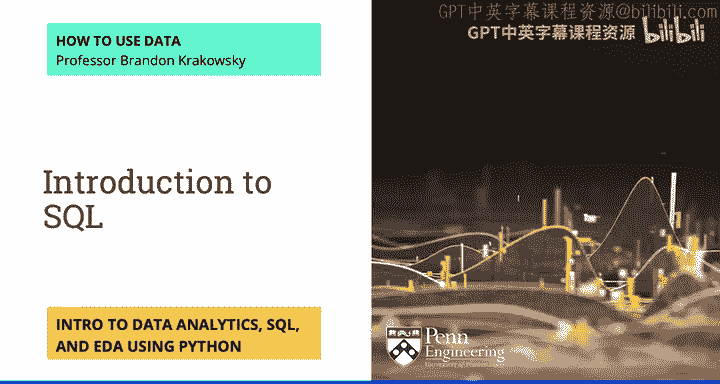
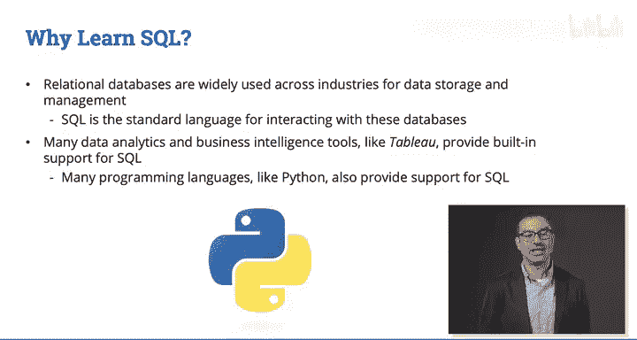
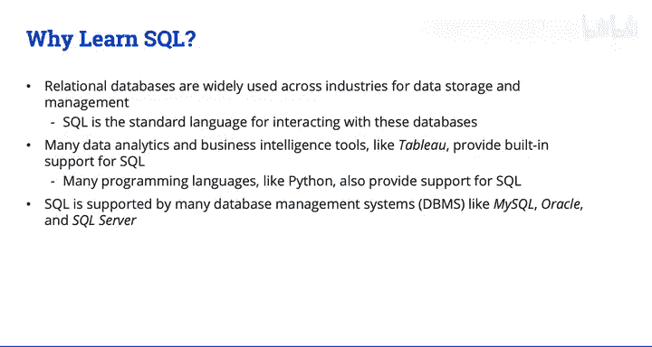
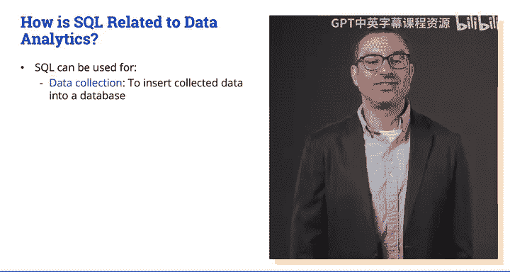

# 13：SQL入门 🗄️

在本节课中，我们将要学习SQL的基础知识。SQL是用于管理和查询关系型数据库的标准语言，是数据分析师和数据科学家必须掌握的核心技能之一。我们将了解SQL是什么、为何重要，以及它如何应用于数据分析的各个阶段。

---

## 什么是SQL？

SQL代表结构化查询语言。一些人将其发音为“S-Q-L”，另一些人则坚持“sequel”是唯一正确的发音。SQL是一种用于管理、访问和更新关系型数据库的语言。

---

## 为何要学习SQL？

上一节我们介绍了SQL的定义，本节中我们来看看学习SQL的几个关键原因。

以下是学习SQL的主要原因：

*   **行业广泛应用**：关系型数据库在各行各业被广泛用于数据存储和管理，而SQL是与这些数据库交互的标准语言。
*   **工具集成支持**：许多数据分析和商业智能工具（如Tableau）都内置了对SQL的支持。许多编程语言（如Python）也提供对SQL的支持。
*   **多种系统兼容**：SQL受到许多数据库管理系统（如MySQL、Oracle和SQL Server）的支持。
*   **市场需求旺盛**：SQL是就业市场上备受追捧的技能。许多组织都需要能够操作关系型数据库的专业人员。

---

## SQL与数据分析的关系

了解了SQL的重要性后，我们来看看SQL在数据分析工作流中的具体应用。

SQL与数据分析紧密相关，主要应用于以下几个环节：

*   **数据收集**：SQL可用于将收集到的数据插入数据库。对应的操作是`INSERT`语句。
*   **数据准备**：SQL可用于清理和转换数据，或者从多个表中筛选、聚合和连接数据。这涉及`SELECT`、`WHERE`、`JOIN`、`GROUP BY`等语句。
*   **数据探索**：SQL可通过编写查询来检索特定的数据子集，或使用聚合函数生成汇总统计信息，从而帮助进行数据探索。常用的聚合函数包括`COUNT()`, `SUM()`, `AVG()`, `MAX()`, `MIN()`。

此外，SQL允许高效地处理大型数据集。

---

## 总结

本节课中我们一起学习了SQL的基础知识。我们了解到SQL是用于操作关系型数据库的核心语言，因其在行业中的广泛应用、与各类工具的兼容性以及强大的市场需求而成为一项关键技能。更重要的是，我们看到了SQL贯穿于数据分析的整个流程，从数据收集、准备到探索阶段都发挥着不可或缺的作用。掌握SQL是开启数据分析之旅的重要一步。