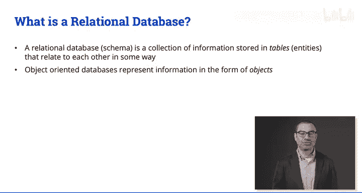
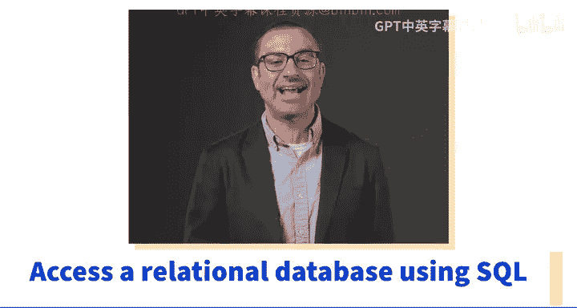
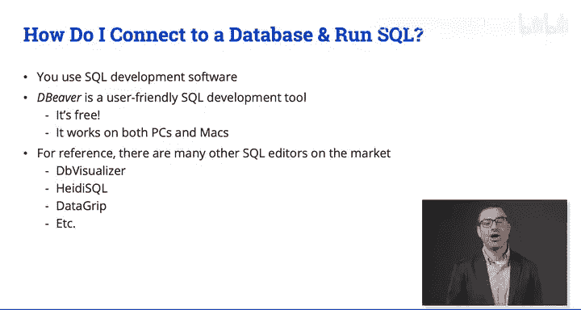
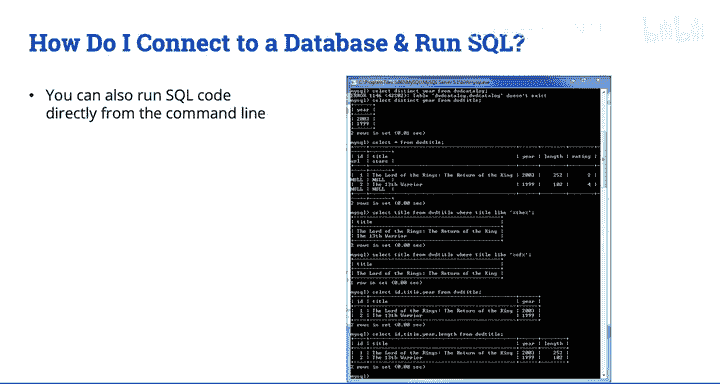

# 14：关系型数据库概述 🗄️

在本节课中，我们将学习关系型数据库的基本概念，了解其核心组成部分，并认识用于管理和查询数据库的工具。

## 什么是关系型数据库？

关系型数据库或模式，是一个存储在相互关联的表或实体中的信息集合。

作为参考，面向对象数据库以对象的形式表示信息。

本模块将重点介绍如何使用SQL访问关系型数据库。

## 数据库的核心结构

上一节我们定义了关系型数据库，本节中我们来看看它的具体构成。一个数据库由多个表组成，每个表存储特定类型的事物，例如“客户”。

一个表由行和列构成。列或属性是一组特定类型的数据值。

每一列定义了实体的一个属性，例如“地址”。行是表中的一条记录。

它包含实体的一个实例，例如一位具体的客户。

而值则是单行中单个列的属性。

## 与Excel的类比

为了更好地理解，我们可以将关系型数据库比作Excel。

一个数据库表可以比作一个Excel工作表。

一个数据库表的列或属性可以比作Excel工作表的列。

一个数据库表的行可以比作Excel工作表的行。

一个数据库表的值可以比作Excel工作表单元格中的值。

## 如何访问数据库？

我们介绍了数据库的结构，那么如何实际使用它呢？你并不直接“打开”一个数据库。

数据库运行在数据库管理系统内部。

你需要连接到数据库。MySQL和SQLite是常用的开源DBMS。它们是免费的。

它们可以运行在本地计算机或云端。Oracle和SQL Server是其他常用的商业数据库系统。

这些不是免费的。在本课程中，我们将连接到SQLite数据库。

## 使用SQL开发工具

要连接到数据库并运行SQL，你需要使用SQL开发软件。DBeaver是一个用户友好的SQL开发工具。它是免费的。

它可以在PC和Mac上运行。

作为参考，市场上还有许多其他的SQL编辑器。

你也可以直接从命令行运行SQL代码，但通常使用图形化工具更为便捷。

---

**本节课总结**

本节课中我们一起学习了关系型数据库的基础知识。我们了解了数据库由相互关联的表组成，表则由行和列构成。我们还认识了用于管理数据库的DBMS（如MySQL、SQLite）以及用于编写和运行SQL查询的开发工具（如DBeaver）。这些概念是后续进行SQL数据操作的基础。