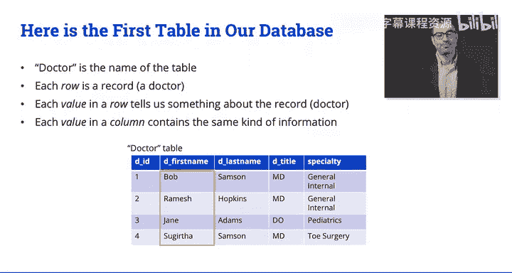
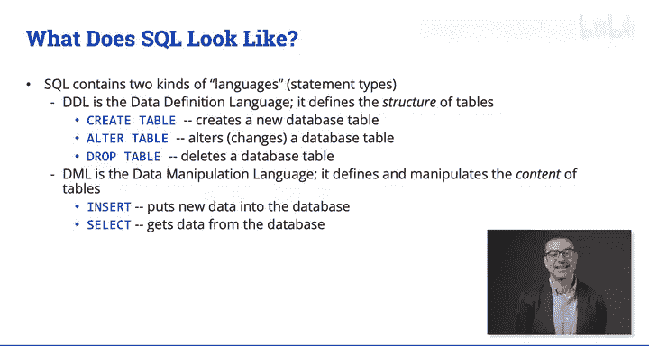

# 16：数据查询与筛选导论 🗂️

在本节课中，我们将学习数据库的基本结构、SQL语言的两种主要类型，以及如何开始使用数据操作语言（DML）进行简单的查询。我们将从理解数据表的结构开始，逐步介绍SQL的核心概念。

## 理解数据表结构

上一节我们介绍了课程概述，本节中我们来看看数据表的基本构成。

`Doctor` 是一个表的名称。表中的每一行代表一条记录，即一位医生。

每一行中的每个值都告诉我们关于这条记录（一位医生）的某些信息。

每一列中的值包含同一种类的信息，例如，所有医生的名字。

除了存储医生个人信息的 `doctor` 表，我们还有一个 `patient` 表，用于存储患者信息，以及一个 `appointment` 表，用于存储医生与患者之间的预约信息。

## SQL语言的两种类型

理解了表的结构后，接下来我们认识一下操作这些数据的工具——SQL语言。

SQL包含两种语言或语句类型。DDL是数据定义语言。

它用于定义表的结构。例如，`CREATE TABLE` 语句用于创建一个新的数据库表。

`ALTER TABLE` 语句用于修改或更改数据库表，而 `DROP TABLE` 语句用于删除一个数据库表。

另一方面，DML是数据操作语言。

它用于定义和操作表中的内容。`INSERT` 语句用于向数据库插入新数据。

`SELECT` 语句用于从数据库获取数据。

`UPDATE` 语句用于更新或更改数据库中的数据，而 `DELETE` 语句用于从数据库中删除数据。

## 开始使用DML语句

认识了SQL的两种语言后，本节我们将从简单的DML语句开始学习。

让我们从简单的DML语句开始。

---

本节课中我们一起学习了数据库表的基本结构，认识了SQL的两种核心语言——DDL（用于定义结构）和DML（用于操作数据），并了解了`SELECT`、`INSERT`、`UPDATE`、`DELETE`等基本DML语句的作用。这些是进行数据查询与筛选的基础。