# 17：SQL 基础 SELECT 语句编程演示 🖥️

在本节课中，我们将学习如何使用 SQL 中最基础且最重要的 `SELECT` 语句。我们将通过查询一个包含医生和患者信息的数据库，来演示如何选择特定列、为列和表设置别名，以及如何获取唯一值。

---

## 选择特定列数据

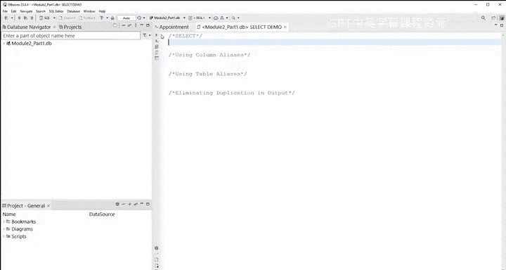

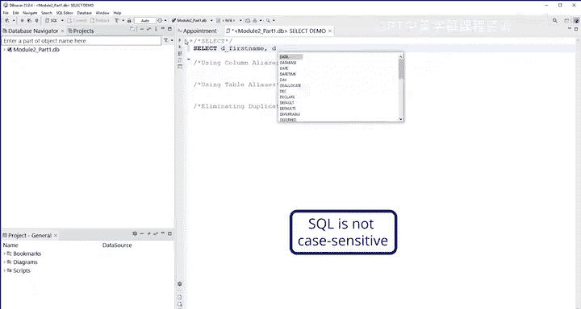

上一节我们介绍了 SQL 的基本结构，本节中我们来看看如何从数据库表中提取我们关心的数据。

要从 `doctor` 表中查询每位医生的名和姓，我们使用以下 `SELECT` 语句：

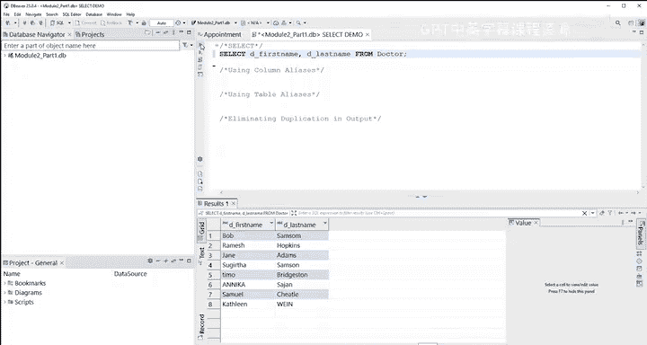

```sql
SELECT doctor_first_name, doctor_last_name FROM doctor;
```

执行此查询后，我们将获得 `doctor` 表中所有医生的名和姓。

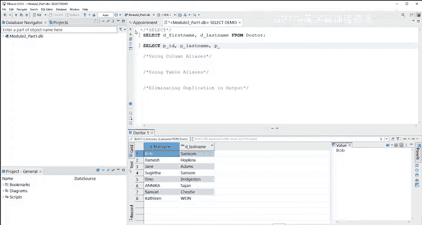


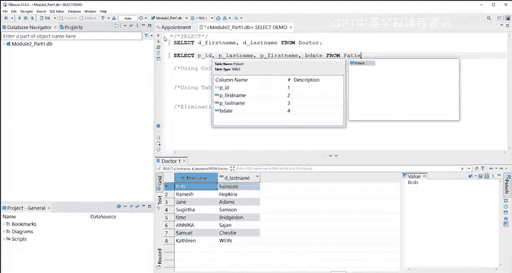

接下来，让我们从 `patient` 表中查询每位患者的 ID、姓、名和出生日期。

```sql
SELECT patient_id, patient_last_name, patient_first_name, patient_birth_date FROM patient;
```

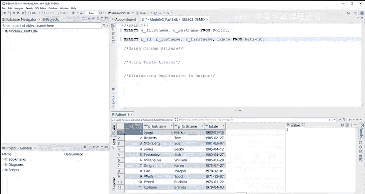

此查询将返回 `patient` 表中所有患者的 ID、姓、名和出生日期信息。

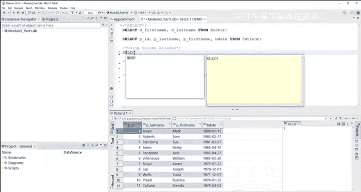


---

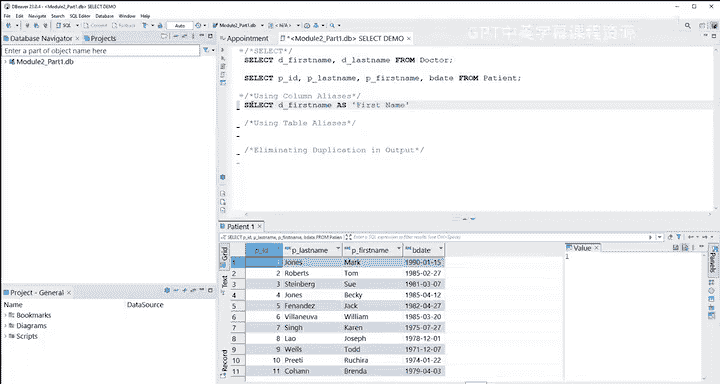

## 为列设置别名（Alias）

在查询结果中，我们有时希望列标题显示为更易读的名称，而不是数据库中的原始列名。这可以通过为列设置别名来实现。

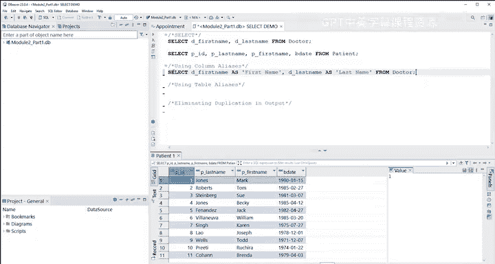

以下是使用 `AS` 关键字为 `doctor` 表的列设置别名的示例：

```sql
SELECT doctor_first_name AS "First Name", doctor_last_name AS "Last Name" FROM doctor;
```

执行此查询后，我们依然能看到每位医生的名和姓，但结果中的列标题已分别更改为“First Name”和“Last Name”。


我们同样可以为 `patient` 表的列设置别名。需要注意的是，`AS` 关键字是可选的，可以直接在列名后指定别名。

```sql
SELECT patient_first_name "First Name", patient_last_name "Last Name" FROM patient;
```

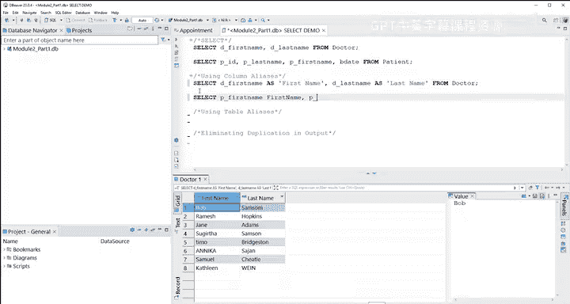

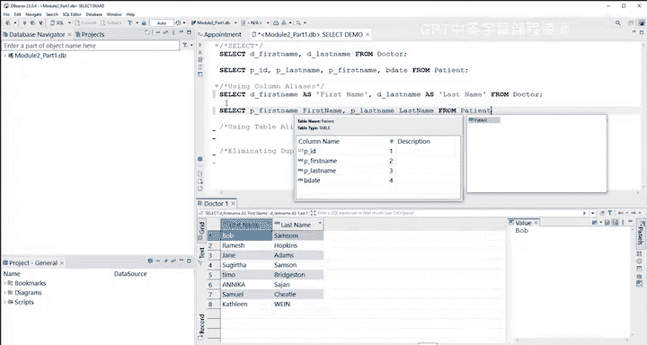

此查询返回每位患者的名和姓，并且列标题也已被重命名。


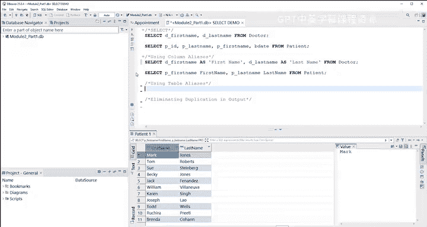

---


## 为表设置别名（Alias）

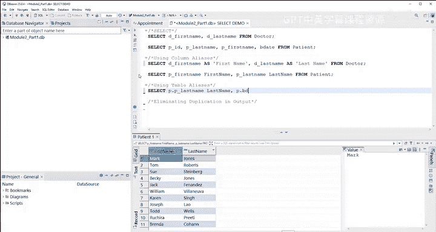

除了为列设置别名，我们也可以为表设置别名，这在编写涉及多个表的复杂查询时非常有用，可以简化语句。

以下是给 `patient` 表设置别名为 `P` 的示例：

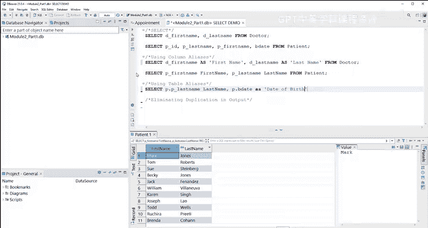

```sql
SELECT patient_first_name, patient_last_name FROM patient AS P;
```

使用 `AS` 关键字将 `patient` 表别名为 `P`。请注意，在指定要选择的列时，我们可以在查询的其他地方使用这个别名 `P`。


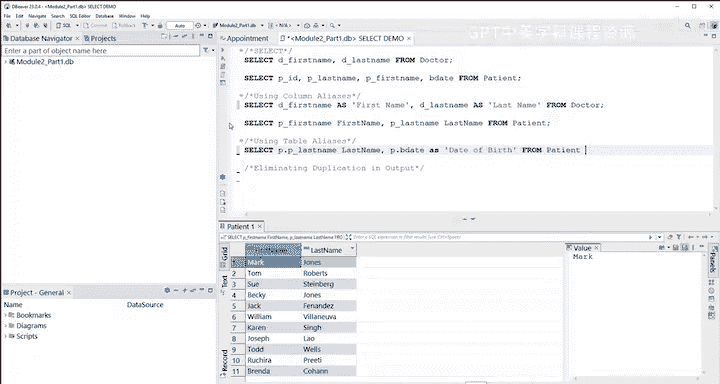
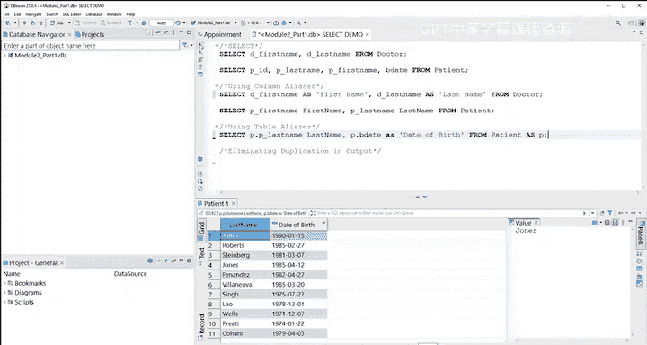


同样，我们也可以为 `doctor` 表设置别名为 `D`：


```sql
SELECT doctor_first_name, doctor_last_name FROM doctor D;
```

这里，`AS` 关键字同样是可选的，我们可以直接为 `doctor` 表指定别名 `D`。

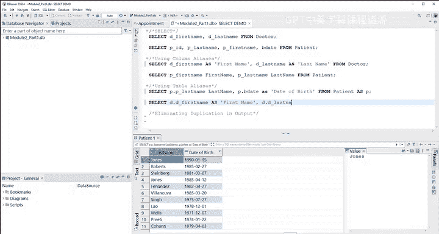
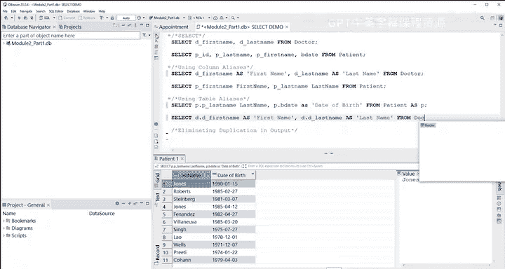
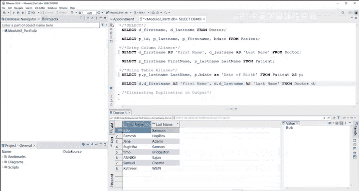


---

## 使用 DISTINCT 关键字获取唯一值


当我们想查看某一列中有哪些不同的取值，而不是所有重复的值时，可以使用 `DISTINCT` 关键字。它只返回该列中互不相同的值。


首先，让我们从 `doctor` 表中选择所有的医生专业。但如果我们想知道医生可能有哪些不同的专业呢？

以下是使用 `DISTINCT` 关键字来显示所有医生的唯一专业的示例：

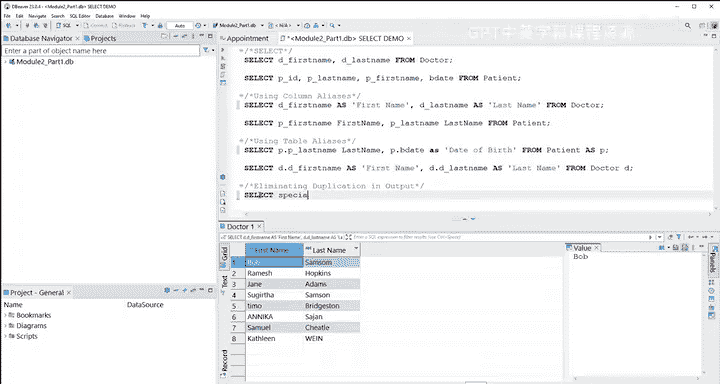

```sql
SELECT DISTINCT specialty FROM doctor;
```

此查询显示了 `specialty` 列中的唯一值。


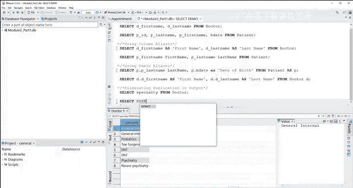
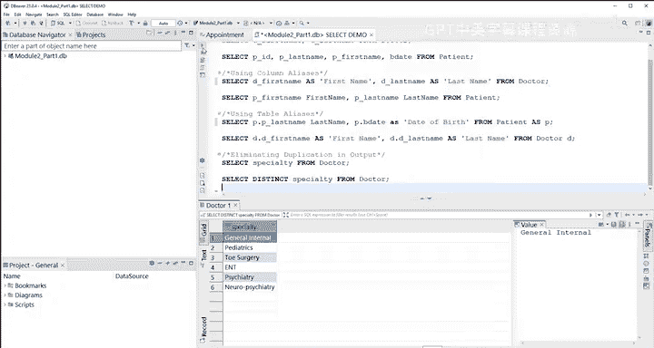

同样，我们可以获取所有患者的唯一姓氏列表：


```sql
SELECT DISTINCT patient_last_name FROM patient;
```


此查询显示了数据库中患者的唯一姓氏。

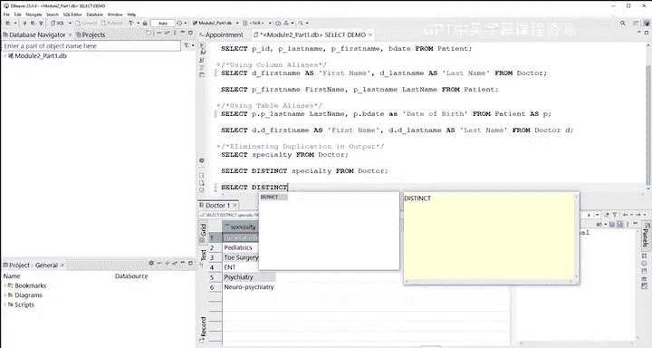
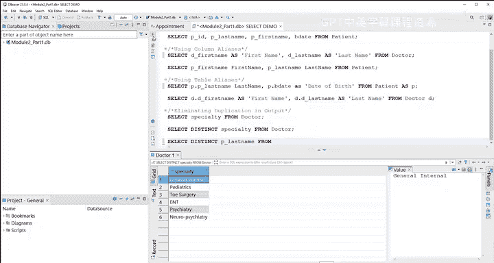

---


## 总结


本节课中我们一起学习了 SQL `SELECT` 语句的基础操作。我们掌握了如何从表中选择特定的列，如何通过 `AS` 关键字为列和表设置更清晰的别名，以及如何使用 `DISTINCT` 关键字来过滤掉重复数据，获取列中的唯一值。这些是构建更复杂 SQL 查询的基石。