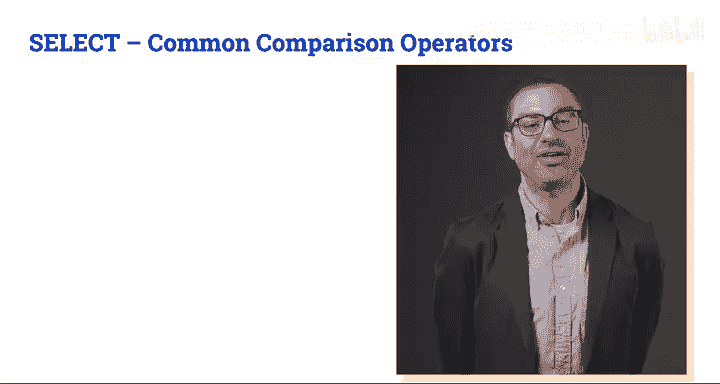
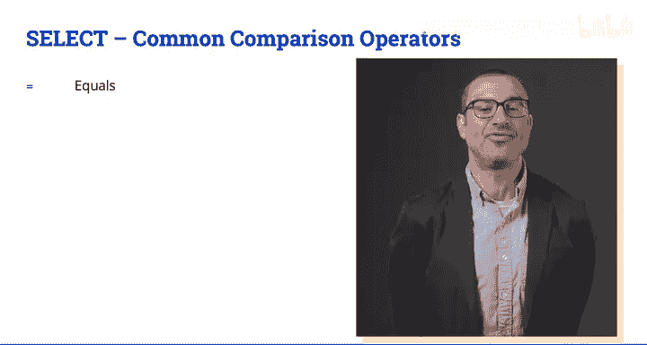
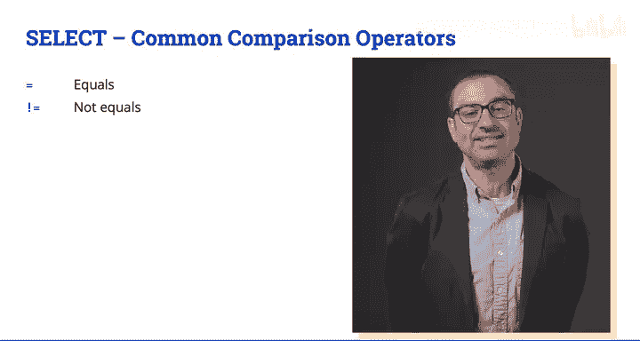
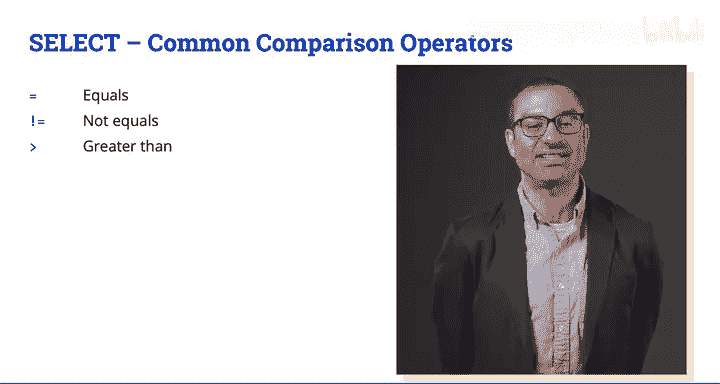
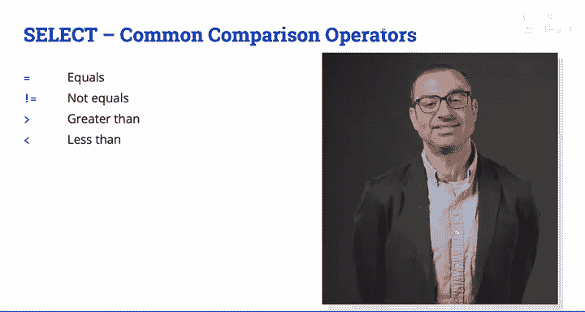
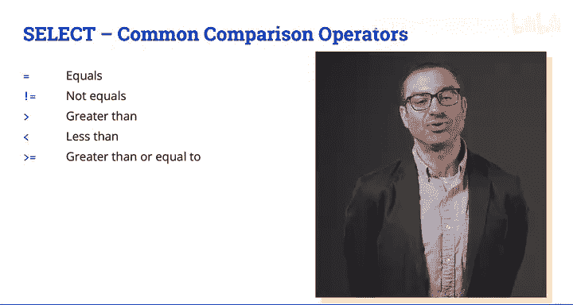
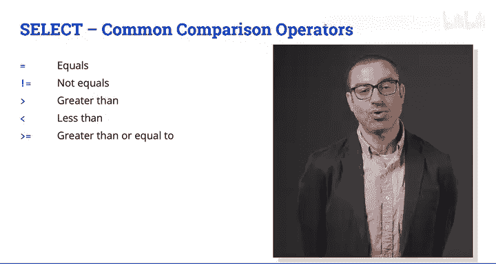

# 18：常用比较运算符 ⚖️

在本节课中，我们将学习编程中用于比较两个值关系的“比较运算符”。它们是构建条件判断逻辑的基础，在数据分析、筛选和决策流程中至关重要。

## 概述

比较运算符用于比较两个值，并判断它们之间的关系。这些运算符会返回一个布尔值（`True` 或 `False`），表示比较结果是否成立。

## 相等与不等运算符

上一节我们介绍了比较运算符的基本概念，本节中我们来看看最基础的两个运算符：相等与不等。

*   **相等运算符 (`==`)**：用于测试两个值是否相等。
    *   **公式/代码**：`值1 == 值2`
    *   示例：`5 == 5` 的结果是 `True`，`5 == 3` 的结果是 `False`。

*   **不等运算符 (`!=`)**：用于测试两个值是否不相等。
    *   **公式/代码**：`值1 != 值2`
    *   示例：`5 != 3` 的结果是 `True`，`5 != 5` 的结果是 `False`。

## 大于与小于运算符

理解了相等性比较后，我们进一步学习用于比较数值大小的运算符。

以下是用于判断一个值是否大于或小于另一个值的运算符。

*   **大于运算符 (`>`)**：测试左侧值是否大于右侧值。
    *   **公式/代码**：`值1 > 值2`
    *   示例：`10 > 6` 的结果是 `True`，`4 > 9` 的结果是 `False`。

*   **小于运算符 (`<`)**：测试左侧值是否小于右侧值。
    *   **公式/代码**：`值1 < 值2`
    *   示例：`3 < 7` 的结果是 `True`，`8 < 2` 的结果是 `False`。

## 大于等于与小于等于运算符

除了严格的大于和小于，我们还需要判断“大于或等于”、“小于或等于”的情况。

以下是包含边界条件的比较运算符。

*   **大于等于运算符 (`>=`)**：测试左侧值是否大于或等于右侧值。
    *   **公式/代码**：`值1 >= 值2`
    *   示例：`7 >= 7` 和 `9 >= 5` 的结果都是 `True`，`3 >= 6` 的结果是 `False`。

*   **小于等于运算符 (`<=`)**：测试左侧值是否小于或等于右侧值。
    *   **公式/代码**：`值1 <= 值2`
    *   示例：`4 <= 4` 和 `2 <= 5` 的结果都是 `True`，`8 <= 3` 的结果是 `False`。

## 总结

本节课中我们一起学习了六种常用的比较运算符：`==`（等于）、`!=`（不等于）、`>`（大于）、`<`（小于）、`>=`（大于等于）和 `<=`（小于等于）。它们构成了程序中进行条件判断的核心工具，所有运算符的运算结果都是布尔值 `True` 或 `False`。熟练掌握这些运算符是编写逻辑判断语句的第一步。